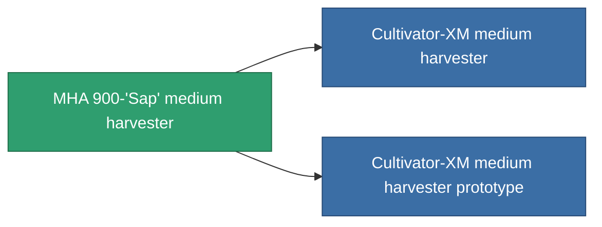

<!-- Generated by tools/generate from the live database (source: entitydefaults definition 810, aggregatevalues via aggregatefields).
     Do not edit by hand; regenerate instead. -->

# MHA 900-'Sap' medium harvester

|  |  |
|---|---|
| Définition | `def_named1_medium_harvester` |
| Niveau | T2 |
| Points de vie | 100 |
| Volume | 1.5 |
| Masse | 900 |
| Catégorie | Modules / Harvesting |
| Tier line | [Standard medium harvester](/fr/content/items/standard-medium-harvester/) (T1) → **MHA 900-'Sap' medium harvester** (T2) → [Cultivator-XM medium harvester](/fr/content/items/named2-medium-harvester/) (T3) → [Protrim V-II medium harvester](/fr/content/items/named3-medium-harvester/) (T4) |

## Statistiques

| Champ | Valeur |
|---|---|
| core_usage | 45 |
| cpu_usage | 48 |
| cycle_time | 12k |
| optimal_range | 3 |
| powergrid_usage | 135 |

<!-- production:generated -->
## Production

**Produit à partir de 4 composants, niveau de recherche 4** — assemblez les composants pour le fabriquer (liste complète dans [Recettes](/fr/content/recipes/)):

**Plan :** [MHA 900-'Sap' medium harvester CT](/fr/content/items/named1-medium-harvester-cprg/)

<svg class="prod-card-icon" aria-hidden="true"><use href="#mi-grid"/></svg><a class="prod-card-name" href="/fr/content/items/axicol/">Cryoperine</a>

requis : <b>100</b>

<svg class="prod-card-icon" aria-hidden="true"><use href="#mi-crystal"/></svg><a class="prod-card-name" href="/fr/content/items/robotshard-common-basic/">Damaged common fragment</a>

requis : <b>60</b>

<svg class="prod-card-icon" aria-hidden="true"><use href="#mi-grid"/></svg><a class="prod-card-name" href="/fr/content/items/standard-medium-harvester/">Standard medium harvester</a>

requis : <b>1</b>

<svg class="prod-card-icon" aria-hidden="true"><use href="#mi-grid"/></svg><a class="prod-card-name" href="/fr/content/items/titanium/">Titanium</a>

requis : <b>300</b>

## Utilisé en production

**Composant de 2 articles** — tout ce qui l'utilise en production :

