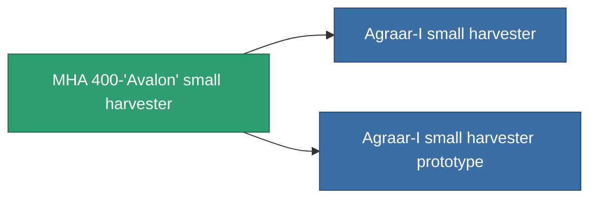

<!-- Generated by tools/generate from the live database (source: entitydefaults definition 807, aggregatevalues via aggregatefields).
     Do not edit by hand; regenerate instead. -->

# MHA 400-'Avalon' small harvester

|  |  |
|---|---|
| Définition | `def_named1_small_harvester` |
| Niveau | T2 |
| Points de vie | 100 |
| Volume | 1 |
| Masse | 360 |
| Catégorie | Modules / Harvesting |
| Tier line | [Standard small harvester](/fr/content/items/standard-small-harvester/) (T1) → **MHA 400-'Avalon' small harvester** (T2) → [Agraar-I small harvester](/fr/content/items/named2-small-harvester/) (T3) → [Protrim FDV-30 small harvester](/fr/content/items/named3-small-harvester/) (T4) |

## Statistiques

| Champ | Valeur |
|---|---|
| core_usage | 15 |
| cpu_usage | 38 |
| cycle_time | 15.5k |
| optimal_range | 3 |
| powergrid_usage | 28 |

<!-- production:generated -->
## Production

**Produit à partir de 4 composants, niveau de recherche 2** — assemblez les composants pour le fabriquer (liste complète dans [Recettes](/fr/content/recipes/)):

**Plan :** [MHA 400-'Avalon' small harvester CT](/content/items/named1-small-harvester-cprg/)

<svg class="prod-card-icon" aria-hidden="true"><use href="#mi-grid"/></svg><a class="prod-card-name" href="/fr/content/items/axicol/">Cryoperine</a>

requis : <b>50</b>

<svg class="prod-card-icon" aria-hidden="true"><use href="#mi-crystal"/></svg><a class="prod-card-name" href="/fr/content/items/robotshard-common-basic/">Damaged common fragment</a>

requis : <b>30</b>

<svg class="prod-card-icon" aria-hidden="true"><use href="#mi-grid"/></svg><a class="prod-card-name" href="/fr/content/items/standard-small-harvester/">Standard small harvester</a>

requis : <b>1</b>

<svg class="prod-card-icon" aria-hidden="true"><use href="#mi-grid"/></svg><a class="prod-card-name" href="/fr/content/items/titanium/">Titanium</a>

requis : <b>150</b>

## Utilisé en production

**Composant de 2 articles** — tout ce qui l'utilise en production :

