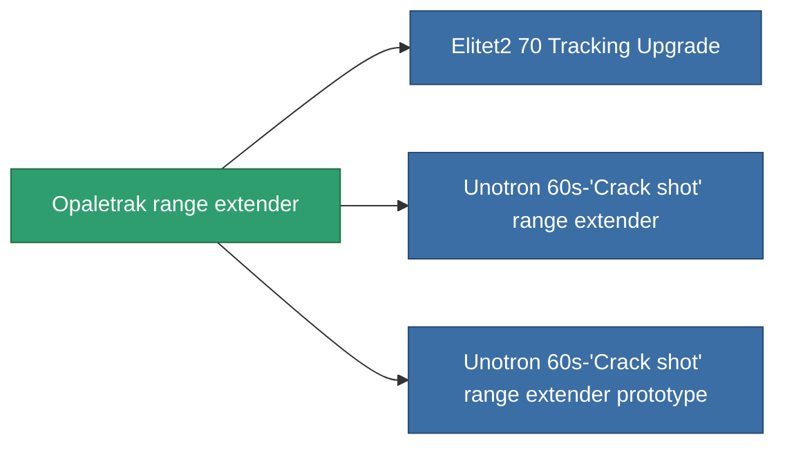

<!-- Generated by tools/generate from the live database (source: entitydefaults definition 936, aggregatevalues via aggregatefields).
     Do not edit by hand; regenerate instead. -->

# Opaletrak range extender

|  |  |
|---|---|
| Définition | `def_named1_tracking_upgrade` |
| Niveau | T2 |
| Points de vie | 100 |
| Volume | 0.1 |
| Masse | 45 |
| Catégorie | Modules / Enhancements |
| Tier line | [Standard range extender](/fr/content/items/standard-tracking-upgrade/) (T1) → **Opaletrak range extender** (T2) → [Unotron 60s-'Crack shot' range extender](/fr/content/items/named2-tracking-upgrade/) (T3) → [ATCS-gh50 range extender](/fr/content/items/named3-tracking-upgrade/) (T4) |

## Statistiques

| Champ | Valeur |
|---|---|
| cpu_usage | 33 |
| optimal_range_modifier | 1.1 |
| powergrid_usage | 90 |

<!-- production:generated -->
## Production

**Produit à partir de 5 composants, niveau de recherche 4** — assemblez les composants pour le fabriquer (liste complète dans [Recettes](/fr/content/recipes/)):

**Plan :** [Opaletrak range extender CT](/fr/content/items/named1-tracking-upgrade-cprg/)

<svg class="prod-card-icon" aria-hidden="true"><use href="#mi-grid"/></svg><a class="prod-card-name" href="/fr/content/items/axicol/">Cryoperine</a>

requis : <b>300</b>

<svg class="prod-card-icon" aria-hidden="true"><use href="#mi-grid"/></svg><a class="prod-card-name" href="/fr/content/items/axicoline/">Axicoline</a>

requis : <b>150</b>

<svg class="prod-card-icon" aria-hidden="true"><use href="#mi-crystal"/></svg><a class="prod-card-name" href="/fr/content/items/robotshard-common-basic/">Damaged common fragment</a>

requis : <b>30</b>

<svg class="prod-card-icon" aria-hidden="true"><use href="#mi-grid"/></svg><a class="prod-card-name" href="/fr/content/items/standard-tracking-upgrade/">Standard range extender</a>

requis : <b>1</b>

<svg class="prod-card-icon" aria-hidden="true"><use href="#mi-grid"/></svg><a class="prod-card-name" href="/fr/content/items/titanium/">Titanium</a>

requis : <b>100</b>

## Utilisé en production

**Composant de 3 articles** — tout ce qui l'utilise en production :

