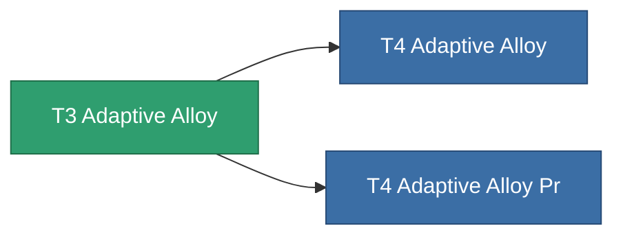

<!-- Generated by tools/generate from the live database (source: entitydefaults definition 8793, aggregatevalues via aggregatefields).
     Do not edit by hand; regenerate instead. -->

# T3 Adaptive Alloy

|  |  |
|---|---|
| Définition | `def_named2_adaptive_alloy` |
| Niveau | T3 |
| Points de vie | 100 |
| Volume | 1.5 |
| Masse | 500 |
| Catégorie | Modules / Enhancements |
| Tier line | [Standard Adaptive Alloy](/fr/content/items/standard-adaptive-alloy/) (T1) → [T2 Adaptive Alloy](/fr/content/items/named1-adaptive-alloy/) (T2) → **T3 Adaptive Alloy** (T3) → [T4 Adaptive Alloy](/fr/content/items/named3-adaptive-alloy/) (T4) |

## Statistiques

| Champ | Valeur |
|---|---|
| adaptive_resist_points | 80 |
| cpu_usage | 40 |
| powergrid_usage | 12 |

<!-- production:generated -->
## Production

**Produit à partir de 14 composants** — assemblez les composants pour le fabriquer (liste complète dans [Recettes](/fr/content/recipes/)):

**Plan :** [T3 Adaptive Alloy Cprg](/fr/content/items/named2-adaptive-alloy-cprg/)

<svg class="prod-card-icon" aria-hidden="true"><use href="#mi-grid"/></svg><a class="prod-card-name" href="/fr/content/items/alligior/">Alligior</a>

requis : <b>250</b>

<svg class="prod-card-icon" aria-hidden="true"><use href="#mi-grid"/></svg><a class="prod-card-name" href="/fr/content/items/axicol/">Cryoperine</a>

requis : <b>100</b>

<svg class="prod-card-icon" aria-hidden="true"><use href="#mi-grid"/></svg><a class="prod-card-name" href="/fr/content/items/chollonin/">Chollonin</a>

requis : <b>25</b>

<svg class="prod-card-icon" aria-hidden="true"><use href="#mi-grid"/></svg><a class="prod-card-name" href="/fr/content/items/espitium/">Espitium</a>

requis : <b>100</b>

<svg class="prod-card-icon" aria-hidden="true"><use href="#mi-grid"/></svg><a class="prod-card-name" href="/fr/content/items/isopropentol/">Isopropentol</a>

requis : <b>65</b>

<svg class="prod-card-icon" aria-hidden="true"><use href="#mi-grid"/></svg><a class="prod-card-name" href="/fr/content/items/metachropin/">Metachropin</a>

requis : <b>65</b>

<svg class="prod-card-icon" aria-hidden="true"><use href="#mi-crystal"/></svg><a class="prod-card-name" href="/fr/content/items/named1-adaptive-alloy/">T2 Adaptive Alloy</a>

requis : <b>1</b>

<svg class="prod-card-icon" aria-hidden="true"><use href="#mi-grid"/></svg><a class="prod-card-name" href="/fr/content/items/plasteosine/">Plasteosine</a>

requis : <b>250</b>

<svg class="prod-card-icon" aria-hidden="true"><use href="#mi-grid"/></svg><a class="prod-card-name" href="/fr/content/items/prilumium/">Prilumium</a>

requis : <b>25</b>

<svg class="prod-card-icon" aria-hidden="true"><use href="#mi-crystal"/></svg><a class="prod-card-name" href="/fr/content/items/robotshard-common-advanced/">Functional common fragment</a>

requis : <b>20</b>

<svg class="prod-card-icon" aria-hidden="true"><use href="#mi-crystal"/></svg><a class="prod-card-name" href="/fr/content/items/robotshard-common-basic/">Damaged common fragment</a>

requis : <b>20</b>

<svg class="prod-card-icon" aria-hidden="true"><use href="#mi-grid"/></svg><a class="prod-card-name" href="/fr/content/items/statichnol/">Statichnol</a>

requis : <b>65</b>

<svg class="prod-card-icon" aria-hidden="true"><use href="#mi-grid"/></svg><a class="prod-card-name" href="/fr/content/items/titanium/">Titanium</a>

requis : <b>200</b>

<svg class="prod-card-icon" aria-hidden="true"><use href="#mi-grid"/></svg><a class="prod-card-name" href="/fr/content/items/vitricyl/">Vitricyl</a>

requis : <b>25</b>

## Utilisé en production

**Composant de 2 articles** — tout ce qui l'utilise en production :

