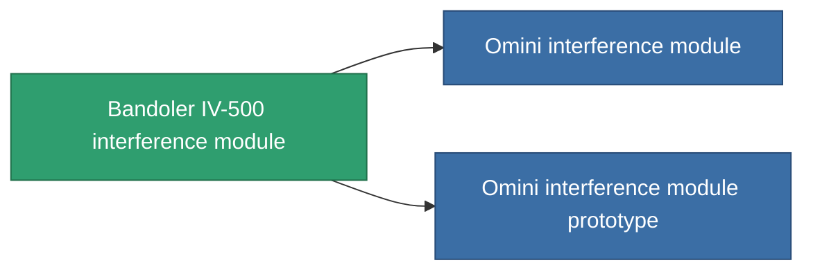

<!-- Generated by tools/generate from the live database (source: entitydefaults definition 2848, aggregatevalues via aggregatefields).
     Do not edit by hand; regenerate instead. -->

# Bandoler IV-500 interference module

|  |  |
|---|---|
| Définition | `def_named2_blob_emission_modulator` |
| Niveau | T3 |
| Points de vie | 100 |
| Volume | 0.5 |
| Masse | 150 |
| Catégorie | Modules / Enhancements |
| Tier line | [Standard interference module](/fr/content/items/standard-blob-emission-modulator/) (T1) → [Bandoler IU-250 interference module](/fr/content/items/named1-blob-emission-modulator/) (T2) → **Bandoler IV-500 interference module** (T3) → [Omini interference module](/fr/content/items/named3-blob-emission-modulator/) (T4) |

## Statistiques

| Champ | Valeur |
|---|---|
| blob_emission_modifier | 1.2 |
| blob_emission_radius_modifier | 1.2 |
| core_usage | 55 |
| cpu_usage | 90 |
| cycle_time | 5k |
| optimal_range | 35 |
| powergrid_usage | 165 |

<!-- production:generated -->
## Production

**Produit à partir de 8 composants, niveau de recherche 7** — assemblez les composants pour le fabriquer (liste complète dans [Recettes](/fr/content/recipes/)):

**Plan :** [Bandoler IV-500 interference module CT](/fr/content/items/named2-blob-emission-modulator-cprg/)

<svg class="prod-card-icon" aria-hidden="true"><use href="#mi-grid"/></svg><a class="prod-card-name" href="/fr/content/items/axicol/">Cryoperine</a>

requis : <b>125</b>

<svg class="prod-card-icon" aria-hidden="true"><use href="#mi-grid"/></svg><a class="prod-card-name" href="/fr/content/items/axicoline/">Axicoline</a>

requis : <b>50</b>

<svg class="prod-card-icon" aria-hidden="true"><use href="#mi-grid"/></svg><a class="prod-card-name" href="/fr/content/items/espitium/">Espitium</a>

requis : <b>125</b>

<svg class="prod-card-icon" aria-hidden="true"><use href="#mi-grid"/></svg><a class="prod-card-name" href="/fr/content/items/hydrobenol/">Hydrobenol</a>

requis : <b>50</b>

<svg class="prod-card-icon" aria-hidden="true"><use href="#mi-panel"/></svg><a class="prod-card-name" href="/fr/content/items/named1-blob-emission-modulator/">Bandoler IU-250 interference module</a>

requis : <b>1</b>

<svg class="prod-card-icon" aria-hidden="true"><use href="#mi-crystal"/></svg><a class="prod-card-name" href="/fr/content/items/robotshard-common-advanced/">Functional common fragment</a>

requis : <b>20</b>

<svg class="prod-card-icon" aria-hidden="true"><use href="#mi-crystal"/></svg><a class="prod-card-name" href="/fr/content/items/robotshard-common-basic/">Damaged common fragment</a>

requis : <b>20</b>

<svg class="prod-card-icon" aria-hidden="true"><use href="#mi-grid"/></svg><a class="prod-card-name" href="/fr/content/items/titanium/">Titanium</a>

requis : <b>50</b>

## Utilisé en production

**Composant de 2 articles** — tout ce qui l'utilise en production :

