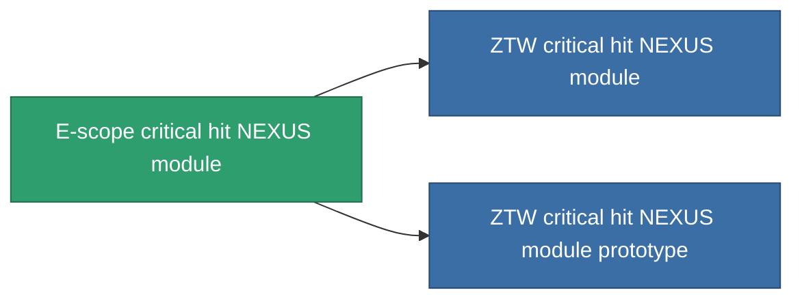

<!-- Generated by tools/generate from the live database (source: entitydefaults definition 2596, aggregatevalues via aggregatefields).
     Do not edit by hand; regenerate instead. -->

# E-scope critical hit NEXUS module

|  |  |
|---|---|
| Définition | `def_named2_gang_assist_precision_firing_module` |
| Niveau | T3 |
| Points de vie | 100 |
| Volume | 0.2 |
| Masse | 50 |
| Catégorie | Modules / Enhancements |
| Tier line | [Standard critical hit NEXUS module](/fr/content/items/standard-gang-assist-precision-firing-module/) (T1) → [Qandellay critical hit NEXUS module](/fr/content/items/named1-gang-assist-precision-firing-module/) (T2) → **E-scope critical hit NEXUS module** (T3) → [ZTW critical hit NEXUS module](/fr/content/items/named3-gang-assist-precision-firing-module/) (T4) |
| Note | crit_chancet novel |

## Statistiques

| Champ | Valeur |
|---|---|
| core_usage | 36 |
| cpu_usage | 88 |
| cycle_time | 10k |
| default_effect_range | 100 |
| effect_critical_hit_chance_modifier | 0.035 |
| powergrid_usage | 36 |

<!-- production:generated -->
## Production

**Produit à partir de 10 composants, niveau de recherche 6** — assemblez les composants pour le fabriquer (liste complète dans [Recettes](/fr/content/recipes/)):

**Plan :** [E-scope critical hit NEXUS module CT](/content/items/named2-gang-assist-precision-firing-module-cprg/)

<svg class="prod-card-icon" aria-hidden="true"><use href="#mi-grid"/></svg><a class="prod-card-name" href="/fr/content/items/espitium/">Espitium</a>

requis : <b>250</b>

<svg class="prod-card-icon" aria-hidden="true"><use href="#mi-grid"/></svg><a class="prod-card-name" href="/fr/content/items/hydrobenol/">Hydrobenol</a>

requis : <b>50</b>

<svg class="prod-card-icon" aria-hidden="true"><use href="#mi-panel"/></svg><a class="prod-card-name" href="/fr/content/items/named1-gang-assist-precision-firing-module/">Qandellay critical hit NEXUS module</a>

requis : <b>1</b>

<svg class="prod-card-icon" aria-hidden="true"><use href="#mi-grid"/></svg><a class="prod-card-name" href="/fr/content/items/polynucleit/">Polynucleit</a>

requis : <b>50</b>

<svg class="prod-card-icon" aria-hidden="true"><use href="#mi-grid"/></svg><a class="prod-card-name" href="/fr/content/items/prilumium/">Prilumium</a>

requis : <b>250</b>

<svg class="prod-card-icon" aria-hidden="true"><use href="#mi-crystal"/></svg><a class="prod-card-name" href="/fr/content/items/robotshard-nuimqol-advanced/">Functional nuimqol fragment</a>

requis : <b>10</b>

<svg class="prod-card-icon" aria-hidden="true"><use href="#mi-crystal"/></svg><a class="prod-card-name" href="/fr/content/items/robotshard-nuimqol-basic/">Damaged nuimqol fragment</a>

requis : <b>10</b>

<svg class="prod-card-icon" aria-hidden="true"><use href="#mi-crystal"/></svg><a class="prod-card-name" href="/fr/content/items/robotshard-thelodica-advanced/">Functional thelodica fragment</a>

requis : <b>10</b>

<svg class="prod-card-icon" aria-hidden="true"><use href="#mi-crystal"/></svg><a class="prod-card-name" href="/fr/content/items/robotshard-thelodica-basic/">Damaged thelodica fragment</a>

requis : <b>10</b>

<svg class="prod-card-icon" aria-hidden="true"><use href="#mi-grid"/></svg><a class="prod-card-name" href="/fr/content/items/titanium/">Titanium</a>

requis : <b>50</b>

## Utilisé en production

**Composant de 2 articles** — tout ce qui l'utilise en production :

