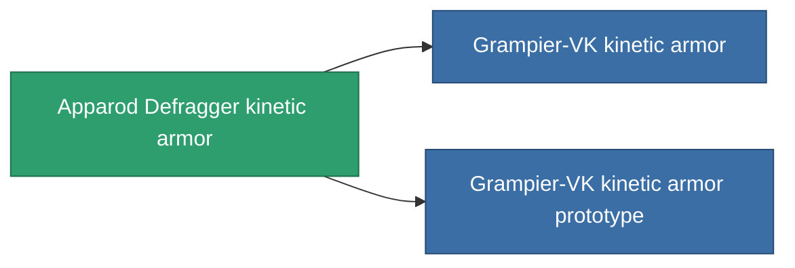

<!-- Generated by tools/generate from the live database (source: entitydefaults definition 717, aggregatevalues via aggregatefields).
     Do not edit by hand; regenerate instead. -->

# Apparod Defragger kinetic armor

|  |  |
|---|---|
| Définition | `def_named2_kin_armor_hardener` |
| Niveau | T3 |
| Points de vie | 100 |
| Volume | 1 |
| Masse | 100 |
| Catégorie | Modules / Armor |
| Tier line | [Standard kinetic armor](/fr/content/items/standard-kin-armor-hardener/) (T1) → [Counterpress I-230 kinetic armor](/fr/content/items/named1-kin-armor-hardener/) (T2) → **Apparod Defragger kinetic armor** (T3) → [Grampier-VK kinetic armor](/fr/content/items/named3-kin-armor-hardener/) (T4) |

## Statistiques

| Champ | Valeur |
|---|---|
| core_usage | 13 |
| cpu_usage | 25 |
| cycle_time | 10k |
| effect_resist_kinetic | 110 |
| powergrid_usage | 5 |
| resist_kinetic | 25 |

<!-- production:generated -->
## Production

**Produit à partir de 10 composants, niveau de recherche 5** — assemblez les composants pour le fabriquer (liste complète dans [Recettes](/fr/content/recipes/)):

**Plan :** [Apparod Defragger kinetic armor CT](/content/items/named2-kin-armor-hardener-cprg/)

<svg class="prod-card-icon" aria-hidden="true"><use href="#mi-grid"/></svg><a class="prod-card-name" href="/fr/content/items/alligior/">Alligior</a>

requis : <b>125</b>

<svg class="prod-card-icon" aria-hidden="true"><use href="#mi-grid"/></svg><a class="prod-card-name" href="/fr/content/items/espitium/">Espitium</a>

requis : <b>50</b>

<svg class="prod-card-icon" aria-hidden="true"><use href="#mi-grid"/></svg><a class="prod-card-name" href="/fr/content/items/metachropin/">Metachropin</a>

requis : <b>125</b>

<svg class="prod-card-icon" aria-hidden="true"><use href="#mi-tree"/></svg><a class="prod-card-name" href="/fr/content/items/named1-kin-armor-hardener/">Counterpress I-230 kinetic armor</a>

requis : <b>1</b>

<svg class="prod-card-icon" aria-hidden="true"><use href="#mi-grid"/></svg><a class="prod-card-name" href="/fr/content/items/prilumium/">Prilumium</a>

requis : <b>50</b>

<svg class="prod-card-icon" aria-hidden="true"><use href="#mi-crystal"/></svg><a class="prod-card-name" href="/fr/content/items/robotshard-common-advanced/">Functional common fragment</a>

requis : <b>10</b>

<svg class="prod-card-icon" aria-hidden="true"><use href="#mi-crystal"/></svg><a class="prod-card-name" href="/fr/content/items/robotshard-common-basic/">Damaged common fragment</a>

requis : <b>10</b>

<svg class="prod-card-icon" aria-hidden="true"><use href="#mi-crystal"/></svg><a class="prod-card-name" href="/fr/content/items/robotshard-pelistal-advanced/">Functional pelistal fragment</a>

requis : <b>10</b>

<svg class="prod-card-icon" aria-hidden="true"><use href="#mi-crystal"/></svg><a class="prod-card-name" href="/fr/content/items/robotshard-pelistal-basic/">Damaged pelistal fragment</a>

requis : <b>10</b>

<svg class="prod-card-icon" aria-hidden="true"><use href="#mi-grid"/></svg><a class="prod-card-name" href="/fr/content/items/titanium/">Titanium</a>

requis : <b>100</b>

## Utilisé en production

**Composant de 2 articles** — tout ce qui l'utilise en production :

