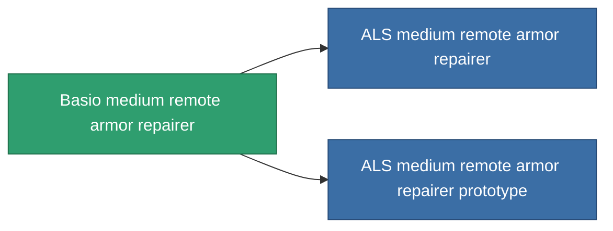

<!-- Generated by tools/generate from the live database (source: entitydefaults definition 706, aggregatevalues via aggregatefields).
     Do not edit by hand; regenerate instead. -->

# Basio medium remote armor repairer

|  |  |
|---|---|
| Définition | `def_named2_medium_remote_armor_repairer` |
| Niveau | T3 |
| Points de vie | 100 |
| Volume | 1.5 |
| Masse | 500 |
| Catégorie | Modules / Repair |
| Tier line | [Standard medium remote armor repairer](/fr/content/items/standard-medium-remote-armor-repairer/) (T1) → [Avaror GD-800 medium remote armor repairer](/fr/content/items/named1-medium-remote-armor-repairer/) (T2) → **Basio medium remote armor repairer** (T3) → [ALS medium remote armor repairer](/fr/content/items/named3-medium-remote-armor-repairer/) (T4) |

## Statistiques

| Champ | Valeur |
|---|---|
| armor_repair_amount | 190 |
| core_usage | 360 |
| cpu_usage | 70 |
| cycle_time | 17k |
| falloff | 0 |
| optimal_range | 22.5 |
| powergrid_usage | 140 |

<!-- production:generated -->
## Production

**Produit à partir de 8 composants, niveau de recherche 6** — assemblez les composants pour le fabriquer (liste complète dans [Recettes](/fr/content/recipes/)):

**Plan :** [Basio medium remote armor repairer CT](/content/items/named2-medium-remote-armor-repairer-cprg/)

<svg class="prod-card-icon" aria-hidden="true"><use href="#mi-grid"/></svg><a class="prod-card-name" href="/fr/content/items/alligior/">Alligior</a>

requis : <b>250</b>

<svg class="prod-card-icon" aria-hidden="true"><use href="#mi-grid"/></svg><a class="prod-card-name" href="/fr/content/items/axicol/">Cryoperine</a>

requis : <b>50</b>

<svg class="prod-card-icon" aria-hidden="true"><use href="#mi-grid"/></svg><a class="prod-card-name" href="/fr/content/items/espitium/">Espitium</a>

requis : <b>50</b>

<svg class="prod-card-icon" aria-hidden="true"><use href="#mi-tree"/></svg><a class="prod-card-name" href="/fr/content/items/named1-medium-remote-armor-repairer/">Avaror GD-800 medium remote armor repairer</a>

requis : <b>1</b>

<svg class="prod-card-icon" aria-hidden="true"><use href="#mi-grid"/></svg><a class="prod-card-name" href="/fr/content/items/plasteosine/">Plasteosine</a>

requis : <b>250</b>

<svg class="prod-card-icon" aria-hidden="true"><use href="#mi-crystal"/></svg><a class="prod-card-name" href="/fr/content/items/robotshard-common-advanced/">Functional common fragment</a>

requis : <b>40</b>

<svg class="prod-card-icon" aria-hidden="true"><use href="#mi-crystal"/></svg><a class="prod-card-name" href="/fr/content/items/robotshard-common-basic/">Damaged common fragment</a>

requis : <b>40</b>

<svg class="prod-card-icon" aria-hidden="true"><use href="#mi-grid"/></svg><a class="prod-card-name" href="/fr/content/items/titanium/">Titanium</a>

requis : <b>200</b>

## Utilisé en production

**Composant de 2 articles** — tout ce qui l'utilise en production :

