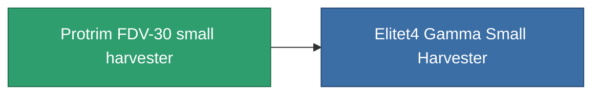

<!-- Generated by tools/generate from the live database (source: entitydefaults definition 809, aggregatevalues via aggregatefields).
     Do not edit by hand; regenerate instead. -->

# Protrim FDV-30 small harvester

|  |  |
|---|---|
| Définition | `def_named3_small_harvester` |
| Niveau | T4 |
| Points de vie | 100 |
| Volume | 1 |
| Masse | 400 |
| Catégorie | Modules / Harvesting |
| Tier line | [Standard small harvester](/fr/content/items/standard-small-harvester/) (T1) → [MHA 400-'Avalon' small harvester](/fr/content/items/named1-small-harvester/) (T2) → [Agraar-I small harvester](/fr/content/items/named2-small-harvester/) (T3) → **Protrim FDV-30 small harvester** (T4) |

## Statistiques

| Champ | Valeur |
|---|---|
| core_usage | 22 |
| cpu_usage | 44 |
| cycle_time | 12.5k |
| optimal_range | 3 |
| powergrid_usage | 33 |

<!-- production:generated -->
## Production

**Produit à partir de 8 composants, niveau de recherche 4** — assemblez les composants pour le fabriquer (liste complète dans [Recettes](/fr/content/recipes/)):

**Plan :** [Protrim FDV-30 small harvester CT](/content/items/named3-small-harvester-cprg/)

<svg class="prod-card-icon" aria-hidden="true"><use href="#mi-grid"/></svg><a class="prod-card-name" href="/fr/content/items/axicol/">Cryoperine</a>

requis : <b>50</b>

<svg class="prod-card-icon" aria-hidden="true"><use href="#mi-grid"/></svg><a class="prod-card-name" href="/fr/content/items/espitium/">Espitium</a>

requis : <b>50</b>

<svg class="prod-card-icon" aria-hidden="true"><use href="#mi-grid"/></svg><a class="prod-card-name" href="/fr/content/items/named2-small-harvester/">Agraar-I small harvester</a>

requis : <b>1</b>

<svg class="prod-card-icon" aria-hidden="true"><use href="#mi-crystal"/></svg><a class="prod-card-name" href="/fr/content/items/robotshard-common-advanced/">Functional common fragment</a>

requis : <b>30</b>

<svg class="prod-card-icon" aria-hidden="true"><use href="#mi-crystal"/></svg><a class="prod-card-name" href="/fr/content/items/robotshard-common-basic/">Damaged common fragment</a>

requis : <b>15</b>

<svg class="prod-card-icon" aria-hidden="true"><use href="#mi-crystal"/></svg><a class="prod-card-name" href="/fr/content/items/robotshard-common-expert/">Perfect common fragment</a>

requis : <b>45</b>

<svg class="prod-card-icon" aria-hidden="true"><use href="#mi-grid"/></svg><a class="prod-card-name" href="/fr/content/items/titanium/">Titanium</a>

requis : <b>150</b>

<svg class="prod-card-icon" aria-hidden="true"><use href="#mi-grid"/></svg><a class="prod-card-name" href="/fr/content/items/unimetal/">Briochit</a>

requis : <b>150</b>

## Utilisé en production

**Composant de 1 articles** — tout ce qui l'utilise en production :

