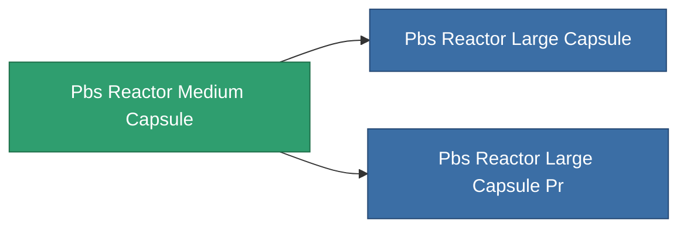

<!-- Generated by tools/generate from the live database (source: entitydefaults definition 4668, aggregatevalues via aggregatefields).
     Do not edit by hand; regenerate instead. -->

# Pbs Reactor Medium Capsule

|  |  |
|---|---|
| Définition | `def_pbs_reactor_medium_capsule` |
| Niveau | T2 |
| Points de vie | 100 |
| Volume | 225 |
| Masse | 225000 |
| Catégorie | Special & other / Miscellaneous |

## Statistiques

| Champ | Valeur |
|---|---|
| armor_max | 125k |
| core_max | 20M |
| core_recharge_time | 345.6k |
| resist_chemical | 75 |
| resist_explosive | 75 |
| resist_kinetic | 75 |
| resist_thermal | 75 |
| signature_radius | 65 |
| stealth_strength | 50 |

<!-- production:generated -->
## Production

**Produit à partir de 10 composants** — assemblez les composants pour le fabriquer (liste complète dans [Recettes](/fr/content/recipes/)):

**Plan :** [Advanced reactor foundation CT](/content/items/pbs-reactor-medium-capsule-cprg/)

<svg class="prod-card-icon" aria-hidden="true"><use href="#mi-grid"/></svg><a class="prod-card-name" href="/fr/content/items/alligior/">Alligior</a>

requis : <b>3.5k</b>

<svg class="prod-card-icon" aria-hidden="true"><use href="#mi-grid"/></svg><a class="prod-card-name" href="/fr/content/items/axicol/">Cryoperine</a>

requis : <b>7.5k</b>

<svg class="prod-card-icon" aria-hidden="true"><use href="#mi-grid"/></svg><a class="prod-card-name" href="/fr/content/items/espitium/">Espitium</a>

requis : <b>15.0k</b>

<svg class="prod-card-icon" aria-hidden="true"><use href="#mi-grid"/></svg><a class="prod-card-name" href="/fr/content/items/gamma-buildblock/">Coalimin</a>

requis : <b>2.5k</b>

<svg class="prod-card-icon" aria-hidden="true"><use href="#mi-grid"/></svg><a class="prod-card-name" href="/fr/content/items/gamma-defblock/">Bochilum</a>

requis : <b>1.8k</b>

<svg class="prod-card-icon" aria-hidden="true"><use href="#mi-grid"/></svg><a class="prod-card-name" href="/fr/content/items/gamma-energyblock/">Tiraizin</a>

requis : <b>7.5k</b>

<svg class="prod-card-icon" aria-hidden="true"><use href="#mi-home"/></svg><a class="prod-card-name" href="/fr/content/items/pbs-reactor-small-capsule/">Pbs Reactor Small Capsule</a>

requis : <b>1</b>

<svg class="prod-card-icon" aria-hidden="true"><use href="#mi-grid"/></svg><a class="prod-card-name" href="/fr/content/items/plasteosine/">Plasteosine</a>

requis : <b>1.8k</b>

<svg class="prod-card-icon" aria-hidden="true"><use href="#mi-grid"/></svg><a class="prod-card-name" href="/fr/content/items/titanium/">Titanium</a>

requis : <b>2.5k</b>

<svg class="prod-card-icon" aria-hidden="true"><use href="#mi-grid"/></svg><a class="prod-card-name" href="/fr/content/items/unimetal/">Briochit</a>

requis : <b>5.0k</b>

## Utilisé en production

**Composant de 2 articles** — tout ce qui l'utilise en production :

