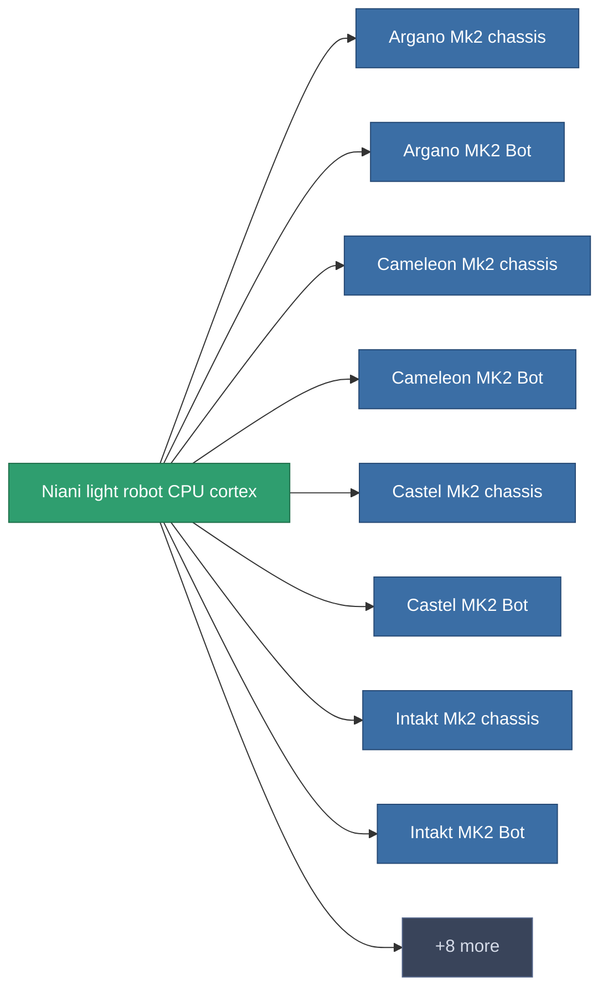

<!-- Generated by tools/generate from the live database (source: entitydefaults definition 2943, aggregatevalues via aggregatefields).
     Do not edit by hand; regenerate instead. -->

# Niani light robot CPU cortex

|  |  |
|---|---|
| Définition | `def_reactore_core_runner` |
| Niveau | – |
| Points de vie | 100 |
| Volume | 0.5 |
| Masse | 1000 |
| Catégorie | Materials |

_Aucune statistique — cet article ne porte aucune valeur agrégée._

<!-- production:generated -->
## Utilisé en production

**Composant de 16 articles** — un aperçu de ce qui peut être produit avec (liste complète dans [Recettes](/fr/content/recipes/)).

