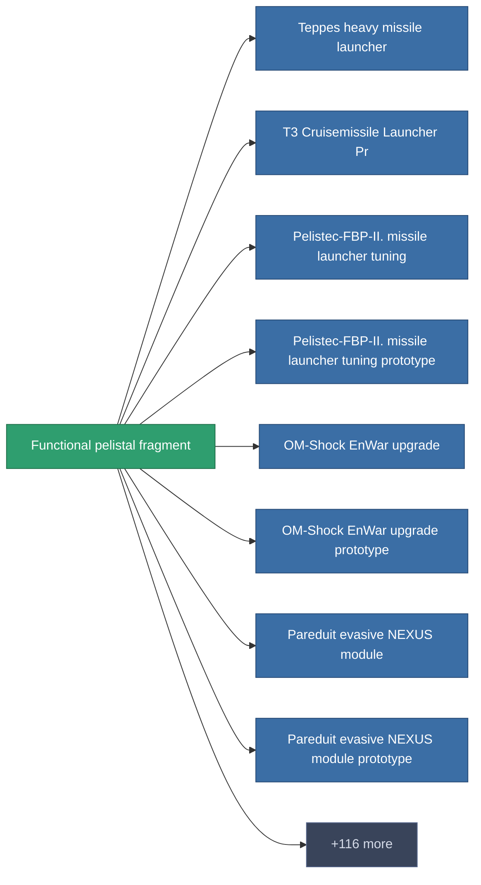

<!-- Generated by tools/generate from the live database (source: entitydefaults definition 1990, aggregatevalues via aggregatefields).
     Do not edit by hand; regenerate instead. -->

# Functional pelistal fragment

|  |  |
|---|---|
| Définition | `def_robotshard_pelistal_advanced` |
| Niveau | – |
| Points de vie | 100 |
| Volume | 0.01 |
| Masse | 1 |
| Catégorie | Materials |

_Aucune statistique — cet article ne porte aucune valeur agrégée._

<!-- production:generated -->
## Production

**Produit à partir de 3 composants** — assemblez les composants pour le fabriquer (liste complète dans [Recettes](/fr/content/recipes/)):

<svg class="prod-card-icon" aria-hidden="true"><use href="#mi-grid"/></svg><a class="prod-card-name" href="/fr/content/items/isopropentol/">Isopropentol</a>

requis : <b>2</b>

<svg class="prod-card-icon" aria-hidden="true"><use href="#mi-grid"/></svg><a class="prod-card-name" href="/fr/content/items/phlobotil/">Phlobotil</a>

requis : <b>2</b>

<svg class="prod-card-icon" aria-hidden="true"><use href="#mi-grid"/></svg><a class="prod-card-name" href="/fr/content/items/vitricyl/">Vitricyl</a>

requis : <b>2</b>

## Utilisé en production

**Composant de 124 articles** — un aperçu de ce qui peut être produit avec (liste complète dans [Recettes](/fr/content/recipes/)).

