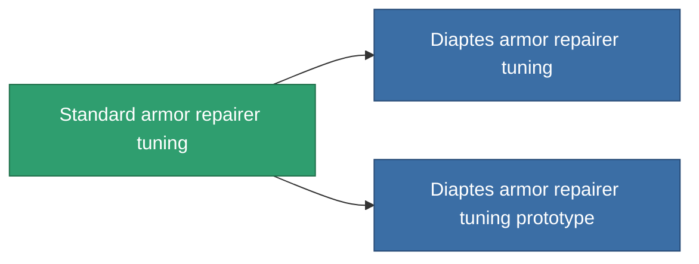

<!-- Generated by tools/generate from the live database (source: entitydefaults definition 1060, aggregatevalues via aggregatefields).
     Do not edit by hand; regenerate instead. -->

# Standard armor repairer tuning

|  |  |
|---|---|
| Définition | `def_standard_armor_repairer_upgrade` |
| Niveau | T1 |
| Points de vie | 100 |
| Volume | 0.5 |
| Masse | 300 |
| Catégorie | Modules / Repair |
| Tier line | **Standard armor repairer tuning** (T1) → [Diaptes armor repairer tuning](/fr/content/items/named1-armor-repairer-upgrade/) (T2) → [WPG3000 armor repairer tuning](/fr/content/items/named2-armor-repairer-upgrade/) (T3) → [Apogenion armor repairer tuning](/fr/content/items/named3-armor-repairer-upgrade/) (T4) |

## Statistiques

| Champ | Valeur |
|---|---|
| armor_repair_amount_modifier | 1.08 |
| armor_repair_cycle_time_modifier | 0.96 |
| cpu_usage | 35 |
| powergrid_usage | 25 |

<!-- production:generated -->
## Production

**Produit à partir de 5 composants, niveau de recherche 3** — assemblez les composants pour le fabriquer (liste complète dans [Recettes](/fr/content/recipes/)):

**Plan :** [Standard armor repairer tuning CT](/fr/content/items/standard-armor-repairer-upgrade-cprg/)

<svg class="prod-card-icon" aria-hidden="true"><use href="#mi-grid"/></svg><a class="prod-card-name" href="/fr/content/items/axicol/">Cryoperine</a>

requis : <b>50</b>

<svg class="prod-card-icon" aria-hidden="true"><use href="#mi-grid"/></svg><a class="prod-card-name" href="/fr/content/items/chollonin/">Chollonin</a>

requis : <b>50</b>

<svg class="prod-card-icon" aria-hidden="true"><use href="#mi-grid"/></svg><a class="prod-card-name" href="/fr/content/items/plasteosine/">Plasteosine</a>

requis : <b>150</b>

<svg class="prod-card-icon" aria-hidden="true"><use href="#mi-grid"/></svg><a class="prod-card-name" href="/fr/content/items/statichnol/">Statichnol</a>

requis : <b>150</b>

<svg class="prod-card-icon" aria-hidden="true"><use href="#mi-grid"/></svg><a class="prod-card-name" href="/fr/content/items/titanium/">Titanium</a>

requis : <b>100</b>

## Utilisé en production

**Composant de 2 articles** — tout ce qui l'utilise en production :

