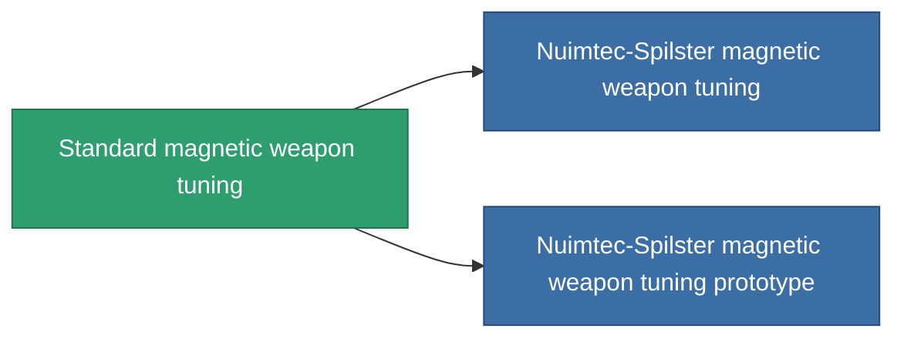

<!-- Generated by tools/generate from the live database (source: entitydefaults definition 909, aggregatevalues via aggregatefields).
     Do not edit by hand; regenerate instead. -->

# Standard magnetic weapon tuning

|  |  |
|---|---|
| Définition | `def_standard_damage_mod_railgun` |
| Niveau | T1 |
| Points de vie | 100 |
| Volume | 0.5 |
| Masse | 100 |
| Catégorie | Modules / Weapons |
| Tier line | **Standard magnetic weapon tuning** (T1) → [Nuimtec-Spilster magnetic weapon tuning](/fr/content/items/named1-damage-mod-railgun/) (T2) → [RSU-Magnitcore magnetic weapon tuning](/fr/content/items/named2-damage-mod-railgun/) (T3) → [Nuimtec-Magniscope XM80 magnetic weapon tuning](/fr/content/items/named3-damage-mod-railgun/) (T4) |

## Statistiques

| Champ | Valeur |
|---|---|
| cpu_usage | 25 |
| damage_railgun_modifier | 0.15 |
| powergrid_usage | 5 |

<!-- production:generated -->
## Production

**Produit à partir de 5 composants, niveau de recherche 3** — assemblez les composants pour le fabriquer (liste complète dans [Recettes](/fr/content/recipes/)):

**Plan :** [Standard magnetic weapon tuning CT](/fr/content/items/standard-damage-mod-railgun-cprg/)

<svg class="prod-card-icon" aria-hidden="true"><use href="#mi-grid"/></svg><a class="prod-card-name" href="/fr/content/items/axicol/">Cryoperine</a>

requis : <b>100</b>

<svg class="prod-card-icon" aria-hidden="true"><use href="#mi-grid"/></svg><a class="prod-card-name" href="/fr/content/items/axicoline/">Axicoline</a>

requis : <b>50</b>

<svg class="prod-card-icon" aria-hidden="true"><use href="#mi-grid"/></svg><a class="prod-card-name" href="/fr/content/items/chollonin/">Chollonin</a>

requis : <b>100</b>

<svg class="prod-card-icon" aria-hidden="true"><use href="#mi-grid"/></svg><a class="prod-card-name" href="/fr/content/items/polynitrocol/">Polynitrocol</a>

requis : <b>50</b>

<svg class="prod-card-icon" aria-hidden="true"><use href="#mi-grid"/></svg><a class="prod-card-name" href="/fr/content/items/titanium/">Titanium</a>

requis : <b>50</b>

## Utilisé en production

**Composant de 2 articles** — tout ce qui l'utilise en production :

