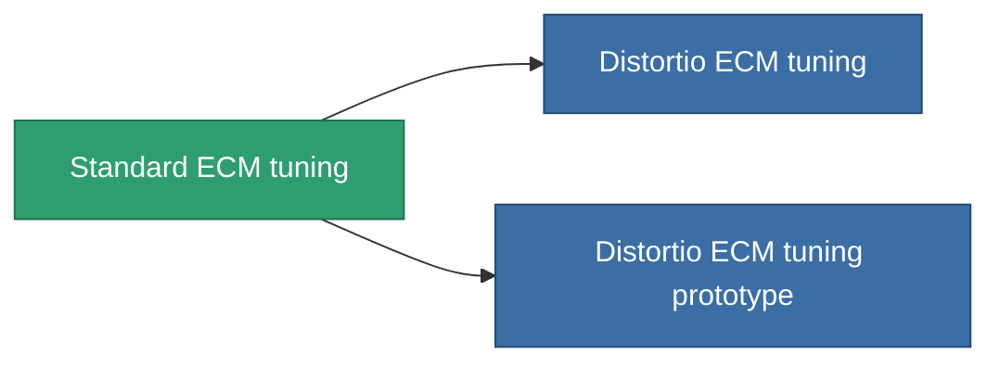

<!-- Generated by tools/generate from the live database (source: entitydefaults definition 4578, aggregatevalues via aggregatefields).
     Do not edit by hand; regenerate instead. -->

# Standard ECM tuning

|  |  |
|---|---|
| Définition | `def_standard_ecm_booster` |
| Niveau | T1 |
| Points de vie | 100 |
| Volume | 0.5 |
| Masse | 150 |
| Catégorie | Modules / Enhancements |
| Tier line | **Standard ECM tuning** (T1) → [Distortio ECM tuning](/fr/content/items/named1-ecm-booster/) (T2) → [Hodge ECM tuning](/fr/content/items/named2-ecm-booster/) (T3) → [Sludge ECM tuning](/fr/content/items/named3-ecm-booster/) (T4) |

## Statistiques

| Champ | Valeur |
|---|---|
| core_usage_sensor_jammer_modifier | 1.1 |
| cpu_usage | 65 |
| ecm_strength_modifier | 1.25 |
| powergrid_usage | 25 |

<!-- production:generated -->
## Production

**Produit à partir de 3 composants, niveau de recherche 5** — assemblez les composants pour le fabriquer (liste complète dans [Recettes](/fr/content/recipes/)):

**Plan :** [Standard ECM tuning CT](/content/items/standard-ecm-booster-cprg/)

<svg class="prod-card-icon" aria-hidden="true"><use href="#mi-grid"/></svg><a class="prod-card-name" href="/fr/content/items/axicol/">Cryoperine</a>

requis : <b>150</b>

<svg class="prod-card-icon" aria-hidden="true"><use href="#mi-grid"/></svg><a class="prod-card-name" href="/fr/content/items/chollonin/">Chollonin</a>

requis : <b>150</b>

<svg class="prod-card-icon" aria-hidden="true"><use href="#mi-grid"/></svg><a class="prod-card-name" href="/fr/content/items/titanium/">Titanium</a>

requis : <b>50</b>

## Utilisé en production

**Composant de 2 articles** — tout ce qui l'utilise en production :

