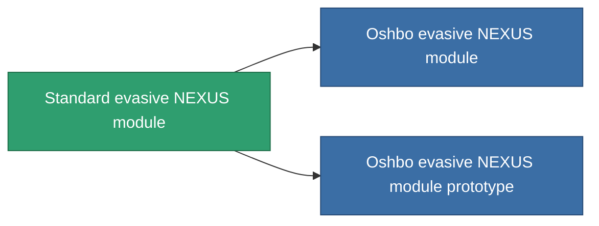

<!-- Generated by tools/generate from the live database (source: entitydefaults definition 2552, aggregatevalues via aggregatefields).
     Do not edit by hand; regenerate instead. -->

# Standard evasive NEXUS module

|  |  |
|---|---|
| Définition | `def_standard_gang_assist_coordinated_maneuvering_module` |
| Niveau | T1 |
| Points de vie | 100 |
| Volume | 0.2 |
| Masse | 50 |
| Catégorie | Modules / Enhancements |
| Tier line | **Standard evasive NEXUS module** (T1) → [Oshbo evasive NEXUS module](/fr/content/items/named1-gang-assist-coordinated-maneuvering-module/) (T2) → [Pareduit evasive NEXUS module](/fr/content/items/named2-gang-assist-coordinated-maneuvering-module/) (T3) → [R4S-A evasive NEXUS module](/fr/content/items/named3-gang-assist-coordinated-maneuvering-module/) (T4) |
| Note | hit surfacet csokkent |

## Statistiques

| Champ | Valeur |
|---|---|
| core_usage | 35 |
| cpu_usage | 85 |
| cycle_time | 10k |
| default_effect_range | 100 |
| effect_signature_radius_modifier | -0.1 |
| powergrid_usage | 35 |

<!-- production:generated -->
## Production

**Produit à partir de 3 composants, niveau de recherche 4** — assemblez les composants pour le fabriquer (liste complète dans [Recettes](/fr/content/recipes/)):

**Plan :** [Standard evasive NEXUS module CT](/content/items/standard-gang-assist-coordinated-maneuvering-module-cprg/)

<svg class="prod-card-icon" aria-hidden="true"><use href="#mi-grid"/></svg><a class="prod-card-name" href="/fr/content/items/axicol/">Cryoperine</a>

requis : <b>500</b>

<svg class="prod-card-icon" aria-hidden="true"><use href="#mi-grid"/></svg><a class="prod-card-name" href="/fr/content/items/plasteosine/">Plasteosine</a>

requis : <b>100</b>

<svg class="prod-card-icon" aria-hidden="true"><use href="#mi-grid"/></svg><a class="prod-card-name" href="/fr/content/items/titanium/">Titanium</a>

requis : <b>50</b>

## Utilisé en production

**Composant de 2 articles** — tout ce qui l'utilise en production :

