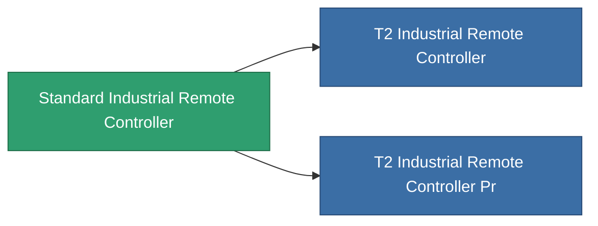

<!-- Generated by tools/generate from the live database (source: entitydefaults definition 8571, aggregatevalues via aggregatefields).
     Do not edit by hand; regenerate instead. -->

# Standard Industrial Remote Controller

|  |  |
|---|---|
| Définition | `def_standard_industrial_remote_controller` |
| Niveau | T1 |
| Points de vie | 100 |
| Volume | 1 |
| Masse | 1 |
| Catégorie | Modules / Remote control |
| Tier line | **Standard Industrial Remote Controller** (T1) → [T2 Industrial Remote Controller](/fr/content/items/named1-industrial-remote-controller/) (T2) → [T3 Industrial Remote Controller](/fr/content/items/named2-industrial-remote-controller/) (T3) → [T4 Industrial Remote Controller](/fr/content/items/named3-industrial-remote-controller/) (T4) |

## Statistiques

| Champ | Valeur |
|---|---|
| core_usage | 150 |
| cpu_usage | 63 |
| cycle_time | 10k |
| drone_amplification_armor_max_modifier | 1 |
| drone_amplification_core_max_modifier | 1 |
| drone_amplification_core_recharge_time_modifier | 1 |
| drone_amplification_harvesting_amount_modifier | 1 |
| drone_amplification_locking_time_modifier | 1 |
| drone_amplification_mining_amount_modifier | 1 |
| drone_amplification_reactor_radiation_modifier | 1 |
| drone_amplification_speed_max_modifier | 1 |
| powergrid_usage | 65 |
| remote_control_bandwidth_max | 0 |
| remote_control_lifetime | 180k |
| remote_control_operational_range | 20 |

<!-- production:generated -->
## Production

**Produit à partir de 4 composants, niveau de recherche 5** — assemblez les composants pour le fabriquer (liste complète dans [Recettes](/fr/content/recipes/)):

**Plan :** [Standard Industrial Remote Controller Cprg](/fr/content/items/standard-industrial-remote-controller-cprg/)

<svg class="prod-card-icon" aria-hidden="true"><use href="#mi-grid"/></svg><a class="prod-card-name" href="/fr/content/items/axicol/">Cryoperine</a>

requis : <b>250</b>

<svg class="prod-card-icon" aria-hidden="true"><use href="#mi-grid"/></svg><a class="prod-card-name" href="/fr/content/items/axicoline/">Axicoline</a>

requis : <b>100</b>

<svg class="prod-card-icon" aria-hidden="true"><use href="#mi-grid"/></svg><a class="prod-card-name" href="/fr/content/items/espitium/">Espitium</a>

requis : <b>50</b>

<svg class="prod-card-icon" aria-hidden="true"><use href="#mi-grid"/></svg><a class="prod-card-name" href="/fr/content/items/titanium/">Titanium</a>

requis : <b>50</b>

## Utilisé en production

**Composant de 2 articles** — tout ce qui l'utilise en production :

