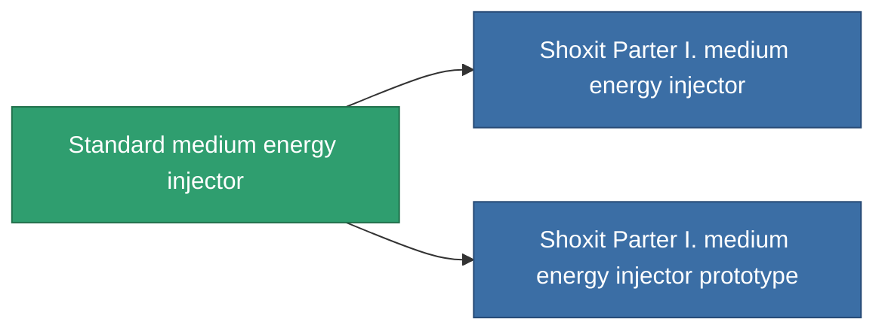

<!-- Generated by tools/generate from the live database (source: entitydefaults definition 649, aggregatevalues via aggregatefields).
     Do not edit by hand; regenerate instead. -->

# Standard medium energy injector

|  |  |
|---|---|
| Définition | `def_standard_medium_core_booster` |
| Niveau | T1 |
| Points de vie | 100 |
| Volume | 1 |
| Masse | 200 |
| Catégorie | Modules / Enhancements |
| Tier line | **Standard medium energy injector** (T1) → [Shoxit Parter I. medium energy injector](/fr/content/items/named1-medium-core-booster/) (T2) → [Follypsos medium energy injector](/fr/content/items/named2-medium-core-booster/) (T3) → [Cerepter II. medium energy injector](/fr/content/items/named3-medium-core-booster/) (T4) |

## Statistiques

| Champ | Valeur |
|---|---|
| core_usage | 0 |
| cpu_usage | 25 |
| cycle_time | 11k |
| powergrid_usage | 250 |

<!-- production:generated -->
## Production

**Produit à partir de 2 composants, niveau de recherche 4** — assemblez les composants pour le fabriquer (liste complète dans [Recettes](/fr/content/recipes/)):

**Plan :** [Standard medium energy injector CT](/fr/content/items/standard-medium-core-booster-cprg/)

<svg class="prod-card-icon" aria-hidden="true"><use href="#mi-grid"/></svg><a class="prod-card-name" href="/fr/content/items/axicol/">Cryoperine</a>

requis : <b>200</b>

<svg class="prod-card-icon" aria-hidden="true"><use href="#mi-grid"/></svg><a class="prod-card-name" href="/fr/content/items/titanium/">Titanium</a>

requis : <b>200</b>

## Utilisé en production

**Composant de 2 articles** — tout ce qui l'utilise en production :

