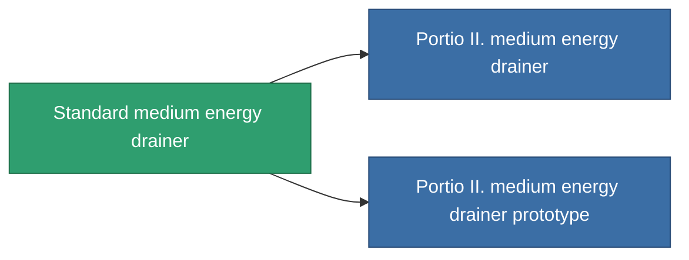

<!-- Generated by tools/generate from the live database (source: entitydefaults definition 36, aggregatevalues via aggregatefields).
     Do not edit by hand; regenerate instead. -->

# Standard medium energy drainer

|  |  |
|---|---|
| Définition | `def_standard_medium_energy_vampire` |
| Niveau | T1 |
| Points de vie | 100 |
| Volume | 1 |
| Masse | 500 |
| Catégorie | Modules / Shield |
| Tier line | **Standard medium energy drainer** (T1) → [Portio II. medium energy drainer](/fr/content/items/named1-medium-energy-vampire/) (T2) → [V90-Quadres medium energy drainer](/fr/content/items/named2-medium-energy-vampire/) (T3) → [Filch-AM medium energy drainer](/fr/content/items/named3-medium-energy-vampire/) (T4) |

## Statistiques

| Champ | Valeur |
|---|---|
| core_usage | 15 |
| cpu_usage | 55 |
| cycle_time | 10k |
| energy_dispersion | 10 |
| energy_vampired_amount | 90 |
| falloff | 0 |
| optimal_range | 25 |
| powergrid_usage | 175 |

<!-- production:generated -->
## Production

**Produit à partir de 3 composants, niveau de recherche 4** — assemblez les composants pour le fabriquer (liste complète dans [Recettes](/fr/content/recipes/)):

**Plan :** [Standard medium energy drainer CT](/fr/content/items/standard-medium-energy-vampire-cprg/)

<svg class="prod-card-icon" aria-hidden="true"><use href="#mi-grid"/></svg><a class="prod-card-name" href="/fr/content/items/axicol/">Cryoperine</a>

requis : <b>400</b>

<svg class="prod-card-icon" aria-hidden="true"><use href="#mi-grid"/></svg><a class="prod-card-name" href="/fr/content/items/axicoline/">Axicoline</a>

requis : <b>200</b>

<svg class="prod-card-icon" aria-hidden="true"><use href="#mi-grid"/></svg><a class="prod-card-name" href="/fr/content/items/titanium/">Titanium</a>

requis : <b>200</b>

## Utilisé en production

**Composant de 2 articles** — tout ce qui l'utilise en production :

