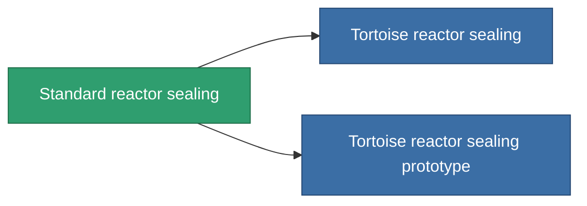

<!-- Generated by tools/generate from the live database (source: entitydefaults definition 4576, aggregatevalues via aggregatefields).
     Do not edit by hand; regenerate instead. -->

# Standard reactor sealing

|  |  |
|---|---|
| Définition | `def_standard_reactor_sealing` |
| Niveau | T1 |
| Points de vie | 100 |
| Volume | 1 |
| Masse | 150 |
| Catégorie | Modules / Enhancements |
| Tier line | **Standard reactor sealing** (T1) → [Tortoise reactor sealing](/fr/content/items/named1-reactor-sealing/) (T2) → [GRIP-250 reactor sealing](/fr/content/items/named2-reactor-sealing/) (T3) → [GRIP-500p reactor sealing](/fr/content/items/named3-reactor-sealing/) (T4) |

## Statistiques

| Champ | Valeur |
|---|---|
| cpu_usage | 15 |
| powergrid_usage | 75 |
| reactor_radiation_modifier | 0.75 |

<!-- production:generated -->
## Production

**Produit à partir de 3 composants, niveau de recherche 3** — assemblez les composants pour le fabriquer (liste complète dans [Recettes](/fr/content/recipes/)):

**Plan :** [Standard reactor sealing CT](/content/items/standard-reactor-sealing-cprg/)

<svg class="prod-card-icon" aria-hidden="true"><use href="#mi-grid"/></svg><a class="prod-card-name" href="/fr/content/items/axicol/">Cryoperine</a>

requis : <b>150</b>

<svg class="prod-card-icon" aria-hidden="true"><use href="#mi-grid"/></svg><a class="prod-card-name" href="/fr/content/items/plasteosine/">Plasteosine</a>

requis : <b>250</b>

<svg class="prod-card-icon" aria-hidden="true"><use href="#mi-grid"/></svg><a class="prod-card-name" href="/fr/content/items/titanium/">Titanium</a>

requis : <b>100</b>

## Utilisé en production

**Composant de 2 articles** — tout ce qui l'utilise en production :

