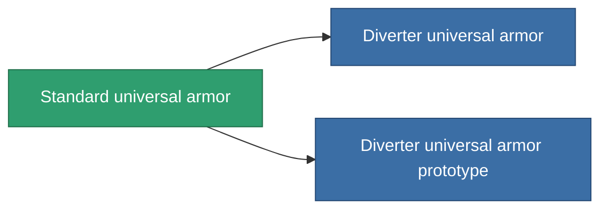

<!-- Generated by tools/generate from the live database (source: entitydefaults definition 951, aggregatevalues via aggregatefields).
     Do not edit by hand; regenerate instead. -->

# Standard universal armor

|  |  |
|---|---|
| Définition | `def_standard_resistant_plating` |
| Niveau | T1 |
| Points de vie | 100 |
| Volume | 1.5 |
| Masse | 250 |
| Catégorie | Modules / Enhancements |
| Tier line | **Standard universal armor** (T1) → [Diverter universal armor](/fr/content/items/named1-resistant-plating/) (T2) → [UNI300pls universal armor](/fr/content/items/named2-resistant-plating/) (T3) → [Aegis UAP-10XL universal armor](/fr/content/items/named3-resistant-plating/) (T4) |

## Statistiques

| Champ | Valeur |
|---|---|
| cpu_usage | 35 |
| powergrid_usage | 10 |
| resist_chemical | 30 |
| resist_explosive | 30 |
| resist_kinetic | 30 |
| resist_thermal | 30 |

<!-- production:generated -->
## Production

**Produit à partir de 7 composants, niveau de recherche 3** — assemblez les composants pour le fabriquer (liste complète dans [Recettes](/fr/content/recipes/)):

**Plan :** [Standard universal armor CT](/content/items/standard-resistant-plating-cprg/)

<svg class="prod-card-icon" aria-hidden="true"><use href="#mi-grid"/></svg><a class="prod-card-name" href="/fr/content/items/axicol/">Cryoperine</a>

requis : <b>50</b>

<svg class="prod-card-icon" aria-hidden="true"><use href="#mi-grid"/></svg><a class="prod-card-name" href="/fr/content/items/isopropentol/">Isopropentol</a>

requis : <b>50</b>

<svg class="prod-card-icon" aria-hidden="true"><use href="#mi-grid"/></svg><a class="prod-card-name" href="/fr/content/items/metachropin/">Metachropin</a>

requis : <b>150</b>

<svg class="prod-card-icon" aria-hidden="true"><use href="#mi-grid"/></svg><a class="prod-card-name" href="/fr/content/items/plasteosine/">Plasteosine</a>

requis : <b>150</b>

<svg class="prod-card-icon" aria-hidden="true"><use href="#mi-grid"/></svg><a class="prod-card-name" href="/fr/content/items/prilumium/">Prilumium</a>

requis : <b>50</b>

<svg class="prod-card-icon" aria-hidden="true"><use href="#mi-grid"/></svg><a class="prod-card-name" href="/fr/content/items/statichnol/">Statichnol</a>

requis : <b>50</b>

<svg class="prod-card-icon" aria-hidden="true"><use href="#mi-grid"/></svg><a class="prod-card-name" href="/fr/content/items/titanium/">Titanium</a>

requis : <b>100</b>

## Utilisé en production

**Composant de 2 articles** — tout ce qui l'utilise en production :

