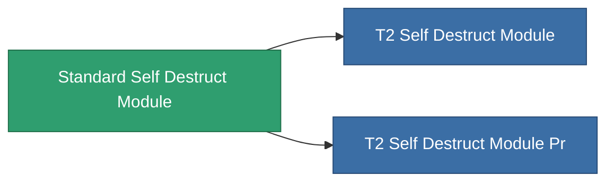

<!-- Generated by tools/generate from the live database (source: entitydefaults definition 8970, aggregatevalues via aggregatefields).
     Do not edit by hand; regenerate instead. -->

# Standard Self Destruct Module

|  |  |
|---|---|
| Définition | `def_standard_self_destruct_module` |
| Niveau | T1 |
| Points de vie | 100 |
| Volume | 100 |
| Masse | 500 |
| Catégorie | Modules / Enhancements |
| Tier line | **Standard Self Destruct Module** (T1) → [T2 Self Destruct Module](/fr/content/items/named1-self-destruct-module/) (T2) → [T3 Self Destruct Module](/fr/content/items/named2-self-destruct-module/) (T3) → [T4 Self Destruct Module](/fr/content/items/named3-self-destruct-module/) (T4) |
| Note | Kamikaze self-destruct module: arms an un-cancellable delayed detonation that kills the owner. |

## Statistiques

| Champ | Valeur |
|---|---|
| core_usage | 50 |
| cpu_usage | 40 |
| powergrid_usage | 20 |

<!-- production:generated -->
## Production

**Produit à partir de 4 composants, niveau de recherche 5** — assemblez les composants pour le fabriquer (liste complète dans [Recettes](/fr/content/recipes/)):

**Plan :** [Standard Self Destruct Module Cprg](/fr/content/items/standard-self-destruct-module-cprg/)

<svg class="prod-card-icon" aria-hidden="true"><use href="#mi-grid"/></svg><a class="prod-card-name" href="/fr/content/items/axicol/">Cryoperine</a>

requis : <b>250</b>

<svg class="prod-card-icon" aria-hidden="true"><use href="#mi-grid"/></svg><a class="prod-card-name" href="/fr/content/items/axicoline/">Axicoline</a>

requis : <b>200</b>

<svg class="prod-card-icon" aria-hidden="true"><use href="#mi-grid"/></svg><a class="prod-card-name" href="/fr/content/items/espitium/">Espitium</a>

requis : <b>200</b>

<svg class="prod-card-icon" aria-hidden="true"><use href="#mi-grid"/></svg><a class="prod-card-name" href="/fr/content/items/titanium/">Titanium</a>

requis : <b>200</b>

## Utilisé en production

**Composant de 2 articles** — tout ce qui l'utilise en production :

