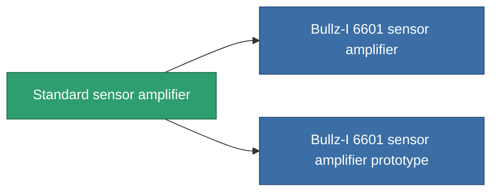

<!-- Generated by tools/generate from the live database (source: entitydefaults definition 43, aggregatevalues via aggregatefields).
     Do not edit by hand; regenerate instead. -->

# Standard sensor amplifier

|  |  |
|---|---|
| Définition | `def_standard_sensor_booster` |
| Niveau | T1 |
| Points de vie | 100 |
| Volume | 0.5 |
| Masse | 100 |
| Catégorie | Modules / Sensors & scanning |
| Tier line | **Standard sensor amplifier** (T1) → [Bullz-I 6601 sensor amplifier](/fr/content/items/named1-sensor-booster/) (T2) → [Desenspure sensor amplifier](/fr/content/items/named2-sensor-booster/) (T3) → [Ambassador SU-I sensor amplifier](/fr/content/items/named3-sensor-booster/) (T4) |

## Statistiques

| Champ | Valeur |
|---|---|
| core_usage | 10 |
| cpu_usage | 15 |
| cycle_time | 10k |
| effect_sensor_booster_locking_range_modifier | 1.35 |
| effect_sensor_booster_locking_time_modifier | 0.8 |
| powergrid_usage | 5 |

<!-- production:generated -->
## Production

**Produit à partir de 2 composants, niveau de recherche 3** — assemblez les composants pour le fabriquer (liste complète dans [Recettes](/fr/content/recipes/)):

**Plan :** [Standard sensor amplifier CT](/content/items/standard-sensor-booster-cprg/)

<svg class="prod-card-icon" aria-hidden="true"><use href="#mi-grid"/></svg><a class="prod-card-name" href="/fr/content/items/axicol/">Cryoperine</a>

requis : <b>400</b>

<svg class="prod-card-icon" aria-hidden="true"><use href="#mi-grid"/></svg><a class="prod-card-name" href="/fr/content/items/titanium/">Titanium</a>

requis : <b>50</b>

## Utilisé en production

**Composant de 2 articles** — tout ce qui l'utilise en production :

