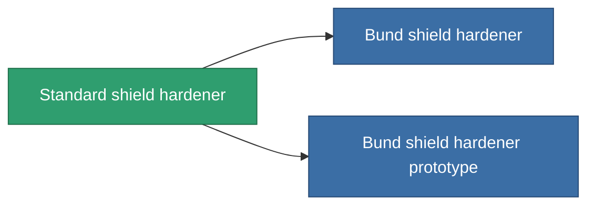

<!-- Generated by tools/generate from the live database (source: entitydefaults definition 31, aggregatevalues via aggregatefields).
     Do not edit by hand; regenerate instead. -->

# Standard shield hardener

|  |  |
|---|---|
| Définition | `def_standard_shield_hardener` |
| Niveau | T1 |
| Points de vie | 100 |
| Volume | 0.5 |
| Masse | 300 |
| Catégorie | Modules / Shield |
| Tier line | **Standard shield hardener** (T1) → [Bund shield hardener](/fr/content/items/named1-shield-hardener/) (T2) → [Patronus shield hardener](/fr/content/items/named2-shield-hardener/) (T3) → [Guardian shield hardener](/fr/content/items/named3-shield-hardener/) (T4) |
| Note | ettol a modultol tud jobban mudkodni a pajzs = kevesebb lesz a core csokkenes 5%kal |

## Statistiques

| Champ | Valeur |
|---|---|
| cpu_usage | 50 |
| powergrid_usage | 20 |
| shield_absorbtion_modifier | 1.2 |

<!-- production:generated -->
## Production

**Produit à partir de 5 composants, niveau de recherche 3** — assemblez les composants pour le fabriquer (liste complète dans [Recettes](/fr/content/recipes/)):

**Plan :** [Standard shield hardener CT](/fr/content/items/standard-shield-hardener-cprg/)

<svg class="prod-card-icon" aria-hidden="true"><use href="#mi-grid"/></svg><a class="prod-card-name" href="/fr/content/items/axicol/">Cryoperine</a>

requis : <b>200</b>

<svg class="prod-card-icon" aria-hidden="true"><use href="#mi-grid"/></svg><a class="prod-card-name" href="/fr/content/items/isopropentol/">Isopropentol</a>

requis : <b>150</b>

<svg class="prod-card-icon" aria-hidden="true"><use href="#mi-grid"/></svg><a class="prod-card-name" href="/fr/content/items/plasteosine/">Plasteosine</a>

requis : <b>150</b>

<svg class="prod-card-icon" aria-hidden="true"><use href="#mi-grid"/></svg><a class="prod-card-name" href="/fr/content/items/titanium/">Titanium</a>

requis : <b>50</b>

<svg class="prod-card-icon" aria-hidden="true"><use href="#mi-grid"/></svg><a class="prod-card-name" href="/fr/content/items/vitricyl/">Vitricyl</a>

requis : <b>200</b>

## Utilisé en production

**Composant de 2 articles** — tout ce qui l'utilise en production :

