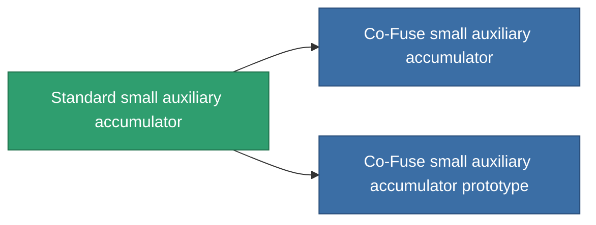

<!-- Generated by tools/generate from the live database (source: entitydefaults definition 645, aggregatevalues via aggregatefields).
     Do not edit by hand; regenerate instead. -->

# Standard small auxiliary accumulator

|  |  |
|---|---|
| Définition | `def_standard_small_core_battery` |
| Niveau | T1 |
| Points de vie | 100 |
| Volume | 0.5 |
| Masse | 100 |
| Catégorie | Modules / Power |
| Tier line | **Standard small auxiliary accumulator** (T1) → [Co-Fuse small auxiliary accumulator](/fr/content/items/named1-small-core-battery/) (T2) → [Ovostec-Ghioc small auxiliary accumulator](/fr/content/items/named2-small-core-battery/) (T3) → [Pheter Charge-S small auxiliary accumulator](/fr/content/items/named3-small-core-battery/) (T4) |

## Statistiques

| Champ | Valeur |
|---|---|
| core_max | 75 |
| cpu_usage | 35 |
| powergrid_usage | 15 |

<!-- production:generated -->
## Production

**Produit à partir de 2 composants, niveau de recherche 2** — assemblez les composants pour le fabriquer (liste complète dans [Recettes](/fr/content/recipes/)):

**Plan :** [Standard small auxiliary accumulator CT](/fr/content/items/standard-small-core-battery-cprg/)

<svg class="prod-card-icon" aria-hidden="true"><use href="#mi-grid"/></svg><a class="prod-card-name" href="/fr/content/items/axicol/">Cryoperine</a>

requis : <b>200</b>

<svg class="prod-card-icon" aria-hidden="true"><use href="#mi-grid"/></svg><a class="prod-card-name" href="/fr/content/items/titanium/">Titanium</a>

requis : <b>100</b>

## Utilisé en production

**Composant de 2 articles** — tout ce qui l'utilise en production :

