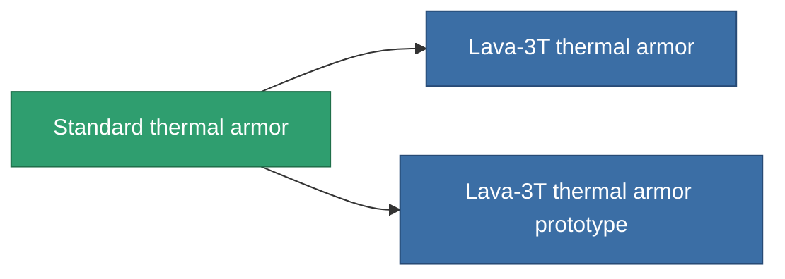

<!-- Generated by tools/generate from the live database (source: entitydefaults definition 24, aggregatevalues via aggregatefields).
     Do not edit by hand; regenerate instead. -->

# Standard thermal armor

|  |  |
|---|---|
| Définition | `def_standard_thrm_armor_hardener` |
| Niveau | T1 |
| Points de vie | 100 |
| Volume | 1 |
| Masse | 100 |
| Catégorie | Modules / Armor |
| Tier line | **Standard thermal armor** (T1) → [Lava-3T thermal armor](/fr/content/items/named1-thrm-armor-hardener/) (T2) → [Thermoflake thermal armor](/fr/content/items/named2-thrm-armor-hardener/) (T3) → [Hephaistos-TSS thermal armor](/fr/content/items/named3-thrm-armor-hardener/) (T4) |

## Statistiques

| Champ | Valeur |
|---|---|
| core_usage | 13 |
| cpu_usage | 25 |
| cycle_time | 10k |
| effect_resist_thermal | 100 |
| powergrid_usage | 5 |
| resist_thermal | 25 |

<!-- production:generated -->
## Production

**Produit à partir de 5 composants, niveau de recherche 3** — assemblez les composants pour le fabriquer (liste complète dans [Recettes](/fr/content/recipes/)):

**Plan :** [Standard thermal armor CT](/fr/content/items/standard-thrm-armor-hardener-cprg/)

<svg class="prod-card-icon" aria-hidden="true"><use href="#mi-grid"/></svg><a class="prod-card-name" href="/fr/content/items/axicol/">Cryoperine</a>

requis : <b>50</b>

<svg class="prod-card-icon" aria-hidden="true"><use href="#mi-grid"/></svg><a class="prod-card-name" href="/fr/content/items/isopropentol/">Isopropentol</a>

requis : <b>125</b>

<svg class="prod-card-icon" aria-hidden="true"><use href="#mi-grid"/></svg><a class="prod-card-name" href="/fr/content/items/plasteosine/">Plasteosine</a>

requis : <b>125</b>

<svg class="prod-card-icon" aria-hidden="true"><use href="#mi-grid"/></svg><a class="prod-card-name" href="/fr/content/items/titanium/">Titanium</a>

requis : <b>100</b>

<svg class="prod-card-icon" aria-hidden="true"><use href="#mi-grid"/></svg><a class="prod-card-name" href="/fr/content/items/vitricyl/">Vitricyl</a>

requis : <b>50</b>

## Utilisé en production

**Composant de 2 articles** — tout ce qui l'utilise en production :

