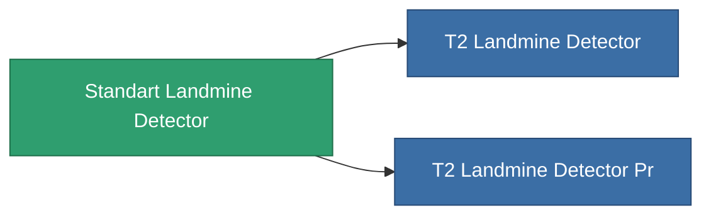

<!-- Generated by tools/generate from the live database (source: entitydefaults definition 8313, aggregatevalues via aggregatefields).
     Do not edit by hand; regenerate instead. -->

# Standart Landmine Detector

|  |  |
|---|---|
| Définition | `def_standart_landmine_detector` |
| Niveau | T1 |
| Points de vie | 100 |
| Volume | 0.5 |
| Masse | 1000 |
| Catégorie | Modules / Enhancements |

## Statistiques

| Champ | Valeur |
|---|---|
| core_usage | 14 |
| cpu_usage | 20 |
| cycle_time | 10k |
| effect_mine_detection_range_modifier | 1.3 |
| powergrid_usage | 7 |

<!-- production:generated -->
## Production

**Produit à partir de 2 composants, niveau de recherche 6** — assemblez les composants pour le fabriquer (liste complète dans [Recettes](/fr/content/recipes/)):

**Plan :** [Standart Landmine Detector Cprg](/fr/content/items/standart-landmine-detector-cprg/)

<svg class="prod-card-icon" aria-hidden="true"><use href="#mi-grid"/></svg><a class="prod-card-name" href="/fr/content/items/axicol/">Cryoperine</a>

requis : <b>400</b>

<svg class="prod-card-icon" aria-hidden="true"><use href="#mi-grid"/></svg><a class="prod-card-name" href="/fr/content/items/titanium/">Titanium</a>

requis : <b>100</b>

## Utilisé en production

**Composant de 2 articles** — tout ce qui l'utilise en production :

