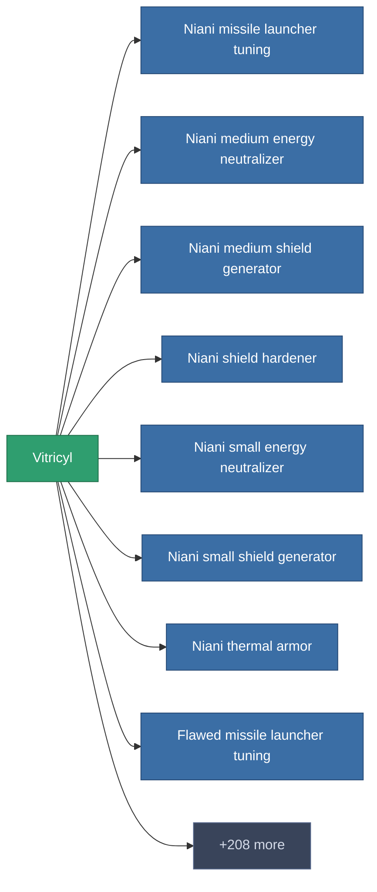

<!-- Generated by tools/generate from the live database (source: entitydefaults definition 180, aggregatevalues via aggregatefields).
     Do not edit by hand; regenerate instead. -->

# Vitricyl

|  |  |
|---|---|
| Définition | `def_vitricyl` |
| Niveau | – |
| Points de vie | 100 |
| Volume | 0 |
| Masse | 0.14 |
| Catégorie | Materials |

_Aucune statistique — cet article ne porte aucune valeur agrégée._

<!-- production:generated -->
## Production

**Produit à partir de 3 composants** — assemblez les composants pour le fabriquer (liste complète dans [Recettes](/fr/content/recipes/)):

<svg class="prod-card-icon" aria-hidden="true"><use href="#mi-grid"/></svg><a class="prod-card-name" href="/fr/content/items/crude/">HDT</a>

requis : <b>25</b>

<svg class="prod-card-icon" aria-hidden="true"><use href="#mi-grid"/></svg><a class="prod-card-name" href="/fr/content/items/helioptris/">Helioptris</a>

requis : <b>30</b>

<svg class="prod-card-icon" aria-hidden="true"><use href="#mi-grid"/></svg><a class="prod-card-name" href="/fr/content/ores/silgium/">Silgium</a>

requis : <b>50</b>

## Utilisé en production

**Composant de 216 articles** — un aperçu de ce qui peut être produit avec (liste complète dans [Recettes](/fr/content/recipes/)).

