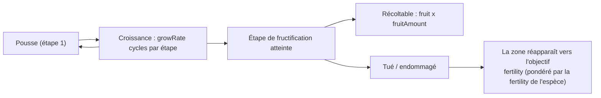

<!-- Generated by tools/generate from the live database (source: plantrules + $GameRoot/plantrules/*.txt (rule files), zones, entitydefaults (fruit names)).
     Do not edit by hand; regenerate instead. -->

# Plantes

Les plantes poussent avec le temps à travers une séquence de stades ; une plante produit (est récoltable) seulement quand elle atteint son stade de fructification. La zone maintient les populations végétales vers un **objectif de fertilité** par aire ; `spreading` oriente la nouvelle pousse vers les amas existants du même type. La référence complète des champs — types, valeurs par défaut, l'automate de croissance et le format du fichier de règles — est dans [Plant fields](/fr/formats/plant-fields/).

Signification des champs : **growRate** = cycles de croissance qu'une plante passe à chaque stade avant d'avancer (plus haut = plus lent) ; **fertility** = à quel point la zone tente de maintenir cette espèce présente ; **spreading** = préférence pour pousser en groupes ; **killDistance** = espacement minimal entre deux plantes du même type (−1 = aucun) ;

## Plantes récoltables

Espèces ayant un stade de fructification — le fruit est le rendement récoltable (× = fruitAmount par stade de fructification).

| Plante | Taux de croissance | Fertilité | Propagation | Portée d'abattage | Pente max | Bande d'altitude | Bande d'eau | Fruit (rendement) | Quantité max | Santé (stades) | Semée par un joueur |
|---|---|---|---|---|---|---|---|---|---|---|---|
| electroplant | 0 | 3 | 2 | -1 | 10 | 0–8076 | -6–8076 | Noralgis (×125) | 630 | 10,50,125,255,255,255 | Oui |
| electroplant | 0 | 3 | 2 | -1 | 10 | 0–8076 | -6–8076 | Noralgis (×175) | 630 | 10,50,125,255,255,255 | Oui |
| electroplant | 3 | 1 | 0 | -1 | 10 | 0–8076 | -6–8076 | Noralgis (×125) | 630 | 10,50,125,255,255,255 | Non |
| electroplant | 3 | 1 | 0 | -1 | 10 | 0–8076 | -6–8076 | Noralgis (×200) | 630 | 10,50,125,255,255,255 | Non |
| electroplant | 0 | 3 | 2 | -1 | 10 | 0–8076 | -6–8076 | Noralgis (×100) | 630 | 10,50,125,255,255,255 | Oui |
| electroplant | 0 | 3 | 2 | -1 | 10 | 0–8076 | -6–8076 | Noralgis (×100) | 630 | 10,50,125,255,255,255 | Oui |
| irontree | 1 | 4 | 2 | -1 | 14 | 0–8480 | 15–8048 | Prismocitae (×75) | 20 | 50,125,255,255 | Non |
| irontree | 1 | 4 | 2 | -1 | 14 | 0–8480 | 15–8048 | Prismocitae (×150) | 20 | 50,125,255,255 | Non |
| irontree | 1 | 4 | 2 | -1 | 14 | 0–8480 | 15–8048 | Prismocitae (×75) | 20 | 50,125,255,255 | Oui |
| irontree | 1 | 4 | 2 | -1 | 14 | 0–8480 | 15–8048 | Prismocitae (×50) | 20 | 50,125,255,255 | Oui |
| irontree | 1 | 4 | 2 | -1 | 14 | 0–8480 | 15–8048 | Prismocitae (×50) | 20 | 50,125,255,255 | Oui |
| irontree | 1 | 4 | 2 | -1 | 14 | 0–8480 | 15–8048 | Prismocitae (×200) | 20 | 50,125,255,255 | Non |
| irontree | 1 | 4 | 2 | -1 | 14 | 0–8480 | 15–8048 | Prismocitae (×150) | 20 | 50,125,255,255 | Non |
| irontree | 1 | 4 | 2 | -1 | 14 | 0–8480 | 15–8048 | Prismocitae (×125) | 20 | 50,125,255,255 | Non |
| irontree | 1 | 4 | 2 | -1 | 14 | 0–8480 | 15–8048 | Prismocitae (×100) | 20 | 50,125,255,255 | Non |
| rustbush | 3 | 4 | 3 | -1 | 7 | 12–8420 | 20–8048 | Helioptris (×50) | 30 | 50,125,255,255 | Non |
| rustbush | 3 | 4 | 3 | -1 | 7 | 12–8420 | 20–8048 | Helioptris (×100) | 30 | 50,125,255,255 | Non |
| rustbush | 3 | 4 | 3 | -1 | 7 | 12–8420 | 20–8048 | Helioptris (×200) | 30 | 50,125,255,255 | Non |
| rustbush | 3 | 4 | 3 | -1 | 7 | 12–8420 | 20–8048 | Helioptris (×150) | 30 | 50,125,255,255 | Non |
| rustbush | 3 | 4 | 3 | -1 | 7 | 12–8420 | 20–8048 | Helioptris (×125) | 30 | 50,125,255,255 | Non |
| rustbush | 3 | 4 | 3 | -1 | 7 | 12–8420 | 20–8048 | Helioptris (×100) | 30 | 50,125,255,255 | Non |
| rustbush | 3 | 4 | 3 | -1 | 7 | 12–8420 | 20–8048 | Helioptris (×75) | 30 | 50,125,255,255 | Oui |
| rustbush | 3 | 4 | 3 | -1 | 7 | 12–8420 | 20–8048 | Helioptris (×50) | 30 | 50,125,255,255 | Oui |
| rustbush | 3 | 4 | 3 | -1 | 7 | 12–8420 | 20–8048 | Helioptris (×50) | 30 | 50,125,255,255 | Oui |
| slimeroot | 3 | 4 | 3 | -1 | 12 | 15–8480 | 20–8048 | Triandlus (×50) | 30 | 50,125,255,255 | Non |
| slimeroot | 3 | 4 | 3 | -1 | 12 | 15–8480 | 20–8048 | Triandlus (×100) | 30 | 50,125,255,255 | Non |
| slimeroot | 3 | 4 | 3 | -1 | 12 | 15–8480 | 20–8048 | Triandlus (×200) | 30 | 50,125,255,255 | Non |
| slimeroot | 3 | 4 | 3 | -1 | 12 | 15–8480 | 20–8048 | Triandlus (×150) | 30 | 50,125,255,255 | Non |
| slimeroot | 3 | 4 | 3 | -1 | 12 | 15–8480 | 20–8048 | Triandlus (×125) | 30 | 50,125,255,255 | Non |
| slimeroot | 3 | 4 | 3 | -1 | 12 | 15–8480 | 20–8048 | Triandlus (×100) | 30 | 50,125,255,255 | Non |
| slimeroot | 3 | 4 | 3 | -1 | 12 | 15–8480 | 20–8048 | Triandlus (×75) | 30 | 50,125,255,255 | Oui |
| slimeroot | 3 | 4 | 3 | -1 | 12 | 15–8480 | 20–8048 | Triandlus (×50) | 30 | 50,125,255,255 | Oui |
| slimeroot | 3 | 4 | 3 | -1 | 12 | 15–8480 | 20–8048 | Triandlus (×50) | 30 | 50,125,255,255 | Oui |

## Plantes de décor (non récoltables)

Espèces sans stade de fructification — uniquement du décor de zone (couverture, repères, blocage).

| Plante | Taux de croissance | Fertilité | Propagation | Portée d'abattage | Pente max | Bande d'altitude | Bande d'eau | Quantité max | Santé (stades) | Semée par un joueur |
|---|---|---|---|---|---|---|---|---|---|---|
| bonsai | 2 | 1 | 4 | -1 | 18 | 0–8480 | 7–8048 | 15 | 50,125,255,255 | Non |
| bush_a | 1 | 1 | 2 | -1 | 7 | 28–8480 | 8–8048 | 190 | 5,5,5,5 | Non |
| bush_b | 1 | 1 | 2 | -1 | 7 | 27–8480 | 7–8048 | 190 | 5,5,5,5 | Non |
| coppertree | 2 | 1 | 5 | -1 | 6 | 0–8480 | 8–8048 | 15 | 50,125,255,255 | Non |
| devrinol | 5 | 3 | 0 | 0 | 40 | 0–8076 | -6–8076 | 14630 | 250,250,250,250 | Oui |
| grass_a | 1 | 1 | 2 | -1 | 6 | 15–8480 | 6–8048 | 190 | 5,5,5,5 | Non |
| grass_b | 1 | 1 | 2 | -1 | 6 | 14–8480 | 7–2048 | 190 | 5,5,5,5 | Non |
| nanowheat | 1 | 2 | 3 | -1 | 9 | 12–8480 | 8–8048 | -1 | 5,5,5,5 | Non |
| pinetree | 3 | 3 | 3 | -1 | 9 | 0–8048 | 20–8048 | 18 | 50,125,255,255 | Non |
| poffeteg | 2 | 1 | 4 | -1 | 16 | 0–8480 | 5–8048 | 15 | 50,125,255,255 | Non |
| quag | 3 | 3 | 4 | 5 | 19 | 0–76 | 6–76 | 50 | 50,125,255,255 | Non |
| rango | 8 | 6 | 2 | 7 | 19 | 55–8480 | 10–8048 | 14 | 50,125,255,255 | Non |
| rango | 8 | 6 | 2 | 7 | 19 | 15–8480 | 10–8048 | 14 | 50,125,255,255 | Non |
| reed | 1 | 1 | 1 | -1 | 21 | 0–170 | -1–7 | 60 | 5,5,5,5 | Non |
| titanplant | 2 | 1 | 5 | -1 | 19 | 0–8480 | 20–8048 | 15 | 50,125,255,255 | Non |
| wall | 1 | 1 | 5 | -1 | 68 | 0–58000 | -5–58000 | 15 | 20,60,80,120,160,200,230,230,230,255,255,255 | Oui |

## Zones

Fertilité par zone (à quel point le sol est maintenu couvert de plantes), l'ensemble de règles végétales de la zone et l'échelle d'altitude.

| Zone | Type | Protégée | Fertilité | Règles des plantes | Échelle d'altitude | Activé |
|---|---|---|---|---|---|---|
| New Virginia | 1 | Oui | 20 | 0 | 1 | Oui |
| Attalica | 1 | Oui | 20 | 1 | 1 | Oui |
| Daoden | 2 | Non | 20 | 2 | 1 | Oui |
| Domhalarn | 2 | Non | 20 | 3 | 1 | Oui |
| Hokkogaros | 2 | Non | 20 | 4 | 1 | Oui |
| Norhoop | 2 | Non | 20 | 5 | 1 | Oui |
| Tellesis | 1 | Oui | 20 | 6 | 1 | Oui |
| Shinjalar | 1 | Oui | 20 | 7 | 1 | Oui |
| Hershfield | 1 | Oui | 20 | 0 | 1 | Oui |
| Kentagura | 2 | Non | 20 | 4 | 1 | Oui |
| Alsbale | 2 | Non | 20 | 5 | 1 | Oui |
| Novastrov | 2 | Non | 20 | 3 | 1 | Oui |
| Omega | 4 | Oui | 20 | 70 | 1 | Oui |
| Davis Barrier | 2 | Non | 20 | 5 | 1 | Non |
| Gravehills | 2 | Non | 20 | 5 | 1 | Non |
| Emperth | 2 | Non | 20 | 5 | 1 | Non |
| Guthraw | 2 | Non | 20 | 5 | 1 | Non |
| Landers Bridge | 2 | Non | 20 | 5 | 1 | Non |
| Solarfield | 2 | Non | 20 | 5 | 0.3 | Non |
| Blackpoint | 2 | Non | 20 | 5 | 1 | Non |
| Greensward | 2 | Non | 20 | 5 | 1 | Non |
| Novaya Trava | 2 | Non | 20 | 3 | 1 | Non |
| Neuhorn | 2 | Non | 20 | 3 | 1 | Non |
| Kraslovsk | 2 | Non | 20 | 3 | 0.3 | Non |
| Langruhm | 2 | Non | 20 | 3 | 1 | Non |
| Berger's Island | 2 | Non | 20 | 3 | 1 | Non |
| Clandrais | 2 | Non | 20 | 3 | 1 | Non |
| Bleumon | 2 | Non | 20 | 3 | 1 | Non |
| Chalydor | 2 | Non | 20 | 3 | 1 | Non |
| Rhaoshan | 2 | Non | 20 | 4 | 0.3 | Non |
| Changowa | 2 | Non | 20 | 4 | 1 | Non |
| Mhenosha | 2 | Non | 20 | 4 | 1 | Non |
| Xiantor | 2 | Non | 20 | 4 | 1 | Non |
| Nirayon | 2 | Non | 20 | 4 | 1 | Non |
| Shuzhon | 2 | Non | 20 | 4 | 1 | Non |
| Imidero | 2 | Non | 20 | 4 | 1 | Non |
| Yuraion Ro | 2 | Non | 20 | 4 | 1 | Non |
| Virtual Training Grounds | 3 | Oui | 20 | 0 | 1 | Oui |
| New Virginia | 3 | Oui | 20 | 0 | 1 | Oui |
| New Virginia | 3 | Oui | 20 | 0 | 1 | Oui |
| zone_strghld_70 | 4 | Oui | 20 | 70 | 1 | Oui |
| zone_strghld_71 | 4 | Oui | 20 | 71 | 1 | Oui |
| zone_strghld_72 | 4 | Oui | 20 | 72 | 1 | Oui |
| zone_gamma_tc_z100 | 2 | Non | 15 | 14 | 1 | Oui |
| zone_gamma_tc_z101 | 2 | Non | 15 | 14 | 1 | Oui |
| zone_gamma_tc_z102 | 2 | Non | 15 | 34 | 1 | Oui |
| zone_gamma_tc_z103 | 2 | Non | 15 | 34 | 1 | Oui |
| zone_gamma_tc_z104 | 2 | Non | 15 | 24 | 1 | Oui |
| zone_gamma_tc_z105 | 2 | Non | 15 | 24 | 1 | Oui |
| zone_gamma_z106 | 2 | Non | 15 | 22 | 1 | Oui |
| zone_gamma_z107 | 2 | Non | 15 | 33 | 1 | Oui |
| zone_gamma_z108 | 2 | Non | 15 | 32 | 1 | Oui |
| zone_gamma_z109 | 2 | Non | 15 | 31 | 1 | Oui |
| zone_gamma_z110 | 2 | Non | 15 | 20 | 1 | Oui |
| zone_gamma_z111 | 2 | Non | 15 | 21 | 1 | Oui |
| zone_gamma_z112 | 2 | Non | 15 | 21 | 1 | Oui |
| zone_gamma_z113 | 2 | Non | 15 | 11 | 1 | Oui |
| zone_gamma_z114 | 2 | Non | 15 | 10 | 1 | Oui |
| zone_gamma_z115 | 2 | Non | 15 | 11 | 1 | Oui |
| zone_gamma_z116 | 2 | Non | 15 | 31 | 1 | Oui |
| zone_gamma_z117 | 2 | Non | 15 | 31 | 1 | Oui |
| zone_gamma_z118 | 2 | Non | 15 | 32 | 1 | Oui |
| zone_gamma_z119 | 2 | Non | 15 | 30 | 1 | Oui |
| zone_gamma_z120 | 2 | Non | 15 | 31 | 1 | Oui |
| zone_gamma_z121 | 2 | Non | 15 | 12 | 1 | Oui |
| zone_gamma_z122 | 2 | Non | 15 | 13 | 1 | Oui |
| zone_gamma_z123 | 2 | Non | 15 | 12 | 1 | Oui |
| zone_gamma_z124 | 2 | Non | 15 | 12 | 1 | Oui |
| zone_gamma_z125 | 2 | Non | 15 | 11 | 1 | Oui |
| zone_gamma_z126 | 2 | Non | 15 | 12 | 1 | Oui |
| zone_gamma_z127 | 2 | Non | 15 | 12 | 1 | Oui |
| zone_gamma_z128 | 2 | Non | 15 | 23 | 1 | Oui |
| zone_gamma_z129 | 2 | Non | 15 | 22 | 1 | Oui |
| zone_gamma_z130 | 2 | Non | 15 | 21 | 1 | Oui |
| zone_gamma_z131 | 2 | Non | 15 | 20 | 1 | Oui |
| zone_gamma_z132 | 2 | Non | 15 | 21 | 1 | Oui |
| zone_gamma_z133 | 2 | Non | 15 | 22 | 1 | Oui |
| zone_gamma_z134 | 2 | Non | 15 | 23 | 1 | Oui |
| zone_gamma_z135 | 2 | Non | 15 | 22 | 1 | Oui |
| zone_gamma_z136 | 2 | Non | 15 | 22 | 1 | Oui |
| zone_gamma_z137 | 2 | Non | 15 | 31 | 1 | Oui |
| zone_gamma_z138 | 2 | Non | 15 | 32 | 1 | Oui |
| zone_gamma_z139 | 2 | Non | 15 | 32 | 1 | Oui |
| zone_gamma_z140 | 2 | Non | 15 | 33 | 1 | Oui |

## Règles → espèces

| Règles | Zones | Espèces |
|---|---|---|
| 0 | New Virginia, Hershfield, Virtual Training Grounds | grass_a, grass_b, pinetree, bush_a, bush_b, rango, coppertree, reed, nanowheat, rustbush_lo, slimeroot_lo, quag, electroplant_lo, bonsai, irontree_lo |
| 1 | Attalica | bonsai, bush_a, bush_b, coppertree, grass_a, grass_b, nanowheat, pinetree, quag, rango, reed, devrinol, electroplant_hi, rustbush_hi, slimeroot_hi |
| 2 | Daoden | bonsai, bush_a, bush_b, coppertree, devrinol, electroplant_hi, grass_a, grass_b, irontree_hi, nanowheat, pinetree, poffeteg, quag, rango, reed, rustbush_hi, slimeroot_hi, titanplant, wall |
| 3 | Domhalarn, Novastrov, Novaya Trava, Neuhorn, Kraslovsk, Langruhm, Berger's Island, Clandrais, Bleumon, Chalydor | bush_a, bush_b, coppertree, electroplant_hi, grass_a, grass_b, irontree_hi, nanowheat, pinetree, quag, rango, reed, rustbush_hi, titanplant, wall, devrinol, electroplant_lo_beta |
| 4 | Hokkogaros, Kentagura, Rhaoshan, Changowa, Mhenosha, Xiantor, Nirayon, Shuzhon, Imidero, Yuraion Ro | poffeteg, bush_a, bush_b, coppertree, electroplant_hi, grass_a, grass_b, irontree_hi, nanowheat, pinetree, quag, rango, reed, slimeroot_hi, wall, devrinol, electroplant_lo_beta |
| 5 | Norhoop, Alsbale, Davis Barrier, Gravehills, Emperth, Guthraw, Landers Bridge, Solarfield, Blackpoint, Greensward | bonsai, bush_a, bush_b, coppertree, electroplant_hi, grass_a, grass_b, nanowheat, pinetree, quag, rango, reed, rustbush_hi, slimeroot_hi, wall, devrinol, electroplant_lo_beta |
| 6 | Tellesis | bush_a, bush_b, coppertree, grass_a, grass_b, pinetree, quag, rango, reed, titanplant, nanowheat, irontree_hi, electroplant_hi, rustbush_hi |
| 7 | Shinjalar | bush_a, bush_b, coppertree, grass_a, grass_b, nanowheat, pinetree, quag, rango, reed, poffeteg, electroplant_hi, irontree_hi, slimeroot_hi |
| 8 | – | bonsai, bush_a, bush_b, coppertree, devrinol, electroplant_hi, grass_a, grass_b, irontree_hi, nanowheat, pinetree, poffeteg, quag, rango, reed, rustbush_hi, slimeroot_hi, titanplant, wall |
| 10 | zone_gamma_z114 | electroplant_t0, slimeroot_t0, rustbush_t0, bush_a, bush_b, coppertree, devrinol, grass_a, grass_b, nanowheat, pinetree, poffeteg, quag, rango, reed |
| 11 | zone_gamma_z113, zone_gamma_z115, zone_gamma_z125 | slimeroot_t1, rustbush_t1, electroplant_seeded_t1, irontree_seeded_t1, bush_a, bush_b, coppertree, devrinol, grass_a, grass_b, nanowheat, pinetree, poffeteg, quag, rango, reed, wall |
| 12 | zone_gamma_z121, zone_gamma_z123, zone_gamma_z124, zone_gamma_z126, zone_gamma_z127 | slimeroot_t2, rustbush_t2, electroplant_seeded_t2, irontree_seeded_t2, bush_a, bush_b, coppertree, devrinol, grass_a, grass_b, nanowheat, pinetree, poffeteg, quag, rango, reed, wall |
| 13 | zone_gamma_z122 | slimeroot_t3, rustbush_t3, irontree_seeded_t3, bush_a, bush_b, coppertree, devrinol, grass_a, grass_b, nanowheat, pinetree, poffeteg, quag, rango, reed, wall |
| 14 | zone_gamma_tc_z100, zone_gamma_tc_z101 | bush_a, bush_b, coppertree, devrinol, grass_a, grass_b, nanowheat, pinetree, poffeteg, quag, rango, reed |
| 20 | zone_gamma_z110, zone_gamma_z131 | electroplant_t0, irontree_t0, rustbush_t0, bush_a, bush_b, coppertree, devrinol, grass_a, grass_b, nanowheat, pinetree, poffeteg, quag, rango, reed |
| 21 | zone_gamma_z111, zone_gamma_z112, zone_gamma_z130, zone_gamma_z132 | irontree_t1, rustbush_t1, electroplant_seeded_t1, slimeroot_seeded_t1, bush_a, bush_b, coppertree, devrinol, grass_a, grass_b, nanowheat, pinetree, poffeteg, quag, rango, reed, wall |
| 22 | zone_gamma_z106, zone_gamma_z129, zone_gamma_z133, zone_gamma_z135, zone_gamma_z136 | irontree_t2, rustbush_t2, electroplant_seeded_t2, slimeroot_seeded_t2, bush_a, bush_b, coppertree, devrinol, grass_a, grass_b, nanowheat, pinetree, poffeteg, quag, rango, reed, wall |
| 23 | zone_gamma_z128, zone_gamma_z134 | irontree_t3, rustbush_t3, slimeroot_seeded_t3, bush_a, bush_b, coppertree, devrinol, grass_a, grass_b, nanowheat, pinetree, poffeteg, quag, rango, reed, wall |
| 24 | zone_gamma_tc_z104, zone_gamma_tc_z105 | bush_a, bush_b, coppertree, devrinol, grass_a, grass_b, nanowheat, pinetree, poffeteg, quag, rango, reed |
| 30 | zone_gamma_z119 | electroplant_t0, irontree_t0, slimeroot_t0, bush_a, bush_b, coppertree, devrinol, grass_a, grass_b, nanowheat, pinetree, poffeteg, quag, rango, reed |
| 31 | zone_gamma_z109, zone_gamma_z116, zone_gamma_z117, zone_gamma_z120, zone_gamma_z137 | irontree_t1, slimeroot_t1, electroplant_seeded_t1, rustbush_seeded_t1, bush_a, bush_b, coppertree, devrinol, grass_a, grass_b, nanowheat, pinetree, poffeteg, quag, rango, reed, wall |
| 32 | zone_gamma_z108, zone_gamma_z118, zone_gamma_z138, zone_gamma_z139 | irontree_t2, slimeroot_t2, electroplant_seeded_t2, rustbush_seeded_t2, bush_a, bush_b, coppertree, devrinol, grass_a, grass_b, nanowheat, pinetree, poffeteg, quag, rango, reed, wall |
| 33 | zone_gamma_z107, zone_gamma_z140 | irontree_t3, slimeroot_t3, rustbush_seeded_t3, bush_a, bush_b, coppertree, devrinol, grass_a, grass_b, nanowheat, pinetree, poffeteg, quag, rango, reed, wall |
| 34 | zone_gamma_tc_z102, zone_gamma_tc_z103 | bush_a, bush_b, coppertree, devrinol, grass_a, grass_b, nanowheat, pinetree, poffeteg, quag, rango, reed |
| 70 | Omega, zone_strghld_70 | bush_a, bush_b, coppertree, grass_a, grass_b, nanowheat, pinetree, quag, rango_lowaltitude, titanplant |
| 71 | zone_strghld_71 | bush_a, bush_b, coppertree, grass_a, grass_b, nanowheat, pinetree, quag, rango_lowaltitude, titanplant |
| 72 | zone_strghld_72 | bush_a, bush_b, coppertree, grass_a, grass_b, nanowheat, pinetree, quag, rango_lowaltitude, titanplant |
