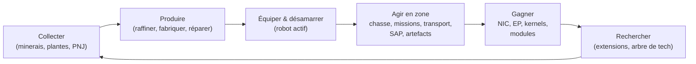

# Ce que l'on peut faire dans le jeu

Toutes les actions du joueur, organisées par système. Le nom de commande est
l'identifiant côté serveur — le client présente ces actions dans sa propre
interface. Le texte par action se trouve sur les pages par système.

Le jeu en une boucle : gagnez et dépensez pour gravir l'échelle des paliers.

## Systèmes

| Système | Page | Ce qu'il couvre |
|---|---|---|
| Premiers pas | [getting-started](/fr/features/getting-started/) | création/sélection de personnages, premier robot, bases du compte |
| Déplacements | [movement](/fr/features/movement/) | zones, amarrage, file d'attente, téléports, sauts de spark, portes |
| Collecte | [gathering](/fr/features/gathering/) | scan, récolte, collecte de ressources |
| Combat | [combat](/fr/features/combat/) | combats, types de dégâts, brouillage, alarmes, rapports de kill, SOS |
| PNJ & chasse PVE | [npcs](/fr/features/npcs/) | rangs & factions de PNJ, faiblesses, types d'apparition, TAP, tactiques |
| Exploration | [exploration](/fr/features/exploration/) | artefacts et reliques |
| Robots & équipement | [robots](/fr/features/robots/) | sélection de robots, modules, munitions, préréglages, teintes |
| Modules & équipement | [modules](/fr/features/modules/) | les familles de modules et les règles de base d'équipement |
| Sparks | [sparks](/fr/features/sparks/) | autorisation de sparks, commutation, bonus de capacités |
| Recherche | [research](/fr/features/research/) | extensions (arbre de compétences), EP, arbre de tech |
| Personnage | [character](/fr/features/character/) | la fenêtre de personnage : onglet extensions (arbre de compétences) et sparks |
| Production | [production](/fr/features/production/) | lignes de production, raffinage, réparation, retransformation, prototypes, CPRG |
| Marché & commerce | [market](/fr/features/market/) | ordres de marché, échanges directs, boutique d'objets, crédits |
| Groupes | [groups](/fr/features/groups/) | corporations, alliances, gangs (flottes) |
| Stations de base puissantes | [pbs](/fr/features/pbs/) | structures PBS, territoires, connexions |
| Missions | [missions](/fr/features/missions/) | missions de terrain, agents, terminaux |
| Transport | [transport](/fr/features/transport/) | expédition d'objets entre bases |
| Objets & inventaire | [items](/fr/features/items/) | conteneurs, empilement, noms d'objets, objets échangeables, packs bonus |
| Social | [social](/fr/features/social/) | messagerie, canaux, amis, standings, annuaire, nouvelles, sondages |
| Intrusion | [intrusion](/fr/features/intrusion/) | le mode d'assaut de sites PNJ |
| Posts avancés & SAP | [outposts](/fr/features/outposts/) | possession des posts, stabilité, les quatre types de SAP |
| Probes de proximité | [probes](/fr/features/probes/) | probes de surveillance de zone |
| Serveur & référence | [server](/fr/features/server/) | infos serveur, classements, données de référence, achats |
| FAQ | [faq](/fr/features/faq/) | le tutoriel, le choix de faction, premiers pas, le jargon |
| Lore | [lore](/fr/features/lore/) | le décor : Nia, les Nians, le Syndicat |
| Client & configuration PC | [client-setup](/fr/features/client-setup/) | lancer le client, multi-boxing, échelle de l'interface |

### Référence

| Page | Ce qu'il couvre |
|---|---|
| [Aperçu de l'interface client](/fr/features/ui/) | L'interface style EVE : barre du haut, bouton Déployer/Amarrer, catégories d'actions, panneau de statut désamarré, et les conventions utilisées dans ce wiki |

Les tableaux de statistiques des entités se trouvent dans la section générée
[Contenu](/content/).

## Inventaire d'actions complet

### Premiers pas & compte

| Action | Commande |
|---|---|
| Créer un personnage | `characterCreate` |
| Sélectionner (jouer) un personnage | `characterSelect` |
| Supprimer un personnage | `characterDelete` |
| Renommer un personnage | `characterRename` |
| Vérifier si un nom est disponible | `characterCheckNick` |
| Demander le robot de départ | `requestStarterRobot` |
| Demander la boîte de départ | `requestInfiniteBox` |
| Données de configuration du nouveau personnage | `characterWizardData` |
| Voir mon profil | `characterGetMyProfile` |
| Voir les profils d'autres personnages | `characterGetProfiles` |
| Rechercher des personnages | `characterSearch` |
| Lister les personnages | `characterList` |
| Lire/écrire les réglages d'un personnage | `characterSettingsGet`, `characterSettingsSet` |
| Définir l'avatar | `characterSetAvatar` |
| Définir le message d'humeur | `characterSetMoodmessage` |
| Mettre une note privée sur un personnage | `characterSetNote` / `characterGetNote` |
| Définir / effacer la base principale | `characterSetHomeBase`, `characterClearHomeBase` |
| Transférer des crédits entre ses personnages | `characterTransferCredit` |
| Bloquer/autoriser le commerce sur un personnage | `characterSetBlockTrades` |
| Changer l'e-mail / le mot de passe du compte | `changeSessionEmail`, `changeSessionPassword` |
| Voir l'historique des EP par activité | `accountEpForActivityHistory` |
| Voir l'historique des transactions du compte | `accountGetTransactionHistory` |
| Se déconnecter / entretien de la connexion | `signOut`, `connectionStart`, `connectionEnd`, `ping`, `quit`, `isOnline`, `transferData`, `welcome` |
| Qui est en ligne | `getCharactersOnline`, `getAccountsWithCharacters` |
| Historiques de personnage | `characterNickHistory`, `characterCorporationHistory`, `characterTransactionHistory`, `characterListNpcDeath` |

### Déplacements & zones

| Action | Commande |
|---|---|
| S'amarrer à une base / PBS | `dock` |
| Désamarrer | `undock` |
| Amarrage forcé (urgence) | `forceDock` |
| Vérifier la file d'entrée de zone | `zoneGetQueueInfo` |
| Définir la préférence de longueur de file | `zoneSetQueueLength` |
| Annuler l'attente dans la file | `zoneCancelEnterQueue` |
| Obtenir les infos de zone | `getZoneInfo` |
| Lister les secteurs d'une zone | `zoneSectorList` |
| Lister les bâtiments de zone | `zoneGetBuildings` |
| Envoyer un SOS (appel à l'aide) | `zoneSOS` |
| Lister les téléports disponibles | `teleportList` |
| Utiliser un téléport | `teleportUse` |
| Téléporter vers un objet de zone | `teleportToZoneObject` |
| Lister les canaux de téléport | `teleportGetChannelList` |
| Interroger les canaux de téléport mondiaux | `teleportQueryWorldChannels` |
| Lister les charges de spark | `sparkList` |
| Changer de spark actif | `sparkChange` |
| Retirer un spark | `sparkRemove` |
| Déverrouiller un spark | `sparkUnlock` |
| Lister / définir / utiliser / supprimer les téléports de spark | `sparkTeleportList`, `sparkTeleportSet`, `sparkTeleportUse`, `sparkTeleportDelete` |
| Renommer une porte | `gateSetName` |
| Infos de base / propriété / installations / mes objets à la base | `baseGetInfo`, `baseGetOwnershipInfo`, `baseListFacilities`, `baseGetMyItems` |
| Définir les droits d'amarrage d'une base | `baseSetDockingRights` |

### Collecte & scan

| Action | Commande |
|---|---|
| Scanner la zone (scan minerais/plantes/deployables) | `zoneUploadScanResult` |
| Lister mes résultats de scan de minerais | `mineralScanResultList` |
| Créer un objet depuis un résultat de scan | `mineralScanResultCreateItem` |
| Supprimer un résultat de scan | `mineralScanResultDelete` |
| Déplacer des résultats de scan entre conteneurs | `mineralScanResultMove` |
| Uploader des données de scan depuis un objet | `mineralScanResultUploadFromItem` |
| Compter les objets d'une zone (vérification de visibilité) | `itemCountOnZone`, `itemCount` |
| Kiosque : consulter / soumettre des objets | `kioskInfo`, `kioskSubmitItem` |
| Utiliser un objet (générique — incl. récoltables) | `useItem` |

### Combat

| Action | Commande |
|---|---|
| Activer / désactiver l'alarme de combat | `alarmStart` (la fin de l'alarme est pilotée par le serveur) |
| Voir mes rapports de kill | `getMyKillReports` |
| Voir mes classements | `getMyHighScores` |
| Voir les classements du serveur | `getHighScores` |

### Robots & équipement

| Action | Commande |
|---|---|
| Sélectionner le robot actif | `selectActiveRobot` |
| Vider un robot (tout décharger) | `robotEmpty` |
| Obtenir les infos d'un robot | `getRobotInfo` |
| Obtenir les infos d'équipement d'un robot | `getRobotFittingInfo` |
| Équiper un module | `equipModule` |
| Retirer un module | `removeModule` |
| Échanger des modules | `changeModule` |
| Équiper des munitions | `equipAmmo` |
| Échanger des munitions | `changeAmmo` |
| Retirer les munitions | `unEquipAmmo` |
| Définir la teinte d'un robot | `setRobotTint` |
| Enregistrer / lister / appliquer / supprimer des préréglages d'équipement | `fittingPresetSave`, `fittingPresetList`, `fittingPresetApply`, `fittingPresetDelete` |

### Recherche (extensions & arbre de tech)

| Action | Commande |
|---|---|
| Lister les catégories d'extensions | `extensionCategoryList` |
| Obtenir toutes les extensions | `extensionGetAll` |
| Lister les extensions apprises | `extensionLearntList` |
| Lister les prérequis | `extensionPrerequireList` |
| Acheter une extension avec des points | `extensionBuyForPoints` |
| Acheter un boost d'EP | `extensionBuyEpBoost` |
| Obtenir les points disponibles | `extensionGetAvailablePoints` |
| Obtenir les paramètres de points | `extensionGetPointParameters` |
| Historique des extensions | `extensionHistory` |
| Retirer un niveau d'extension | `extensionRemoveLevel` |
| Réinitialiser les extensions d'un personnage | `extensionResetCharacter` |
| Libérer les EP verrouillés | `extensionFreeLockedEp` |
| Voir le journal quotidien des EP par activité | `epForActivityDailyLog` |
| Obtenir les niveaux de recherche | `getResearchLevels` |
| Arbre de tech : rechercher un nœud | `techTreeResearch` |
| Arbre de tech : déverrouiller un nœud | `techTreeUnlock` |
| Arbre de tech : donner | `techTreeDonate` |
| Arbre de tech : infos / journaux | `techTreeInfo`, `techTreeGetLogs` |

### Production

| Action | Commande |
|---|---|
| Lister les lignes de production | `productionLineList` |
| Démarrer une ligne | `productionLineStart` |
| Calibrer une ligne | `productionLineCalibrate` |
| Définir le nombre de tours d'une ligne | `productionLineSetRounds` |
| Supprimer une ligne | `productionLineDelete` |
| Interroger le tour suivant d'une ligne | `productionQueryLineNextRound` |
| Annuler la production | `productionCancel` |
| Raffiner (interroger + lancer) | `productionRefine`, `productionRefineQuery` |
| Réparer (interroger + lancer) | `productionRepair`, `productionRepairQuery` |
| Retransformer (interroger + lancer) | `productionReprocess`, `productionReprocessQuery` |
| Composants de recherche (interroger + lancer) | `productionResearch`, `productionResearchQuery` |
| Prototype (démarrer + interroger) | `productionPrototypeStart`, `productionPrototypeQuery` |
| Fusionner des kits de recherche (lancer + interroger) | `productionMergeResearchKitsMulti`, `productionMergeResearchKitsMultiQuery` |
| Forger un CPRG (lancer + interroger) | `productionCPRGForge`, `productionCPRGForgeQuery` |
| Infos CPRG | `productionCPRGInfo` |
| Obtenir un CPRG d'une ligne (obtenir + interroger) | `productionGetCPRGFromLine`, `productionGetCPRGFromLineQuery` |
| Assurance production : acheter / lister / interroger / supprimer | `productionInsuranceBuy`, `productionInsuranceList`, `productionInsuranceQuery`, `productionInsuranceDelete` |
| Lister les composants de production | `productionComponentsList` |
| Infos / description d'installation | `productionFacilityInfo`, `productionFacilityDescription` |
| Ce qui est en cours (le mien / corporation) | `productionInProgress`, `productionInProgressCorporation` |
| Historique de production | `productionHistory` |
| Infos de production serveur | `productionServerInfo` |

### Marché & commerce

| Action | Commande |
|---|---|
| Créer un ordre de vente | `marketCreateSellOrder` |
| Créer un ordre d'achat | `marketCreateBuyOrder` |
| Modifier un ordre | `marketModifyOrder` |
| Annuler un objet / un ordre | `marketCancelItem` |
| Acheter un objet directement | `marketBuyItem` |
| Lister les objets du marché | `marketItemList` |
| Lister les objets disponibles pour moi | `marketAvailableItems` |
| Lister les objets d'une plage | `marketItemsInRange` |
| Lister mes objets de marché | `marketGetMyItems` |
| Infos du marché | `marketGetInfo` |
| Prix moyens (marché / définition / global) | `marketGetAveragePrices`, `marketGetDefinitionAveragePrice`, `marketGlobalAveragePrices` |
| Changer la taxe de marché / voir le journal de taxe | `marketTaxChange`, `marketTaxLogList` |
| Commencer un échange | `tradeBegin` |
| Définir / retirer mon offre | `tradeSetOffer`, `tradeRetractOffer` |
| Accepter un échange | `tradeAccept` |
| Annuler un échange | `tradeCancel` |
| Échange terminé / état | `tradeFinished`, `tradeState` |
| Boutique d'objets : lister / acheter | `itemShopList`, `itemShopBuy` |
| Transférer des crédits à un autre personnage | `characterTransferCredit` |

### Groupes (corporations, alliances, gangs)

| Action | Commande |
|---|---|
| Créer une corporation | `corporationCreate` |
| Postuler à / inviter dans une corporation | `corporationApply`, `corporationCharacterInvite` |
| Accepter une candidature / lister les candidatures | `corporationAcceptApplication`, `corporationListApplications` |
| Mes candidatures : lister / supprimer | `corporationListMyApplications`, `corporationDeleteMyApplication` |
| Supprimer une candidature (officier) | `corporationDeleteApplication` |
| Répondre à une invitation | `corporationInviteReply` |
| Quitter / annuler le départ | `corporationLeave`, `corporationCancelLeave` |
| Retirer un membre / définir le rôle d'un membre | `corporationRemoveMember`, `corporationSetMemberRole` |
| Déposer tous mes rôles | `corporationDropRoles` |
| Rendre les membres neutres | `corporationSetMembersNeutral` |
| Infos de corporation / mes infos / recherche | `corporationInfo`, `corporationGetMyInfo`, `corporationSearch` |
| Standings / réputation de corporation | `corporationGetMyStandings`, `corporationGetReputation` |
| Faire un don à / payer depuis la corporation | `corporationDonate`, `corporationPayOut` |
| Transférer des crédits de corporation | `corporationTransfer` |
| Renommer / définir la couleur / définir les infos | `corporationRename`, `corporationSetColor`, `corporationSetInfo` |
| Obtenir les délégués | `corporationGetDelegates` |
| Statut de prise de contrôle du CEO / se porter volontaire CEO | `corporationCEOTakeOverStatus`, `corporationVolunteerForCEO` |
| Votes de corporation : démarrer / définir le sujet / lister / voter / supprimer | `corporationVoteStart`, `corporationVoteSetTopic`, `corporationVoteList`, `corporationVoteCast`, `corporationVoteDelete` |
| Tableau d'affichage : démarrer / lister / nouvelles entrées / publier / modérer / supprimer | `corporationBulletinStart`, `corporationBulletinList`, `corporationBulletinNewEntries`, `corporationBulletinEntry`, `corporationBulletinModerate`, `corporationBulletinDelete`, `corporationBulletinEntryDelete`, `corporationBulletinDetails` |
| Hangar : louer / payer le loyer / prix du loyer / fermer | `corporationRentHangar`, `corporationHangarPayRent`, `corporationHangarRentPrice`, `corporationHangarClose` |
| Hangar : lister (tous / sur base) | `corporationHangarListAll`, `corporationHangarListOnBase` |
| Hangar : dossiers (créer / supprimer) | `corporationHangarFolderCreate`, `corporationHangarFolderDelete` |
| Hangar : définir l'accès / définir le nom | `corporationHangarSetAccess`, `corporationHangarSetName` |
| Journaux du hangar : lister / définir / vider | `corporationHangarLogList`, `corporationHangarLogSet`, `corporationHangarLogClear` |
| Documents de corporation : config / créer / lister / ouvrir / supprimer / transférer / louer / surveiller / désurveiller / mettre à jour le corps / liste du registre / définir le registre | `corporationDocumentConfig`, `corporationDocumentCreate`, `corporationDocumentList`, `corporationDocumentOpen`, `corporationDocumentDelete`, `corporationDocumentTransfer`, `corporationDocumentRent`, `corporationDocumentMonitor`, `corporationDocumentUnmonitor`, `corporationDocumentUpdateBody`, `corporationDocumentRegisterList`, `corporationDocumentRegisterSet` |
| Historiques : journal / rôles des membres / rôles de corporation / rôles / nom / transactions | `corporationLogHistory`, `corporationMemberRoleHistory`, `corporationRoleHistory`, `corporationNameHistory`, `corporationTransactionHistory` |
| Infos d'alliance / valeurs par défaut / historique des rôles | `allianceGetMyInfo`, `allianceGetDefaults`, `allianceRoleHistory` |
| Gang (flotte) : créer / supprimer / infos | `gangCreate`, `gangDelete`, `gangInfo` |
| Gang : inviter / répondre / expulser / quitter | `gangInvite`, `gangInviteReply`, `gangKick`, `gangLeave` |
| Gang : définir le leader / définir le rôle | `gangSetLeader`, `gangSetRole` |

### Stations de base puissantes (PBS) & territoires

| Action | Commande |
|---|---|
| Obtenir le réseau PBS | `PBSGetNetwork` |
| Infos d'un nœud PBS | `PBSNodeInfo` |
| Renommer un nœud PBS | `PBSRenameNode` |
| Créer / rompre une connexion PBS | `PBSMakeConnection`, `PBSBreakConnection` |
| Définir le poids d'une connexion | `PBSSetConnectionWeight` |
| Définir l'état en ligne d'une PBS | `PBSSetOnline` |
| Définir un effet de PBS | `PBSSetEffect` |
| Vérifier le déploiement (peux-je déployer ici ?) | `PBSCheckDeployment` |
| Lister mes territoires | `PBSGetTerritories` |
| Définir la visibilité d'un territoire | `PBSSetTerritoryVisibility` |
| Définir la limite de standing | `PBSSetStandingLimit` |
| Définir le décalage de renfort | `PBSSetReinforceOffset` |
| Obtenir / définir les infos de remboursement | `PBSGetReimburseInfo`, `PBSSetReimburseInfo` |
| Nourrir une PBS en objets | `PBSFeedableInfo`, `PBSFeedItems` |
| Définir la déconstruction de base | `PBSSetBaseDeconstruct` |
| Journaux PBS | `PBSGetLog` |

### Missions

| Action | Commande |
|---|---|
| Démarrer une mission | `missionStart` |
| Démarrer une mission depuis une zone | `missionStartFromZone` |
| Abandonner une mission | `missionAbort` |
| Livrer (livraison de mission) | `missionDeliver` |
| Données de mission / options / ravitaillement | `missionData`, `missionGetOptions`, `missionGetSupply` |
| Lister les agents de mission | `missionListAgents` |
| Lister mes missions en cours | `missionListRunning` |
| Journal de mission | `missionLogList` |
| Ajouter un participant à une mission | `missionPlayerAddsParticipant` |
| Infos du terminal de terrain | `fieldTerminalInfo` |

### Transport (expédition d'objets)

| Action | Commande |
|---|---|
| Soumettre un transport | `transportAssignmentSubmit` |
| Prendre un transport (en tant que porteur) | `transportAssignmentTake` |
| Lister les transports | `transportAssignmentList` |
| Lister le contenu d'un transport | `transportAssignmentListContent` |
| Infos du conteneur d'un transport | `transportAssignmentContainerInfo` |
| Livrer un transport | `transportAssignmentDeliver` |
| Récupérer mon transport | `transportAssignmentRetrieve` |
| Annuler / abandonner un transport | `transportAssignmentCancel`, `transportAssignmentGiveUp` |
| Un transport est-il en cours ? | `transportAssignmentRunning` |
| Journal des transports | `transportAssignmentLog` |

### Objets & inventaire

| Action | Commande |
|---|---|
| Lister un conteneur | `listContainer` |
| Emballer des objets (dans un sac/une boîte) | `packItems` |
| Déballer des objets | `unpackItems` |
| Empiler des objets ensemble | `stackItems`, `stackTo`, `stackSelection` |
| Démpiler une quantité | `unStackAmount` |
| Relocaliser des objets entre conteneurs | `relocateItems` |
| Jeter des objets | `trashItems` |
| Renommer un objet | `setItemName` |
| Utiliser un objet | `useItem` |
| Utiliser un objet de loterie | `useLotteryItem` |
| Objets échangeables : lister / échanger / activer | `redeemableItemList`, `redeemableItemRedeem`, `redeemableItemActivate` |
| Packs bonus : lister / échanger | `goodiePackList`, `goodiePackRedeem` |
| Ouvrir un cadeau | `giftOpen` |
| Rembourser un objet | `ReimburseItem` |

### Social

| Action | Commande |
|---|---|
| Messagerie : lister / ouvrir / envoyer / supprimer / compteur de nouveaux / dossiers utilisés / déplacer vers un dossier / supprimer un dossier | `mailList`, `mailOpen`, `mailSend`, `mailDelete`, `mailNewCount`, `mailUsedFolders`, `mailMoveToFolder`, `mailDeleteFolder` |
| Messagerie de masse (corporation) : envoyer / lister / ouvrir / supprimer / compteur de nouveaux | `massMailSend`, `massMailList`, `massMailOpen`, `massMailDelete`, `massMailNewCount` |
| Amis : envoyer / répondre / confirmer / supprimer / bloquer / lister | `socialFriendRequest`, `socialFriendRequestReply`, `socialConfirmPendingFriendRequest`, `socialDeleteFriend`, `socialBlockFriend`, `socialGetMyList` |
| Canaux de chat : créer / rejoindre / quitter / parler | `channelCreate`, `channelJoin`, `channelLeave`, `channelTalk` |
| Canaux : lister (tous / les miens) | `channelList`, `channelMyList`, `channelListAll` |
| Canaux : expulser / bannir / débannir / rôles / couper le micro / mot de passe / sujet / notification | `channelKick`, `channelBan`, `channelRemoveBan`, `channelModifyMemberRole`, `channelGlobalMute`, `channelGetMutedCharacters`, `channelGetBannedMembers`, `channelSetPassword`, `channelSetTopic`, `channelNotification` |
| Chat direct | `chat` |
| Standings : lister / historique | `standingList`, `standingHistory` |
| Définir le standing (là où c'est permis) | `setStanding` |
| Standings par défaut (alliances / corporations) | `getStandingForDefaultAlliances`, `getStandingForDefaultCorporations` |
| Annuaire : consulter / soumettre / supprimer / rechercher | `yellowPagesGet`, `yellowPagesSubmit`, `yellowPagesDelete`, `yellowPagesSearch` |
| Nouvelles : catégories / lister / compteur de nouvelles | `newsCategory`, `getNews`, `freshNewsCount` |
| Sondages : consulter / répondre | `pollGet`, `pollAnswer` |

### Intrusion

| Action | Commande |
|---|---|
| Soumettre un objet SAP | `intrusionSAPSubmitItem` |
| Obtenir les infos d'un objet SAP | `intrusionSAPGetItemInfo`, `intrusionSAPItemInfo` |
| Définir le seuil de défense | `intrusionSetDefenseThreshold` |
| Définir le bonus d'effet de site | `intrusionSiteSetEffectBonus` |
| Améliorer une installation | `intrusionUpgradeFacility` |
| Infos de site | `getIntrusionSiteInfo` |
| Journaux : les miens / publics / mes sites / stabilité | `getIntrusionLog`, `getIntrusionPublicLog`, `getIntrusionMySitesLog`, `getIntrusionStabilityLog` |
| Seuils de bonus de stabilité | `getStabilityBonusThresholds` |
| Définir le message de site | `setIntrusionSiteMessage` |

### Probes de proximité

| Action | Commande |
|---|---|
| Lister mes probes | `proximityProbeList` |
| Infos d'enregistrement d'une probe | `proximityProbeGetRegistrationInfo` |
| Définir l'enregistrement d'une probe | `proximityProbeRegisterSet` |
| Supprimer l'enregistrement d'une probe | `proximityProbeRemove` |
| Nommer une probe | `proximityProbeSetName` |

### Serveur & référence

| Action | Commande |
|---|---|
| Infos serveur | `serverInfoGet`, `systemInfo` |
| Classements (serveur / les miens) | `getHighScores`, `getMyHighScores` |
| Liste des failles | `getRifts` |
| Données de référence : effets / enums / valeurs par défaut des entités / champs agrégés / config de définition / distances | `getEffects`, `getEnums`, `getEntityDefaults`, `getAggregateFields`, `getDefinitionConfigUnits`, `getDistances` |
| Résumé des objets (données de référence client) | `getItemSummary` |
| Lister les commandes serveur (référence côté client) | `getCommands` |
| Boutique : lister les produits / démarrer / terminer une transaction | `steamGetProducts`, `steamStartTransaction`, `steamFinishTransaction` |
