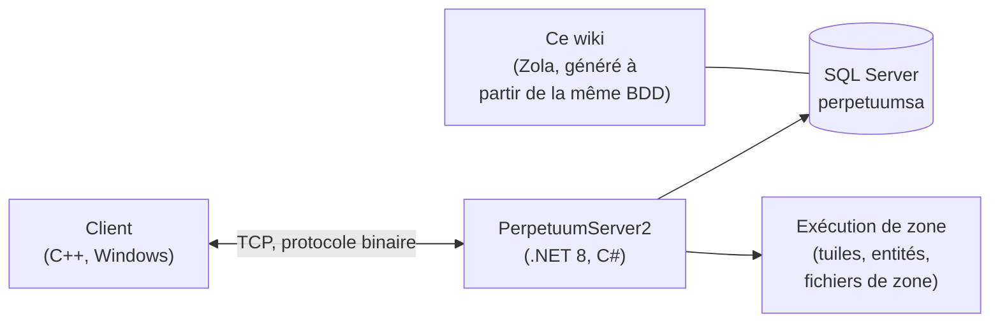

# Accueil développeur

Une vue d'ensemble du fonctionnement du jeu, du point de vue développeur et devops.
Des pages d'analyse approfondie dédiées sont en préparation — pour l'instant, ceci constitue le guide d'orientation.

## Les composants

- **Client** — le client de jeu Perpetuum (Windows ; voir [Configuration du client & PC](/fr/features/client-setup/) pour l'exécuter, y compris sous Linux). Il communique avec le serveur via un protocole binaire TCP ; chaque action du joueur est une *commande* nommée (les mêmes noms que ceux utilisés par ce wiki dans l'[inventaire des actions](/fr/features/#complete-action-inventory)).
- **Serveur (PerpetuumServer2)** — un codebase C#/.NET 8. Un processus unique exécute l'ensemble du serveur : la couche de connexion, la logique de jeu (robots, zones, missions, marché, production, recherche), et le moteur d'exécution de zone qui anime le monde de tuiles de chaque zone (terrain, entités, téléporteurs).
- **Base de données** — SQL Server, base `perpetuumsa`. Contenu statique du jeu (valeurs par défaut des entités, recettes, extensions, arbre technologique, boutique, descriptions de téléporteurs) et l'ensemble de l'état dynamique (personnages, robots, conteneurs, marché, état des zones).
- **Fichiers de zone** — les zones sont des grilles de tuiles (couches d'altitude + de contrôle, 2 octets/tuile) fournies dans des archives `.gbf` et modifiables par zone ; voir le [format des fichiers de zone](/fr/formats/zone-files/).
- **Données de référence** — le client télécharge les tables de statistiques depuis le serveur au démarrage (voir [Serveur & référence](/fr/features/server/)).

## Exécution

- Le serveur s'exécute dans Docker Compose aux côtés de SQL Server (le projet `perpetuumserver2`) ; le conteneur de base de données est celui que lit le générateur de ce wiki.
- Le contenu statique est validé par rapport aux fichiers de règles **plantrules** ; le générateur C# du wiki (`make generate`) s'exécute dans le même écosystème et lit la même base de données, ainsi chaque tableau généré sur ce site reflète les données réelles du serveur.
- Les cartes de téléportation de zone de ce wiki sont générées à partir des mêmes couches d'altitude que celles utilisées par le jeu lui-même.

## Où aller ensuite

- **[Formats](/fr/formats/)** — référence des champs développeur : comment chaque champ de statistiques est stocké (colonne BDD, clé de fichier de règles, octet de couche binaire) et consommé, avec des exemples concrets.
- **[Serveur & référence](/fr/features/server/)** — les méta-systèmes : informations sur le serveur, meilleurs scores, données de référence téléchargées par le client, et boutique en jeu.

> D'autres pages développeur (protocole, cycle de vie des zones, déploiement) sont prévues — cette page est leur point d'ancrage.
