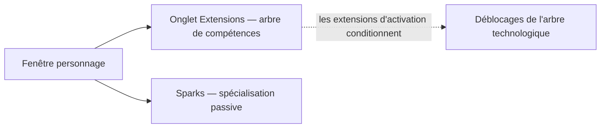

# Personnage

La **fenêtre personnage** (barre supérieure → **Personnage**, en haut à gauche) est le lieu où réside
la progression de votre personnage : profil, crédits, les **extensions** (compétences) et paramètres.
Tout ce qui se trouve sur cette page est spécifique à chaque personnage — un compte peut en posséder plusieurs,
chacun avec son propre arbre. Les emplacements d'interface suivent la [vue d'ensemble de l'interface](/fr/features/ui/).

## Extensions

L'**onglet extensions** représente l'arbre de compétences du personnage : des niveaux de compétence propres
au personnage qui débloquent des pans de gameplay et améliorent les caractéristiques — plus particulièrement les
**extensions d'activation (enablers)** requises pour piloter une classe de robot. Le niveau 1 s'achète avec des crédits,
chaque niveau suivant coûte des points d'extension (EP), et des prérequis jalonnent la progression.

- [Catégories principales](/fr/content/extensions/#categories) — les 15 catégories en un coup d'œil :
  quelles catégories débloquent lesquelles (cliquez sur une case pour accéder à ses fiches)
- [Extensions par catégorie](/fr/content/extensions/#table) — chaque extension : rang,
  prix, bonus, prérequis
- Fonctionnement des EP et de l'arbre technologique : [Recherche](/fr/features/research/)

## Sparks

Votre **spark** est la spécialisation de nanobots installée sur le personnage — tant qu'elle est active,
ses bonus s'appliquent à chaque robot que vous pilotez. Changer de spark a un coût ;
l'autorisation conditionne l'accès aux lignées supérieures. Tous les détails dans [Sparks](/fr/features/sparks/).
