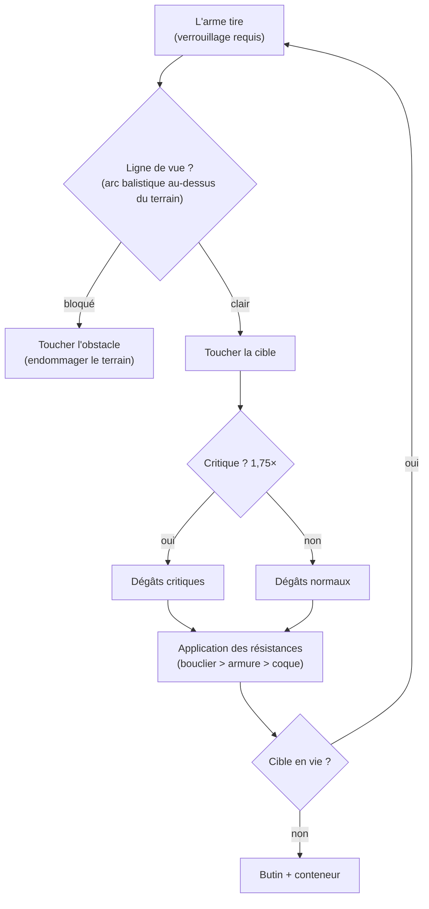

# Combat

Le combat se déroule **en zone**, avec votre robot actif. Vous combattez d'autres
joueurs (PvP), des PNJ, et des structures hostiles. Cette page couvre les mécaniques
confirmées côté serveur ; les interactions détaillées de dégâts/équipement sont dans
[robots & équipement](/fr/features/robots/).

> Les emplacements dans l'interface suivent l'[aperçu de l'interface client](/fr/features/ui/) :
> le **bouclier/armure/coque et l'énergie** de votre robot sont affichés sur le panneau
> de statut désamarré. Le ciblage en combat et les contrôles d'armes ne sont pas encore
> documentés en détail.

## Entrer en combat

- Vous ne pouvez combattre que **désamarré** — vous êtes votre robot actif.
- Tirer une arme offensive sur un autre joueur dans une zone ouverte (PvP) met le
  **flag PvP** sur l'attaquant. Tirer en retour, ou utiliser un module de soutien sur
  un joueur déjà flaggé, le met aussi sur vous. Le flag dure **5 minutes**
  (la définition `effect_pvp`, 300 000 ms) et est rafraîchi à chaque nouvel acte
  d'agression.
- Tant que le flag est actif :
  - vous **ne pouvez pas utiliser les téléporteurs** (y compris mobiles), et
  - vous **ne pouvez pas amarrer normalement** — la seule sortie est le
    **désamarrage forcé**, qui est volontairement non bloqué par le flag.

## Ce que vous pouvez combattre

- **Les robots d'autres joueurs** (PvP).
- **Les PNJ** — les PNJ de zone sont organisés en **troupeaux** (groupes avec
  comportement partagé).
- **Les structures / déplaçables hostiles** dans la zone.

## Quand votre robot est détruit

Votre robot est **détruit** et un **conteneur de butin** apparaît là où il est mort.
Le butin est tiré par objet, chaque tir à 50 % :

| Élément | Sort |
|---|---|
| Chaque **module** équipé | 50 % de chance de tomber **endommagé** (réparable) ; sinon détruit |
| Les **munitions** chargées de chaque module | 50 % de chance de tomber (uniquement si le module est tombé) |
| La **cargaison** (paquets/boîtes) | le contenu tombe en butin, le paquet lui-même est détruit |
| Autres **objets empilables** dans la cargaison | 50 % de chance de tomber, avec une quantité aléatoirement réduite (le reste est détruit) |
| Votre **peinture/teinte** | 50 % de chance de tomber en objet de peinture |
| Le **robot lui-même** | détruit — sauf s'il avait une **assurance** active, auquel cas l'indemnisation est payée en crédits (le robot est toujours parti) |

**L'assurance** (achetée à l'installation d'assurance d'une base, amarré — voir
[production → assurance](/fr/features/production/)) couvre un robot pendant
**15 jours** (plus les jours bonus d'extension). Chaque robot a une **frais** et un
**payout** définis par son contenu (la table `insuranceprices` — 67 définitions de
robots) ; la frais peut être réduite par un bonus d'extension et payée depuis votre
cagnotte de corporation. Les robots de départ ne peuvent pas être assurés. Vous pouvez
avoir une assurance sur 1 + (bonus d'extension) robots.

Après une mort, vous n'avez **plus de robot actif**. Pour revenir dans le jeu :

- **sélectionner un autre robot** que vous possédez avec les extensions
  d'activation requises, ou
- **demander un robot de départ** quand vous êtes amarré — mais il y a un court
  verrouillage après une mort : **3 minutes si tué par un joueur, 1 minute par un PNJ**.
  Si un **PNJ** vous a tué, la base vous donne aussi un **robot de départ gratuit**
  automatiquement au retour.

## Fuir

Quand un combat tourne mal :

- **Désamarrage forcé** — la sortie d'urgence. Vous sort de la zone et vous amarre
  immédiatement à la base principale (TMA), même en plein combat.
- **SOS** — une sortie alternative : vous amarre à la base actuelle après le délai
  normal de désamarrage (7 secondes).

Les deux sont vos filets de sécurité ; le désamarrage forcé est le bouton « je vais
mourir ».

## Les phases de dégâts

Les dégâts traversent trois couches :

1. **Bouclier** — régénère avec le temps, capacité limitée par le module de bouclier.
2. **Armure** — n'a pas de régénération, capacité limitée par le module d'armure.
3. **Coque** — la dernière ligne de défense ; quand elle atteint 0, le robot est
   détruit.

Les modules de **réparation** (armure, bouclier, coque) régénèrent les couches
correspondantes. Les **dégâts** sont réduits par les résistances de la cible.

## Types de dégâts

| Type | Description |
|---|---|
| Cinétique | Dégâts physiques, atténués par l'armure |
| Thermique | Dégâts de chaleur, atténués par les résistances thermiques |
| Explosif | Dégâts en zone, atténués par les résistances explosives |
| Électromagnétique | Dégâts EM, atténués par les résistances EM |
| Énergie | Dégâts de champ, spécifiques à certaines armes |

## Modules de combat

- **Armes** — tirent des projectiles, lasers, missiles, ou canons à rail.
- **Modules de soutien** — améliorent les statistiques du robot ou des alliés.
- **Modules de défense** — boucliers, armure, réacteurs, réparateurs.
- **Modules d'évasion** — propulseurs, écrans de fumée, brouilleurs.
