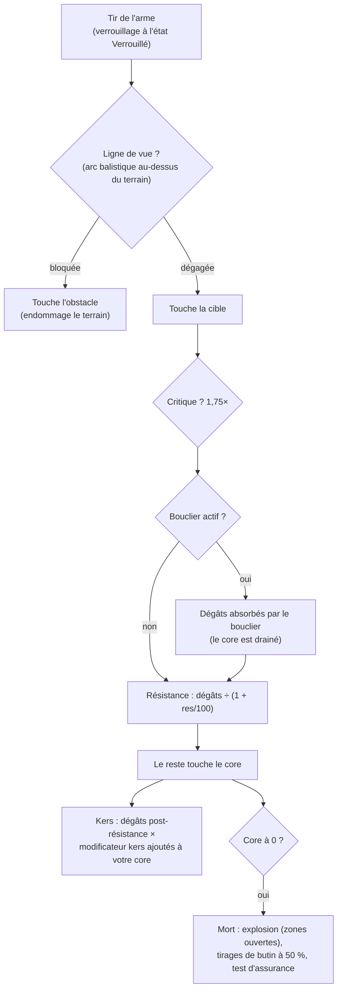

# Combat

Le combat se déroule **dans les zones**, avec votre robot actif. Vous affrontez d'autres joueurs (JcJ),
des PNJ et des structures hostiles. Cette page détaille les mécaniques confirmées côté serveur ;
les interactions approfondies sur les dégâts et l'équipement se trouvent sous [robots & équipement](/fr/features/robots/).

> Les emplacements dans l'interface suivent la [vue d'ensemble de l'interface](/fr/features/ui/) :
> le **bouclier / blindage / coque et l'énergie** de votre robot apparaissent sur le panneau d'état désamarré.
> Le verrouillage de cible et les commandes d'armes en combat ne sont pas encore documentés en détail.

## Entrer en combat

- Vous ne pouvez combattre qu'en étant **désamarré** — vous incarnez votre robot actif.
- Tirer avec une arme offensive sur un autre joueur dans une zone ouverte (JcJ) active le
  **marqueur JcJ (flag PvP)** sur l'attaquant. Répliquer, ou utiliser un module de soutien sur
  un joueur déjà marqué, l'active également sur vous. Le marqueur dure **5 minutes**
  (la définition `effect_pvp`, 300 000 ms) et se réinitialise à chaque nouvel acte d'agression.
- Tant que le marqueur est actif :
  - vous **ne pouvez pas utiliser les téléporteurs** (y compris les modèles mobiles), et
  - vous **ne pouvez pas vous amarrer normalement** — la seule issue est l'**amarrage forcé (force dock)**,
    qui n'est délibérément pas bloqué par le marqueur.

## Ce que vous pouvez combattre

- **Les robots d'autres joueurs** (JcJ).
- **Les PNJ** — les PNJ de zone sont regroupés en **flocks** (groupes au comportement partagé).
- **Les structures et déployables hostiles** dans la zone.

## Quand votre robot est détruit

Votre robot est **détruit** et un **conteneur de butin** apparaît à l'endroit de sa mort.
Le butin fait l'objet d'un tirage pour chaque objet, avec 50 % de chance à chaque tirage :

| Élément | Sort |
|---|---|
| Chaque **module** équipé | 50 % de chance d'apparaître **endommagé** (réparable) ; sinon détruit |
| Les **munitions** chargées de chaque module | 50 % de chance d'apparaître (uniquement si le module a été sauvé) |
| **Cargaison** (paquets/caisses) | le contenu tombe en butin, le paquet lui-même est détruit |
| Autres **objets empilables** en soute | 50 % de chance d'apparaître, avec une quantité aléatoirement réduite (le reste est détruit) |
| Votre **peinture/teinte** | 50 % de chance d'apparaître sous forme d'objet de peinture |
| Le **robot lui-même** | détruit — sauf s'il bénéficiait d'une **assurance** active, auquel cas l'indemnisation vous est versée en crédits (le robot reste perdu) |

L'**assurance** (souscrite auprès de l'infrastructure d'assurance d'une base, amarré — voir
[production → assurance](/fr/features/production/)) couvre un robot pendant **15 jours** (plus les jours de bonus d'extension).
Chaque robot a un **coût** et une **indemnisation** définis dans les données de contenu (table `insuranceprices` — 67 définitions
de robots) ; le coût peut être réduit par un bonus d'extension et payé depuis le portefeuille de votre corporation.
Les robots de départ ne peuvent pas être assurés. Vous pouvez assurer 1 + (bonus d'extension) robots.

Après une destruction, vous vous retrouvez **sans robot actif**. Pour reprendre le jeu, vous pouvez :

- **sélectionner un autre robot** en votre possession pour lequel vous avez les extensions d'activation requises, ou
- **demander un robot de départ** en étant amarré — mais un court délai de blocage s'applique après une mort :
  **3 minutes si vous avez été tué par un joueur, 1 minute par un PNJ**. Si un **PNJ** vous a abattu, la base vous
  fournit également un **robot de départ gratuit** automatiquement à votre retour.

## Échapper au combat

Quand l'affrontement tourne mal :

- **Amarrage forcé (Force dock)** — l'issue de secours. Vous retire immédiatement de la zone et vous amarre à la
  base principale (TMA), même en plein combat.
- **SOS** — une sortie alternative : vous amarre à la base courante après le délai normal (7 secondes) de désamarrage.

Tous deux constituent vos filets de sécurité ; l'amarrage forcé est le bouton d'extrême urgence face à une mort certaine.

## Verrouillage de cible, portée et impact

- **Verrouiller d'abord.** Les armes ne tirent que sur des cibles *verrouillées* — et seulement une fois le verrouillage
  achevé. Le verrouillage prend le temps de la statistique de **vitesse de verrouillage** de votre robot (en ms) ;
  tirer alors qu'il est en cours est rejeté. Vous pouvez maintenir plusieurs cibles verrouillées en même temps (dans la limite
  de la caractéristique de **cibles verrouillées maximales**), mais une seule est *primaire*, et certaines armes ne tirent
  que sur la cible primaire.
- **Portée optimale et chute (falloff).** Dans la **portée optimale** d'une arme, vous infligez l'intégralité des dégâts.
  Au-delà, les dégâts diminuent progressivement sur la distance de **chute (falloff)** — environ la moitié des dégâts au point
  médian du falloff, et zéro à sa limite extrême. Au-delà d'optimale + falloff, vous n'infligez aucun dégât.
- **Rayon d'explosion contre taille de cible.** Les canons ne « manquent » pas leur cible : la caractéristique de **précision**
  d'un canon agit comme un rayon d'explosion, et une cible dont la **signature** est plus petite subit proportionnellement moins
  de dégâts. Les missiles *peuvent* manquer entièrement leur cible (la probabilité dépend de la précision des missiles du robot),
  mais lorsqu'ils touchent, ils explosent selon leur **rayon d'explosion** — et, comme pour les canons, une cible plus petite subit
  une fraction moindre du souffle.
- **Coups critiques.** Chaque tir évalue votre **chance de coup critique** ; un critique multiplie l'intégralité du tir par 1,75×,
  et chaque coup varie également aléatoirement de ±10 %.
- **Ligne de vue.** Les tirs se déplacent en ligne droite : le terrain, les obstacles et les plantes les bloquent. Les missiles
  suivent un arc balistique et peuvent franchir un abri bas — mais cet arc est limité, de sorte que les reliefs élevés continuent
  de faire obstacle.
- **Votre propre bouclier bloque vos propres armes.** Tant que votre bouclier est actif, vos armes ne tireront pas.

### Types de dégâts

Les munitions portent les dégâts : chaque munition possède une valeur pour un ou plusieurs types de dégâts —
généralement un type dominant accompagné d'un composant secondaire moindre (les missiles infligent de l'explosif
avec du cinétique ou du chimique, les cristaux laser du thermique avec du chimique, les tirs de canon à rail du cinétique
avec du thermique). Les types :

| Type | Notes |
|---|---|
| **Chimique** | Composante courante des munitions d'armes à feu et de lasers |
| **Cinétique** | Munitions de canon à rail, projectiles et missiles |
| **Thermique** | Lasers, certaines munitions à projectiles |
| **Explosif** | Missiles |
| **Toxique** | Certaines munitions d'armes légères ; n'endommage que les plantes et le terrain |
| **Électrique** | Effets spéciaux (par ex. le scorcher) — **pénètre les boucliers** |

Les dégâts reçus sont atténués par type selon la **résistance** de la cible à ce type : une résistance de 50 % réduit
les dégâts de 50 / (50 + 100) ≈ 33 %. Les résistances ne s'appliquent qu'à ce qui *traverse* le bouclier — le bouclier
absorbe en premier, ce qui puise dans son énergie : plus l'impact est violent, plus la consommation d'énergie est forte.
Les modules **Kers** permettent à une portion d'un type de dégâts de brûler directement l'énergie du bouclier même après
résistance. L'[alliage adaptatif](/fr/features/modules/#the-module-families) redistribue vos résistances en fonction
du type de dégâts qui vous touche effectivement.

## Détection, masquage et vitesse

- **Détection contre masquage.** Vous apercevez une unité dans un rayon qui s'étend avec votre caractéristique de **détection**
  et diminue avec le **masquage** de la cible — environ 100 m × détection ÷ masquage. Une unité qui vous a verrouillé vous
  est toujours visible, quel que soit son niveau de masquage. Les modules de furtivité augmentent temporairement votre propre
  masquage (voir [modules](/fr/features/modules/)) ; les mines utilisent un rayon de détection dédié spécifique.
- **Blob.** Certaines unités et structures émettent un champ de *blob*. Lorsque vous vous trouvez dans le rayon d'un émetteur,
  le niveau de blob de votre unité s'élève ; entre vos deux seuils de blob, il **augmente votre temps de verrouillage**
  (jusqu'à 6× la valeur de base) et **réduit votre portée de ciblage ainsi que la puissance de vos capteurs** (jusqu'à la moitié).
- **Vitesse.** La vitesse maximale diminue avec la masse : vitesse = base × (masse de conception ÷ masse réelle) — chaque tonne
  de modules supplémentaires, de blindage et de cargaison emportée vous ralentit.
- **Démobilisation (« demob »).** L'effet webber réduit la vitesse de pointe d'une cible. L'intensité de son effet dépend de
  la **massivité** de la cible — les unités plus lourdes subissent une démobilisation plus marquée, les cibles imposantes et
  lentes sont donc les plus pénalisées.

## Alarmes

Une **alarme** est déclenchée dans une zone par un **interrupteur d'alarme** (structure liée à une mission).
Une fois activée :

- Elle dure une **période d'alarme** déterminée (fixée par la mission ; courte par défaut).
- Vous devez **rester dans le rayon de l'interrupteur** durant toute cette période — la distance est vérifiée toutes les quelques secondes,
  et s'éloigner annule l'alarme.
- Vous ne pouvez avoir qu'**une seule alarme active à la fois**.

Les alarmes sont rattachées au contenu des missions — voir [missions](/fr/features/missions/).

## Rapports d'élimination (Kill reports)

L'historique de vos combats est consultable sous la forme de **rapports d'élimination** :

- Filtrage par **fenêtre temporelle**.
- Filtrage par **rôle** : en tant que **victime**, **attaquant** ou **tueur**.

Consultez-les pour analyser les circonstances de votre mort ou identifier les cibles que vous avez abattues.

## Meilleurs scores (High scores)

- **Meilleurs scores du serveur** — les meilleurs résultats sur l'ensemble du serveur.
- **Mes meilleurs scores** — vos records personnels.

## Notes pratiques

- **Ne mourez pas inutilement** — un robot détruit implique un temps d'attente pendant que vous le rééquipez ou en demandez un nouveau.
- **L'amarrage forcé est instantané** — si la situation vous dépasse, regagnez TMA immédiatement ; vous vous rééquiperez plus tard.
- **Le JcJ bloque les téléporteurs** — planifiez vos voies d'évacuation ; vous ne pourrez pas vous téléporter en plein combat.
- **Les alarmes sont un indicateur** — une alarme en cours signale un événement de mission actif dans le secteur.

<!--
Developer notes: rewritten 2026 from backend sources; no community-wiki text reused.
Verified against:
- Locking: Zones/Locking/LockHandler.cs (locking time in ms from
  AggregateField.locking_time; MaxLockedTargetsProperty; one primary lock;
  lock states Inprogress -> Locked), Zones/Locking/Locks/Lock.cs,
  Zones/Locking/LockValidator.cs (dead/not-lockable/out-of-range validation);
  ZoneSession.cs (weapons take an existing lock id; firing a weapon whose lock is
  not fully Locked raises LockIsInProgress — there is NO auto-lock on fire).
- Damage: Modules/Weapons/Damage.cs (CalculateDamages: crit = attacker.
  CriticalHitChance, CRITICALHIT_MOD 1.75, random 0.9-1.1; falloff =
  cos(x*PI)/2+0.5 with x=(distance-optimal)/falloff; zero beyond optimal+falloff;
  explosion modifier = target.SignatureRadius/explosionRadius clamped 0..1;
  toxic excluded from unit damage), Modules/Weapons/WeaponAmmo.cs (damage values
  per type live on the ammo: damage_chemical/thermal/kinetic/explosive/toxic;
  firearm adds damage_toxic to plants).
- Weapons: Modules/Weapons/FirearmWeaponModule.cs (CheckAccuracy always false —
  firearms never miss; WithExplosionRadius(Accuracy) — accuracy IS the blast
  radius), Modules/Weapons/MissileWeaponModule.cs (miss when rnd >
  robot.MissileHitChance; missile_miss property), WeaponModule.cs (shield active
  => ShieldIsActive error; LOS check before firing).
- Resistances: Units/Unit.cs GetResistByDamageType = resist/(resist+100);
  Zones/DamageProcessors/DamageProcessor.cs (shield absorbs first, paid from
  core: coreDamage = damage * AbsorbtionModifier; Electric damage penetrates as
  coreDamage; kers = damage * type kers modifier, scaled by
  (sin(core/coreMax*PI)/2)+0.5, added to target core);
  EffectModules/ShieldGeneratorModule.cs (AbsorbtionModifier =
  max(SigRadius/shieldRadius,1)/shieldAbsorbtion).
- Damage types: Modules/Weapons/DamageType.cs — Chemical, Kinetic, Thermal,
  Explosive, Toxic, Electric (no "seismic"; missile damage is Explosive).
  Electric is only produced by ScorcherModule.cs in this backend.
- Detection: Units/Unit.Visibility.cs (IsDetected: range = 100/max(1,
  target.StealthStrength)*max(1, DetectionStrength); locked-on-you always
  visible; mine detection range separate); stealth_strength property includes
  effect_stealth_strength_modifier (stealth modules raise masking).
- Speed: Units/UnitProperties/SpeedMaxProperty.cs (speed_max * Mass/ActualMass;
  dreadnought => 0.05; massiveness/drone/highway effect modifiers).
- Demob: Modules/EffectModules/WebberModule.cs (effect_demobilizer; effect
  property = module value + target.Massiveness, clamped at 1.0 — heavier targets
  get the full effect; longrange webbers additionally require LOS; accuracy
  check via optimal-range modifier).
- Blob: Zones/Blobs/BlobHandler.cs (emitters raise blob level inside
  BlobEmissionRadius; between blob_level_low/high the multiplier scales:
  locking_time modifier -5, i.e. lock time x(1+5*m) — up to 6x base at full blob, max_targeting_range *0.5,
  sensor_strength *0.5).
- LOS: Zones/LineOfSight.cs (raycast vs terrain blocks incl. Plant flag;
  ballistic arc for missiles: max amplitude 16 m over 40 m);
  Zones/Terrains/BlockingFlags.cs (Obstacle/Plant/Decor/Island block).
Corrections vs ingested page: "seismic" damage type does not exist (explosive
does); "firearms lose damage instead of missing" verified (accuracy = explosion
radius); auto-lock on fire NOT in backend (lock must be created and completed
first); "interference" (emission/minimum/peak, emitters, anomaly degradation)
has NO equivalent in this backend — only a comment in Services/RiftSystem/Rift.cs
— section removed; shield "absorbs" is core-energy based, and Electric damage
penetrates it.
Developer files: Zones/Locking/*; Zones/Locks via Zones/Locking/Locks/*;
Modules/Weapons/*.cs; Zones/DamageProcessors/*.cs; Units/Unit.Visibility.cs;
Units/Unit.cs; Units/UnitProperties/SpeedMaxProperty.cs;
Modules/EffectModules/ShieldGeneratorModule.cs, WebberModule.cs,
StealthModule.cs; Modules/ScorcherModule.cs; Zones/Blobs/*.cs;
Zones/LineOfSight.cs; Zones/ZoneSession.cs (lock/fire packet handling).
Previously verified (kept as-is): PvP flag = effect_pvp 300000 ms
(effect_pvp definition), raised by attack/aggro/support (Player.cs
ApplyPvPEffect); blocks teleport + normal dock (CantDockThisState), ForceDock.cs
has no PvP check; death loot 50% rolls (Player.cs OnUnitDeath,
Services/Looting/LootHelper.cs DROP_CHANCE 0.5); insurance (InsuraceFacility.cs,
InsuranceHelper.cs, insuranceprices 67 defs); starter-robot lock 3 min PvP /
1 min NPC; alarms (Zone/AlarmStart.cs, AlarmSwitch.cs); kill reports
(GetMyKillReports.cs); high scores (GetHighScores.cs / GetMyHighScores.cs).
-->
