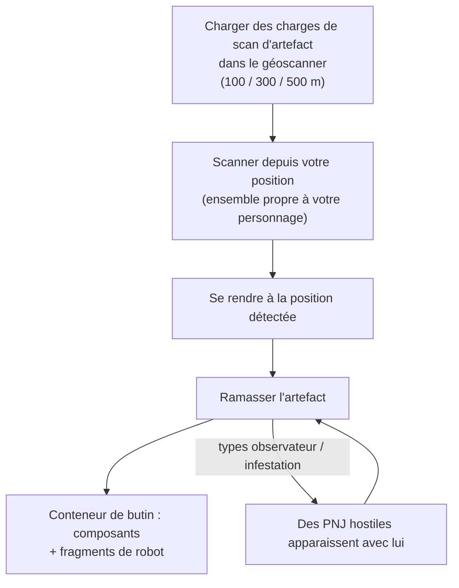

# Exploration (artefacts & reliques)

L'exploration consiste à découvrir de la valeur dissimulée dans le terrain — une excellente activité solo
à tous les niveaux. Elle se présente sous deux formes : les **artefacts**, qui sont personnels et cachés,
et les **reliques**, qui sont visibles de tous et disputées.

## Recherche d'artefacts (Artifacting)

Les artefacts sont des points qui existent **par personnage** : le serveur maintient un ensemble d'artefacts
distinct pour chaque personnage sur chaque île, ce que vous trouvez n'appartient donc qu'à vous. Ils restent
invisibles tant que vous ne les scannez pas.

1. Chargez des **charges de scan d'artefact** dans un module géoscanner. Il existe trois niveaux de charges
   offrant des portées de scan différentes (100 / 300 / 500 m).
2. Scannez depuis la position de votre robot — le scanner renvoie les positions des artefacts situés à portée
   (la précision du géoscanner affine la position indiquée).
3. Volez jusqu'à la position trouvée et ramassez l'artefact ; cela fait apparaître un **conteneur de butin** sur place.

Deux caractéristiques font de la recherche d'artefacts une activité autant martiale que de collecte :

- Certains types d'artefacts **font apparaître des PNJ à vos côtés** — les variantes « observateur » et « infestation »
  attirent des ennemis dès la découverte de l'artefact, pilotez donc un engin capable de se battre.
- Le butin est aléatoire selon le type d'artefact : composants de modules (plaques de blindage, durcisseurs,
  générateurs, réparateurs…) et **fragments de robot (shards)** — ingrédients de recherche et de production
  propres à chaque faction, ce qui fait de l'exploration une filière industrielle majeure.

Les types d'artefacts sont échelonnés par niveaux (niveaux 1 à 3, avec un butin plus abondant aux niveaux supérieurs)
et existent en variantes neutres ainsi que par faction.

## Chasse aux reliques (Relic hunting)

Les reliques existent en **monde ouvert** : la zone les fait apparaître à des positions aléatoires (selon un cycle
de réapparition d'environ 90 minutes avec une marge aléatoire), ce sont des objets visibles surmontés d'un rayon
lumineux, et le premier à les ramasser remporte le butin. Le butin est un tirage de NIC accompagné de **fragments
de robot**, proportionnel au niveau de la relique et au rang de valeur de l'île — les mêmes fragments que ceux obtenus
via les artefacts.

Les types de reliques sont échelonnés par île (niveaux 1 à 3, avec différentes valeurs en EP selon le niveau)
et se déclinent en variantes neutres, par faction et industrielles. Certaines reliques sont liées aux
[avant-postes](/fr/features/outposts/) — l'activité SAP génère ses propres reliques, qui restent actives jusqu'à 12 heures —
et sur les îles en JcJ ouvert, les points d'apparition se situent en territoire contesté : attendez-vous donc à croiser
d'autres chasseurs.

## Les missions en proposent également

Les [missions](/fr/features/missions/) peuvent également vous confier des tâches liées aux artefacts, dans lesquelles
vous êtes rémunéré directement tandis que les objets récupérés reviennent au commanditaire plutôt qu'à votre inventaire.

<!--
Written from scratch against the server backend, 2026-09-27:
Zones/Artifacts/Repositories/ZoneArtifactRepository.cs (per-character artifact
rows), Zones/Scanning/Scanners/Scanner.Artifact.cs (scan range + accuracy),
Zones/Artifacts/Generators/Loot/ (random loot per type),
Services/Relics/RelicManagers/ZoneRelicManager.cs (~1.5 h respawn + random
window) and SAPRelic.cs (12 h lifespan),
artifacttypes/artifactloot/relictypes/relicloot tables,
ammo_artifact_scan_a/b/c (scan ranges 100/300/500).
An earlier version of this page was adapted from the Open Perpetuum
community wiki (perpetuum.miraheze.org) and has been fully rewritten from
backend sources; no text was reused.
-->
