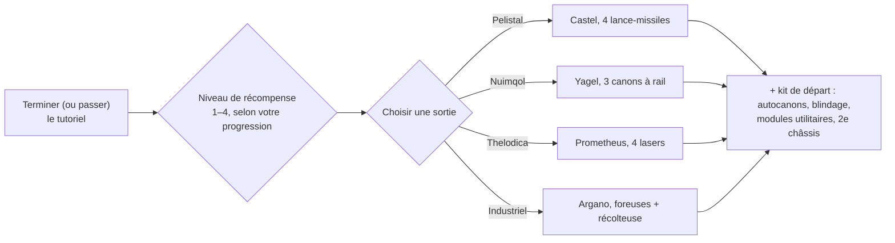

# FAQ

## Puis-je passer le tutoriel ?

Vous pouvez quitter la zone d'entraînement plus tôt, mais vous renoncerez aux récompenses accordées
en le menant à son terme. Lorsqu'un personnage quitte le tutoriel, le serveur :

- verse le **NIC de départ** plus un bonus **par niveau de récompense** obtenu dans le tutoriel
  (il existe quatre niveaux de récompense),
- vous assigne à la **corporation par défaut** correspondant à la race et à l'école choisies,
- vous accorde vos **extensions de départ** (compétences) ainsi que votre **spark**,
- crée votre **robot de départ**, vous amarre à la base d'amarrage de New Virginia et la définit
  comme votre **base principale** — l'endroit où vous réapparaissez en cas de destruction de votre robot,
- dépose vos **objets de récompense** dans un conteneur public de cette base et vous envoie un message
  de bienvenue.

## Comment terminer le tutoriel ?

Remplissez les objectifs dans l'ordre ; la **Liste de contrôle des recrues** du client (menu Aide dans la barre
supérieure) permet de suivre votre avancement et peut être épinglée à la barre inférieure. Votre niveau
de progression détermine votre niveau de récompense, qui fixe les paliers de récompenses accordés à votre sortie —
une sortie au niveau 1 ne rapporte que le premier palier, tandis qu'une complétion intégrale octroie les quatre.

## Que m'apporte chaque sortie ?

Votre choix influe sur trois aspects : le **robot de départ** que vous pilotez, les **objets de récompense**
reçus, ainsi que la **corporation par défaut et les compétences de départ**. Tout le reste — chaque compétence,
chaque robot, chaque équipement de faction — peut être appris et acheté plus tard avec des EP et des NIC ;
ce choix constitue donc un ensemble de départ et non un verrouillage définitif.

| Sortie | Robot de départ (équipé) | Thème des récompenses |
|---|---|---|
| **Pelistal** | Castel — quatre lance-missiles | missiles + autocanons |
| **Nuimqol** | Yagel — trois canons à rail | munitions de canon à rail + autocanons |
| **Thelodica** | Prometheus — quatre lasers | cristaux laser + autocanons |
| **Industriel** | Argano — deux foreuses, une récolteuse, une sonde minière | munitions de minage, de récolte et de scan d'artefacts |

Chaque sortie inclut également un ensemble de petits autocanons avec munitions, du blindage et des modules
utilitaires (réparateur de blindage, amplificateur de capteur ou réducteur de masse, rechargeur de réacteur,
modificateurs de dégâts), un second châssis (vide) ainsi qu'une capsule de bombe murale aux niveaux de récompense supérieurs.

## Que faire une fois dehors ?

Presque toutes les activités rapportent des EP pour vos compétences et des NIC pour votre équipement :

- Miner, récolter des plantes, chercher des artefacts — et vendre vos récoltes sur les [marchés](/fr/features/market/).
- Éliminer des PNJ et revendre le [butin](/fr/features/npcs/).
- Collecter ou acheter des matériaux pour [fabriquer](/fr/features/production/) des objets.
- Accomplir des [missions](/fr/features/missions/) — tout contrat proposé à un terminal ou un avant-poste peut être réalisé en solitaire.

Vous débutez en JcJ en monde ouvert ? Consultez d'abord les [notes de survie dans Premiers pas](/fr/features/getting-started/#survival).

## Puis-je retourner dans la zone d'entraînement ?

Non. La zone d'entraînement est réservée aux nouveaux personnages et aucun retour n'est possible une fois quittée.
La Liste de contrôle des recrues reste consultable dans le menu Aide si vous souhaitez relire les objectifs,
et vous pouvez toujours créer un autre personnage et le laisser dans le tutoriel comme bac à sable d'essai.

## Abréviations

Termes couramment utilisés dans les discussions, sur le marché et pour les configurations (fits). La plupart
renvoient à une page dédiée — les noms d'objets sont retrouvables via la recherche du site.

| Terme | Signification |
|---|---|
| **EP** | [Points d'extension](/fr/features/research/#ep-sources) — la devise de compétences liée au compte, dépensée pour améliorer les [extensions](/fr/features/character/#extensions) (les règles de gain sont sur la [page de recherche](/fr/features/research/#ep-sources)). |
| **NIC** | Nian Credit — la monnaie en jeu (le solde `credit` de votre personnage). |
| **CT** | [CPRG — Programme de calibrage](/fr/features/production/#cprg-calibration-programs) — le programme avec lequel une ligne d'usine est calibrée avant de produire (un par objet, avec des rendements en matériaux et en temps). |
| **Proto** | Un objet prototype — variante de rang supérieur d'un module ou robot, fabriqué dans l'[usine de prototypes](/fr/features/production/#the-item-lifecycle-the-circular-process) (consomme un exemplaire du palier précédent ; voir la [progression par tiers](/fr/features/production/#tier-progression)). |
| **LWF** | Lightweight frame — module de blindage allégé (le client les nomme « … lightweight frame », ex. *Niani lightweight frame*). Rend un robot plus léger au détriment de son blindage. |
| **TP / tele** | [Téléporteur](/fr/features/movement/) — déplacement rapide entre points fixes, ou vers un dispositif de téléportation mobile déployé. |
| **SAP** | Service Access Point — l'activité liée à la [stabilité](/fr/features/outposts/) des avant-postes. |
| **Stab** | Weapon Stabilizer — stabilisateur d'arme améliorant la précision des tirs. |
| **Demob** | Demobilizer — module qui ralentit un robot cible (et le cycle de ses modules). |
| **EWar** | Guerre électronique (Electronic Warfare) : brouillage, suppression de capteurs, furtivité. |
| **EnWar** | Guerre énergétique (Energy Warfare) : injecteurs de réacteur, draineurs, neutraliseurs, transferts d'énergie. |
| **Tuning** | Terme client désignant les modules d'amélioration optimisant d'autres modules — modificateurs de dégâts pour armes, *tuning industriel* pour foreuses et récolteuses, tuning de réparation de blindage, etc. |
| **MK2** | Variante améliorée d'un robot (châssis `_mk2`) — capacités supérieures, ligne de recherche propre. |

Les classes de robots suivent les classifications en jeu — voir la note sous [Classes de robots](/fr/content/robots/#robot-classes).

<!--
Written from scratch against the server backend, 2026-09-27:
Zones/Teleporting/Strategies/TrainingExitStrategy.cs (exit rewards, NIC,
corporation, extensions, spark, starter robot, home base, reward items),
Zones/Training/Reward/TrainingReward*.cs + trainingrewards/robottemplates
(reward levels 1-4, per-race starter packs and items),
Robots/Robot.Properties.cs (race ids 1=Pelistal, 2=Nuimqol, 3=Thelodica, 5=industrial).
An earlier version of this page was adapted from the Open Perpetuum
community wiki (perpetuum.miraheze.org) and has been fully rewritten from
backend sources; no text was reused.
-->
