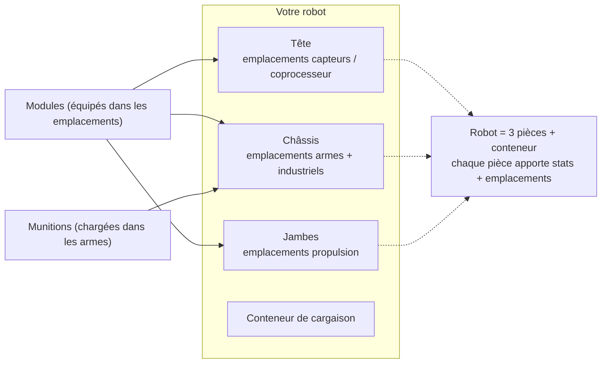

# Équipement

L'équipement consiste à monter des **modules** dans les emplacements de composants du robot et à charger des **munitions**
dans vos armes. Tout l'équipement s'effectue **à quai uniquement** — il est impossible de s'équiper dans une zone.

> Les emplacements dans l'interface suivent la [vue d'ensemble de l'interface](/fr/features/ui/) (la catégorie **Équiper** sur
> la barre supérieure). Les mécaniques ci-dessous sont confirmées par le serveur.

## Installer des modules

Un robot comprend plusieurs **composants** (arme, bouclier, blindage, propulsion, capteur, etc.), chacun disposant
d'un ensemble d'**emplacements (slots)**.

- **Équiper un module** — prélevez un module depuis un conteneur et installez-le dans un emplacement de composant précis.
  Le type de module doit être valide pour cet emplacement sur cette classe de robot. Si l'emplacement est déjà occupé,
  l'ancien module retourne dans le conteneur.
- **Intervertir des modules** — déplacez un module entre deux emplacements d'un même composant.
- **Retirer un module** — retirez un module d'un emplacement pour le remettre dans un conteneur.

Le serveur recalcule les caractéristiques du robot après chaque modification (les modules influent sur les valeurs
affichées sur le panneau d'état désamarré — voir [combat](/fr/features/combat/)).

## Charger des munitions

- **Équiper des munitions** — chargez un objet de munition compatible dans un module (d'arme) actif. Le module doit
  **accepter ce type de munition**, et il se charge jusqu'à concurrence de sa **capacité de munitions**.
  Toute munition précédemment chargée retourne d'abord dans le conteneur.
- **Changer de munitions** — remplacez les munitions chargées par un autre type compatible.
- **Décharger les munitions** — remettez les munitions chargées dans un conteneur.

## Préréglages d'équipement

Un **préréglage (preset)** est un équipement sauvegardé réutilisable rapidement :

- **Enregistrer** — sauvegardez l'équipement actuel d'un robot sous un nom choisi.
- **Lister** — consultez vos préréglages sauvegardés.
- **Appliquer** — chargez un préréglage sur un (autre) robot depuis un conteneur.
- **Supprimer** — retirez un préréglage enregistré.

Les préréglages sont très pratiques pour rééquiper rapidement après un combat ou lors d'un changement de rôle.

## Notes pratiques

- **Impossible de s'équiper en zone** — toutes ces opérations nécessitent d'être amarré.
- **Extension d'activation requise d'abord** — sans la classe de robot recherchée, vous ne pouvez ni le sélectionner ni le piloter.
- **Les munitions doivent correspondre à l'arme** — une munition incompatible sera refusée.
- **Les robots reconditionnés (repackaged) sont inutilisables** — déballez un robot avant de le sélectionner ou de l'équiper.
- **Utilisez les préréglages pour vous rééquiper vite** — sauvegardez une configuration éprouvée pour la réappliquer après une perte.

## Catégories d'emplacements

Les composants d'un robot (tête, châssis, jambes) fournissent des **emplacements**, chacun associé à un jeu
de drapeaux de catégorie. Un module ne s'installe sur un emplacement que si ses propres drapeaux forment un **sous-ensemble**
des drapeaux de l'emplacement. Les catégories de drapeaux sont :

`small`, `medium`, `large`, `turret`, `missile`, `melee`, `industrial`,
`ew_and_engineering`, `specialized` (un emplacement spécialisé n'accepte que des modules spécialisés),
ainsi que les emplacements structurels `head` / `chassis` / `leg`.

Les modules peuvent également être restreints à des robots particuliers, et certains portent le drapeau **unique**
interdisant d'en équiper plus d'un à la fois. Les effets de caractéristiques par module sont répertoriés dans le
[tableau des robots](/fr/content/robots/).
