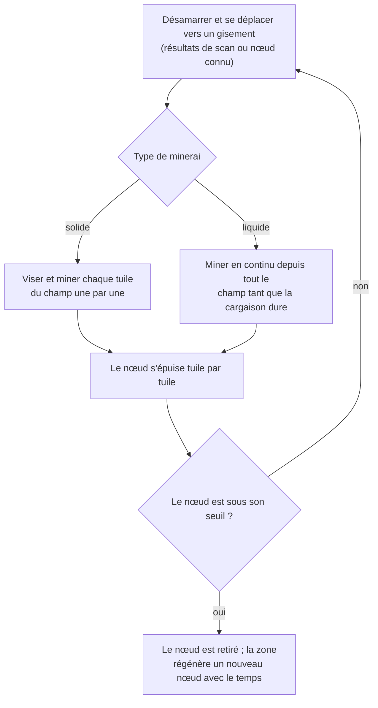
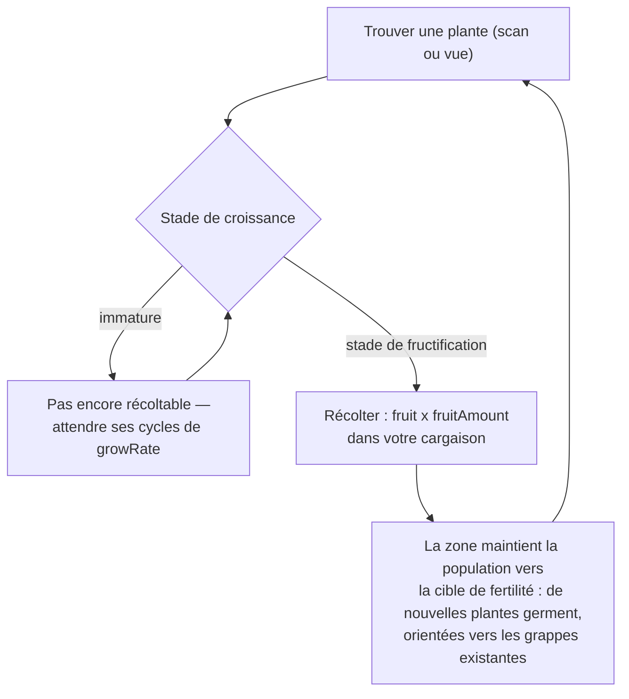
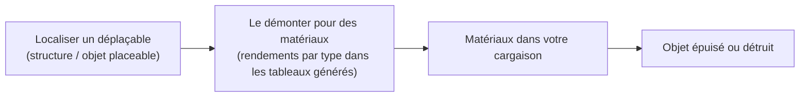

# Collecte & scan

Les ressources du jeu proviennent de trois sources dans une zone : **gisements de minerais**,
**plantes** et **déploiables**. Cette page explique comment chacune fonctionne et comment
se déroule la boucle de collecte.

> Les emplacements dans l'interface suivent l'[aperçu de l'interface client](/fr/features/ui/) :
> les actions de scan et de récolte sont dans la liste des **actions désamarrées** (en haut à
> droite dans une zone). Les rendements par type de ressource sont dans les tableaux
> générés : [Contenu → Minerais](/content/ores/) et [Contenu → Plantes](/content/plants/).
> Les mécaniques ci-dessous sont confirmées par rapport à l'implémentation du serveur.

## La boucle de base

1. **Désamarrez** et déplacez-vous dans une zone (voir [déplacement](/fr/features/movement/)).
2. **Scannez** la zone avec le module scanner de votre robot.
3. **Collectez** — minez le minerai, récoltez le fruit des plantes, ou démontez les déplaçables.
4. **Amarrez** et livrez votre cargaison dans un conteneur de base.

## Gisements de minerais

- Le minerai existe dans le sol sous forme de **gisements (nœuds)** dispersés dans la zone.
- Pour les trouver et les enregistrer, vous avez besoin d'un **module géoscanneur**
  équipé sur votre robot actif. Un scan produit un **résultat de scan** ; vous l'**envoyez**
  ensuite, ce qui l'enregistre dans votre liste personnelle de scans minéraux.
- Vos résultats de scan stockés peuvent être **listés, déplacés, supprimés ou convertis
  en objets** (les objets « scan minéral » utilisés pour le traitement/la production).

- Les gisements sont **finis** : chaque nœud contient une quantité totale limitée.
  Quand un nœud est miné sous son seuil, il est retiré, et la zone **régénère de
  nouveaux nœuds** avec le temps jusqu'à son maximum configuré. Comment les nœuds
  sont placés et comment les populations de plantes sont maintenues — avec de
  vraies zones comme exemples concrets — est dans [Zones → Génération](/zones/generation/).
- **Minerais solides vs liquides.** Les minerais solides s'épuisent tuile par tuile
  — vous visez et minez chaque tuile du champ jusqu'à ce qu'elle soit vide. Les
  minerais liquides puisent dans tout le champ, donc votre mineur peut fonctionner
  en continu tant que vous avez de la cargaison. Cette facilité est exactement pour
  quoi les minerais liquides tendent à valoir moins : moins de skill et d'attention
  pour les miner.

### Statistiques des plantes et minerais en un coup d'œil

Le comportement des minerais et plantes est piloté par des données de règles par type.
Les champs qui comptent pour un joueur :

| Champ | Ce que ça signifie dans le jeu |
|---|---|
| `fertility` | À quel point le type est courant — valeur plus haute = la zone essaie d'en maintenir plus |
| `growRate` | Combien de cycles de croissance une plante doit rester à chaque stade avant d'avancer (plus haut = plus lent) |
| `spreading` | Si le type pousse en grappes (groupes) ou dispersé |
| `killDistance` | Espacement minimum entre deux plantes du même type |
| `slope` / `minSlope` | La pente du sol sur laquelle la plante pousse |
| `allowedAltitudeLow/High` | La bande d'altitude où la plante peut pousser |
| `allowedWaterLevelLow/High` | Bande de distance-from-rivage (crée la végétation côtière) |
| `fruitingState` | Le stade de croissance que la plante doit atteindre avant de produire (être récoltable) |
| `fruitDefinition` / `fruitAmount` | Ce que la plante donne et la quantité de base |
| `maxAmount` | Plafond du nombre de ce type dans une zone de traitement |
| `health` | Points de vie par stade de croissance (les stades plus hauts peuvent être plus durs) |
| `damageScale` | Résistance aux dégâts de la plante |
| `playerSeeded` | La plante n'existe que là où un joueur l'a plantée |
| `onlyOnUnprotectedZone` | Ne pousse que sur les zones non protégées (classe bêta/gamma) |

La référence champ par champ complète (types, valeurs par défaut, stockage, et comment
le tick de zone les utilise) est dans [Formats → Champs des plantes](/formats/plant-fields/).

## Plantes

- Les plantes **poussent avec le temps** à travers une séquence de stades. Chaque stade
  prend un nombre de cycles de croissance (`growRate`) avant que la plante avance
  aléatoirement.
- Une plante ne **produit du fruit qu'une fois arrivée à son stade de fructification**
  — les plantes immatures ne sont pas récoltables.
- La zone maintient les populations de plantes vers une **cible de fertilité** : si
  une parcelle de sol est sous-plantée pour son niveau de fertilité, de nouvelles
  plantes germent ; le type choisi pondère la `fertility` de chaque espèce, et
  `spreading` oriente la nouvelle croissance vers les grappes existantes.

- Certaines plantes sont **semées par les joueurs** (elles n'existent que dans les
  jardins des joueurs) et d'autres sont **exclusives aux zones non protégées**.
- Les plantes peuvent être **endommagées et tuées** ; leur `health` et `damageScale`
  déterminent à quel point c'est difficile.

## Déplaçables

Les déplaçables sont des objets placés dans une zone (voir [Stations de base de pouvoir](/fr/features/pbs/)
pour le côté structure). Certains peuvent être **démontés** pour des matériaux. Les règles
de démontage et les rendements par type sont dans les tableaux générés :
[Contenu → Minerais](/content/ores/) et [Contenu → Plantes](/content/plants/).

## Kiosques

Un **kiosque** est une structure liée aux missions : vous **soumettez des objets**
à distance comme partie d'une mission. Ce n'est pas une source de collecte en soi —
voir [missions](/fr/features/missions/).

## Notes pratiques

- **Le scan nécessite le module** — pas de géoscanneur équipé, pas de résultats de scan.
- **Les résultats de scan sont à vous** — ils vivent par personnage et ne sont pas partagés.
- **Les nœuds de minerai réapparaissent, mais lentement** — si une zone est nue, le
  gisement est parti, pas caché. La régénération restaure le nombre de nœuds, pas
  instantanément.
- **Récoltez ce qui est mature** — les plantes au stade de fructification donnent le
  rendement complet ; les stades plus jeunes ne donnent rien.
