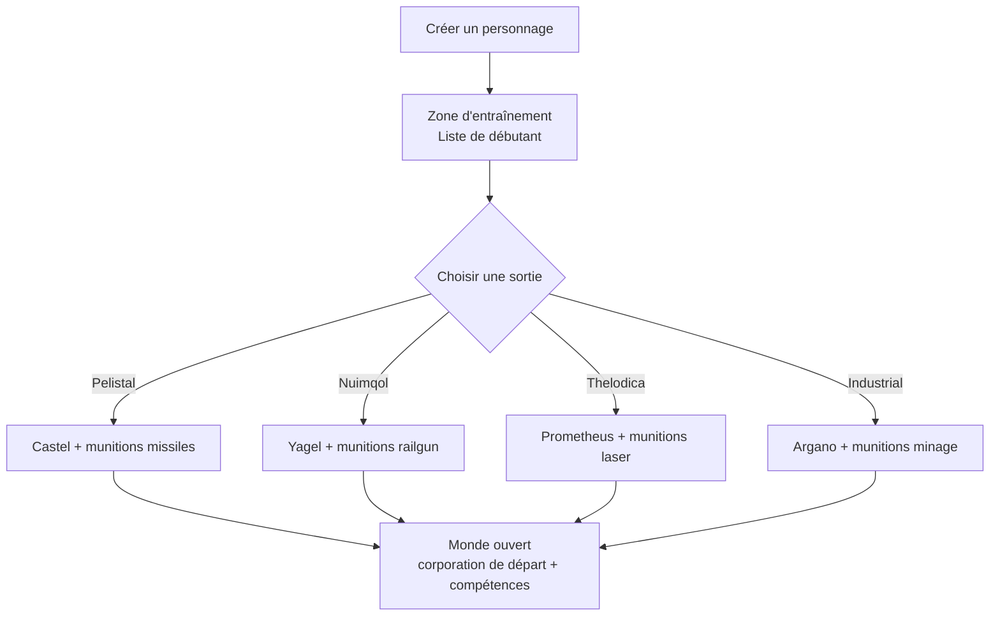

# Premiers pas

Cette page couvre les premiers pas : créer un personnage, obtenir votre premier robot,
et les réglages de personnage que vous toucherez tôt.

> Les emplacements dans l'interface suivent l'[aperçu de l'interface client](/fr/features/ui/). Les mécaniques ci-dessous sont confirmées
> par rapport à l'implémentation du serveur.

## Obtenir le jeu

Perpetuum est gratuit sur [Steam](https://store.steampowered.com/app/223410/Perpetuum/).

  <a class="steam-card-link" href="https://store.steampowered.com/app/223410/Perpetuum/" target="_blank" rel="noopener">
    
    Perpetuum sur Steam — gratuit
  </a>

## Regarder d'abord

Guides du Projet Open Perpetuum. Cliquez sur une carte pour la lire ici.

  

    
    &#9654;
    
Perpetuum Online Tutorial Walkthrough. + Extension Advice and lots more.

  

  

    
    &#9654;
    
Syndicate Careers Help — Artifacting

  

  

    
    &#9654;
    
Open Perpetuum Tutorial — How to run multiple clients

  

## Créer un personnage

- Vous pouvez **vérifier si un nom est libre** avant de créer (`characterCheckNick`).
- **Créer le personnage** — il est rattaché à votre compte. Un compte peut contenir
  plusieurs personnages ; vous en jouez un à la fois.
- **Sélectionner un personnage** pour y jouer. Changer de personnage désélectionne le courant.
- Vous pouvez **renommer** un personnage plus tard (le nom doit être disponible).
- Vous pouvez **supprimer** un personnage que vous n'utilisez plus.

## Votre premier robot

- Quand vous êtes **amarré à une base**, vous pouvez **demander le robot de départ**
  (installations de la base — voir l'[aperçu de l'interface](/fr/features/ui/) pour
  où se trouvent les actions de base).
  - La base doit encore avoir des robots de départ en stock — dans les bases
    populaires, le stock peut s'épuiser, auquel cas la demande échoue.
  - Il y a un **temps de recharge de 5 minutes** entre les demandes de robot de départ
    par personnage.
  - Le nouveau robot est livré dans le conteneur public de la base.

- Quand vous êtes amarré, vous pouvez aussi **demander un « boîtier infini »** : un
  conteneur spécial ajouté à votre inventaire moyennant **5 000 crédits**. C'est un
  conteneur de confort, pas une source de ressources gratuites.

## Réglages du personnage

- **Avatar** — l'apparence de votre personnage.
- **Message d'humeur** — une courte phrase visible par les autres joueurs.
- **Note privée** — une note visible uniquement par vous sur l'un de vos personnages.
- **Base principale** — définir ou effacer votre base principale ; c'est votre amarrage
  par défaut quand le jeu doit vous placer quelque part de sûr.
- **Paramètres** — préférences par personnage.
- **Bloquer les échanges** — activer ou désactiver le commerce pour un personnage.
- **Crédits** — transférer des crédits entre vos propres personnages ; consulter
  l'historique des transactions.
- **Niveau du compte** — changer l'e-mail/mot de passe de session, consulter
  l'historique des transactions du compte et l'historique des EP d'activité.

## Quitter / revenir

- **Se déconnecter** termine la session ; **sélectionner un personnage** la reprend.
- Si le serveur vous expulse (p. ex. forcé à la base), vous réapparaissent amarré —
  voir [déplacement](/fr/features/movement/).

## Le tutoriel

Les nouveaux personnages commencent dans la zone d'entraînement avec une
**Liste de débutant** — terminez-la : elle couvre les bases et distribue plusieurs
robots avec modules et munitions. Vous pouvez l'ignorer (désamarrer et marcher vers
une sortie de faction) mais vous perdez les récompenses, et vous ne pouvez pas
revenir dans la zone d'entraînement plus tard. Ce que les quatre sorties de faction
vous donnent est dans la [FAQ](/fr/features/faq/#what-faction-should-i-pick).

## Survie

Perpetuum est un bac à sable à risques et récompenses, et quand votre robot meurt,
vous le perdez — amarré ou non, tué par un joueur ou un PNJ — et vous réapparaissent
à votre [base principale](#reglages-du-personnage) (vous pouvez y demander un robot
de départ gratuit si vous arrivez à mains vides). Quelques règles pour que les
pertes restent survivables :

- **N'engagez que ce que vous pouvez remplacer.** Désamarrer est un pari : si le
  robot tombe, lui et ses modules équipés sont perdus (ou butin). Avant de lancer,
  assurez-vous que la perte est survivable.
- **Connaisssez les zones.** Les îles protégées (PvE) sont sûres des joueurs ; les
  îles PvP ouvertes sont free-for-fight sans système de crime/punition. Voir
  [zones](/zones/) pour la carte.
- **Connaisssez les PNJ.** Les marqueurs oranges n'attaquent que s'ils sont provoqués ;
  les marqueurs rouges attaquent à l'approche. Fuyez et rompez la ligne de vue pour
  perdre l'agressivité. Voir [PNJ & chasse PVE](/fr/features/npcs/).
- **Atténuez le risque, ne l'acceptez pas juste.** Aller sur une île PvP ouverte dans
  votre meilleur méca équipé T4, c'est comme ça que les mécas meurent. Un équipement
  moins cher, remplaçable, qui s'amortit en quelques voyages, bat le robot coûteux
  qui en prend vingt.
- **Construisez une boucle durable.** Peu importe ce que vous faites — missions,
  collecte, chasse, production, transport — quelqu'un paie le NIC. Gardez des actifs
  de secours pour qu'une mauvaise journée ne réinitialise pas vos revenus.

## Que faire ensuite

1. Sélectionnez votre robot de départ et apprenez l'écran [hangar & équipement](/fr/features/robots/).
2. Désamarrez et déplacez-vous dans la zone — voir [déplacement](/fr/features/movement/).
3. Scannez le sol et commencez à collecter des ressources — voir [collecte](/fr/features/gathering/).
4. Recherchez vos premières extensions — voir [recherche](/fr/features/research/).
5. Choisissez une carrière — la [FAQ](/fr/features/faq/#what-do-i-do-once-i-m-out) a le menu.
