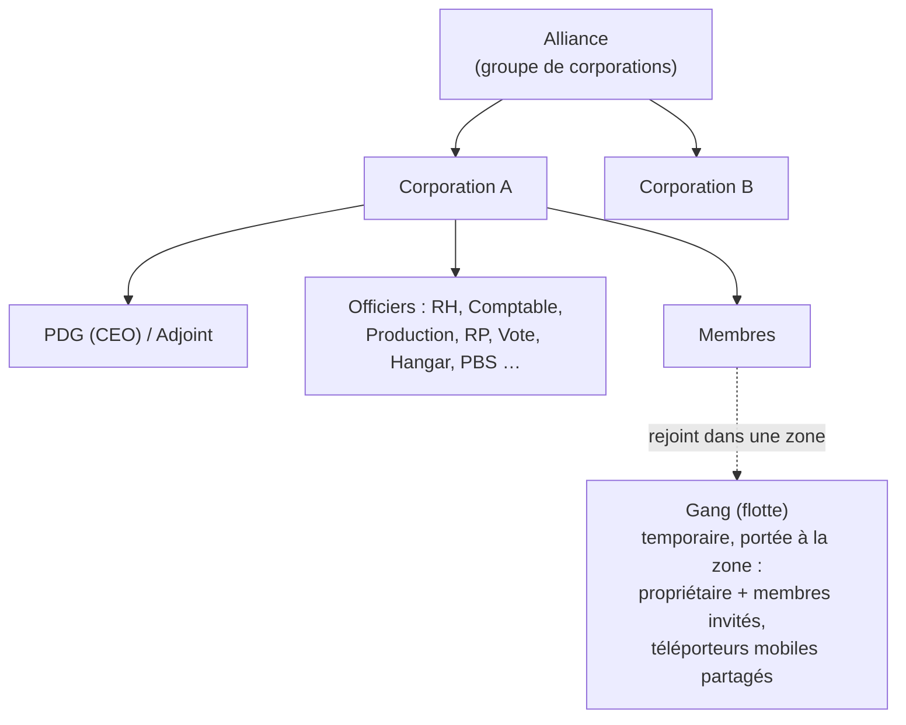

# Groupes

Il existe trois types de regroupements : les **corporations** (votre organisation principale), les **alliances** (regroupements de corporations) et les **gangs** (flottes temporaires pour le jeu en zone).

> Les emplacements dans l'interface suivent la [vue d'ensemble de l'interface](/fr/features/ui/) (le bouton **Corporation** en haut à gauche ; la catégorie **Stockage corpo** ; les gangs disposent de leur propre fenêtre). Les mécaniques ci-dessous sont confirmées par le serveur.

## Corporations

### Adhésion & départ
- **Créer** une corporation — nécessite l'extension basique de gestion de corporation (niveau 1) et des frais de fondation de **250 000 NIC**. Vous choisissez le nom officiel, un **identifiant court (short ID)** (6 caractères max, affiché sur le terrain pour identifier vos membres) ainsi que le **taux d'imposition (tax rate)** — un prélèvement sur les revenus des membres (notamment les récompenses de mission) versé automatiquement sur le compte de la corporation.
- **Postuler** auprès d'une corpo, ou **inviter** un personnage à la rejoindre.
- **Accepter une candidature** / **lister les candidatures** (officiers).
- **Répondre** à une invitation reçue.
- **Quitter**, ou **annuler** un départ en attente.
- **Exclure un membre**, **attribuer un rôle à un membre**, **abandonner ses propres rôles**, ou déclarer des membres neutres.

### Rôles
Les corporations possèdent une hiérarchie de rôles. Les rôles conditionnent les actions possibles — par exemple débloquer des nœuds de l'arbre technologique de corporation, gérer le hangar ou modifier les structures PBS (voir [pbs](/fr/features/pbs/)). Les rôles définis par le serveur (`CorporationRole`) :

- **PDG (CEO)** — contrôle absolu.
- **PDG adjoint (Deputy CEO)** — commandant en second.
- **Responsable RH (HR Manager)** — gestion des effectifs (candidater/inviter/exclure).
- **Délégué de corporation** / **Délégué d'alliance** — agir au nom de l'organisation.
- **Comptable (Accountant)** — trésorerie de la corpo.
- **Responsable de production (Production Manager)** — production de la corpo.
- **Administrateur des votes (Vote Admin)** — gestion des scrutins.
- **Responsable RP (PR Manager)** — relations publiques / tableau d'affichage.
- **Accès au hangar (low / medium / high / secure)** — permissions échelonnées sur les hangars, assorties de paliers de **retrait du hangar** correspondants et d'un rôle d'**opérateur de hangar**.
- **Consulter PBS / Modifier PBS (view PBS / edit PBS)** — visualiser ou modifier les structures PBS de la corporation.
- **Lister / Débloquer l'arbre technologique (Tech tree list / unlock)** — consulter ou débloquer les technologies de la corporation.

Quelques exigences d'accès courantes : les actions de gestion des membres (postuler/inviter/exclure, attribuer des rôles) requièrent **PDG / adjoint / responsable RH** ; le tableau d'affichage et les RP nécessitent **PDG / adjoint / responsable RP** ; les finances et améliorations d'infrastructures nécessitent **PDG / adjoint / comptable** (la production y adjoint le **responsable de production**) ; le déploiement PBS requiert **PDG / adjoint / modifier-PBS**.

Vous pouvez consulter l'**historique des rôles** pour vous-même et vos membres. L'espace de hangar est loué (configuration par défaut du serveur : 50 000 crédits par période de 7 jours).

### Informations & recherche
- **Infos sur la corporation / mes infos** — détails et statut de membre.
- **Rechercher** des corporations.
- **Réputations (Standings) / notoriété** — réputation de votre corporation.
- **Délégués** — personnages agissant au nom de la corpo.

### Finances
- **Faire un don** au portefeuille de la corporation.
- **Effectuer un versement** depuis celui-ci.
- **Transférer** des fonds entre portefeuilles.

### Apparence & profil
- **Renommer**, **définir la couleur**, **renseigner les informations** (profil public).
- **Logo** — jusqu'à 5 symboles parmi un ensemble prédéfini, chacun modifiable (taille, transparence, superposition) ; seuls les membres habilités peuvent le créer ou le modifier.
- **Historique des noms** — anciens noms de la corpo.

### PDG (CEO)
- **Se porter volontaire pour le poste de PDG**, ou vérifier l'**état de passation de pouvoir**.
- **Passation de pouvoir en pratique** : lorsqu'un PDG est resté hors ligne pendant **30 jours**, un adjoint peut lancer une passation de pouvoir — un **compte à rebours de 48 heures** s'enclenche, annoncé dans la fenêtre de corporation. Le PDG ou tout autre adjoint peut y opposer un **veto** instantanément (un veto n'empêche pas une nouvelle tentative si le PDG ne se reconnecte toujours pas). Si le compte à rebours arrive à terme, l'adjoint devient PDG avec l'ensemble des privilèges.

### Votes
Les corporations peuvent organiser des **votes** :
- **Lancer** un vote, **définir son sujet**, **lister** les votes, **voter**, **supprimer** un vote.

## Le tableau d'affichage (bulletin board)
Un tableau d'annonces géré par la corporation :
- **L'activer**, **lister** les messages, voir les **nouveaux messages**, **publier** une entrée, **modérer** (éditer/supprimer les messages d'autrui) et consulter les **détails**.

## Hangar de corporation (stockage)
Un espace de stockage partagé de corporation dans les bases :
- **Louer** une section de hangar, **payer le loyer**, vérifier le **loyer**, **fermer** la section.
- **Lister** le contenu (l'ensemble ou sur une base précise).
- **Dossiers** — créer/supprimer des sous-dossiers.
- **Définir les accès** (qui peut l'utiliser) et **définir un nom**.
- **Journaux (Logs)** — consulter, configurer et effacer le journal d'accès au hangar.

Remarque : vous **ne pouvez pas sélectionner un robot du hangar de corpo** comme robot actif (voir [robots](/fr/features/robots/)).

## Documents de corporation
Un système de documents textuels partagés et versionnés pour la corporation. Il existe deux types de documents :

- **Plan PBS** — un schéma/plan pour le réseau PBS de la corporation.
- **Projet de terraformation** — l'enregistrement d'un projet de modification de terrain.

Opérations : **créer**, **lister**, **ouvrir**, **mettre à jour le contenu** (versionné), **supprimer**, **transférer** la propriété, **louer** (prolonger la période de validité), **surveiller** / **cesser de surveiller** (recevoir des notifications de modifications), et une **liste d'enregistrement** (jusqu'à 25 membres) déterminant qui peut travailler sur le document.

## Alliances

Une alliance regroupe plusieurs corporations :
- **Informations sur mon alliance**, **alliances par défaut** et **historique des rôles d'alliance**.
- Les réputations (standings) peuvent cibler des alliances (voir [social](/fr/features/social/)).

## Gangs (flottes)

Un **gang** est un groupe temporaire pour le jeu en zone (par exemple pour partager un téléporteur mobile ou combattre ensemble) :
- **Créer**, **dissoudre**, **informations**.
- **Inviter**, **répondre** à une invitation, **expulser**, **quitter**.
- **Nommer le chef**, **définir le rôle**.

L'appartenance à un gang est déterminante pour les **téléporteurs mobiles** — seuls le propriétaire ou un membre du gang peuvent en utiliser un (voir [déplacement](/fr/features/movement/)).

## Notes pratiques

- **Les rôles conditionnent le pouvoir** — la plupart des actions d'officier (candidatures, hangar, PBS, votes) requièrent le rôle adapté.
- **La recherche de corpo est partagée** — débloquer des technologies pour la corpo utilise des points partagés avec un multiplicateur (voir [recherche](/fr/features/research/)).
- **Le hangar est un stockage, pas une plateforme de lancement** — vous ne pouvez pas vous désamarrer directement dans un robot qui s'y trouve.
- **Les gangs sont éphémères** — utilisez-les pour une session en zone, pas comme une organisation permanente.
- **Les réputations s'alignent sur votre corpo** — la notoriété de votre corporation influe sur la manière dont l'univers vous accueille (voir [social](/fr/features/social/)).

<!-- TODO: only the corp UI remains (window layout, role picker).
     Confirmed: CorporationRole enum (21 roles incl. hangar access/remove tiers
     low/medium/high/secure, viewPBS/editPBS, TechTreeList/TechTreeUnlock, delegates);
     permission gates sampled from handlers (membership CEO/Deputy/HRManager;
     bulletin CEO/Deputy/PRManager; money+facility upgrades CEO/Deputy/Accountant;
     production +ProductionManager; PBS CEO/Deputy/editPBS); documents = pbsPlan(1) +
     terraformProject(2) (CorporationDocumentType.cs), versioned, rent extends validity,
     monitor for change notifications, register list max 25 (MAX_REGISTERED_MEMBERS).
     Developer notes: Corporations/* (apply/invite/accept, roles, leave, info, money,
     votes, bulletin, hangar, documents, histories, CEO); AllianceGetMyInfo.cs /
     AllianceGetDefaults.cs / AllianceRoleHistory.cs; Gangs/* (create/invite/kick/leave,
     leader/role). SelectActiveRobot.cs forbids corp-hangar robots. -->
