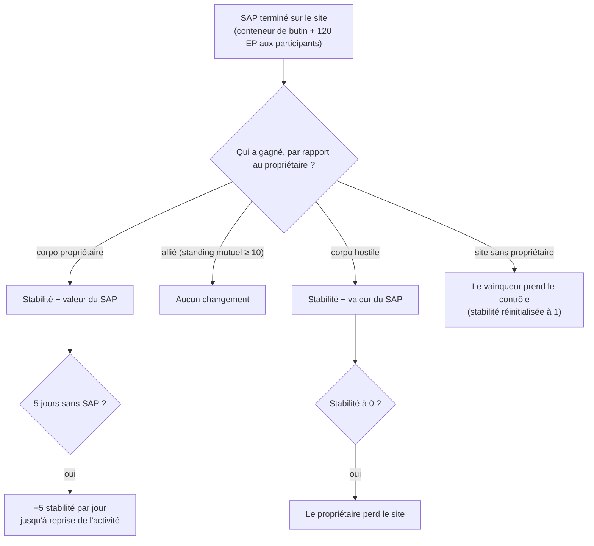

# Intrusion

L'**intrusion** est un mode centré autour des **sites de PNJ** — des sites gérés par les joueurs ou contestables dotés de
**stabilité**, de **défense** et d'**infrastructures**. Vous y investissez des objets, renforcez les défenses et améliorez
les infrastructures pour contrôler un site et en tirer profit.

> Le nom en jeu pour « intrusion » reste à confirmer. Les emplacements dans l'interface suivent la
> [vue d'ensemble de l'interface](/fr/features/ui/). Les mécaniques ci-dessous sont confirmées par le serveur.

## Sites & stabilité

- **Informations sur le site** — détails d'un site d'intrusion.
- **Stabilité** — la statistique centrale du site, comprise entre **0 et 150**. Un nouveau propriétaire débute à **1**.
  La stabilité régit l'ensemble du système :
  - **Seuils de bonus** (données de contenu, `intrusionsitestabilitythreshold`) : les bonus d'infrastructures se débloquent
    aux stabilités **20 / 60 / 80** ; une série d'effets d'aura (core d'intrusion, détection, géoscan, récolteuse, industriel,
    masquage, minage, réparation, signaux — chacun lvl1–3, plus des effets combinés lvl4) se débloque par paliers à
    **10, 20, 40, 50, 70, 80 et 100** ; les **droits d'amarrage** se débloquent à **50** ; la limite des nœuds de défense augmente à **40**.
  - **Points de production** = `stabilité / 10` (max 15) — la monnaie pour améliorer les infrastructures (un point par niveau).
  - **Dégradation (decay)** : si aucun SAP n'est réussi pendant **5 jours**, le site commence à perdre **5 points de stabilité
    par jour** jusqu'à ce qu'une nouvelle action soit entreprise.
  - **Perte** : si la stabilité tombe à **0**, le propriétaire perd le contrôle du site (qui redevient sans propriétaire).
- **Journal de stabilité** — consultation de l'historique des variations de stabilité du site.

### Qui fait varier la stabilité

Les variations de stabilité proviennent des **SAP** menés à terme (ci-dessous) et de la dégradation naturelle du système.
L'effet dépend de l'identité du vainqueur du SAP par rapport au propriétaire actuel :

- **Le propriétaire l'emporte** → la stabilité **augmente** de la valeur du SAP.
- **Un allié l'emporte** (réputation mutuelle ≥ 10) → **aucun changement**.
- **Une corpo ennemie l'emporte** → la stabilité **diminue** de la valeur du SAP.
- **Site sans propriétaire** → la première corpo de joueurs victorieuse **prend le contrôle** (la stabilité revient à 1).

## SAP (Points d'attaque de site)

Un **SAP** est un objectif temporaire qui apparaît sur un site. Le mener à bien fait apparaître un **conteneur de butin**
à l'emplacement du SAP, modifie la stabilité et octroie **120 EP** à chaque personnage participant. **Les cultistes PNJ
contestent également les SAP** — s'ils atteignent le score requis en premier, le SAP compte contre votre camp.
Il existe quatre types de SAP :

| SAP | Comment le terminer | Valeur de stabilité |
|---|---|---|
| **Piratage actif** | utiliser un module de piratage sur le SAP (jusqu'à 120 utilisations) | +15 |
| **Piratage passif** | rester à portée 5 du SAP pendant **8 minutes** | +10 |
| **Destruction** | infliger des dégâts au SAP jusqu'à sa destruction (les dégâts infligés par les PNJ comptent aussi) | +15 |
| **Traitement d'échantillons** | soumettre **5–6 spécimens SAP** (par lots de 2–3, recharge de 1,5 min, portée 7) | +15 |

- **Soumettre un objet SAP** — dans une zone, déposer un spécimen dans un SAP de traitement d'échantillons.
- **Informations sur l'objet SAP** — examiner les données de l'objet SAP (les vôtres et générales).

Les spécimens SAP constituent les consommables de ce mode ; ils possèdent également une importante valeur énergétique,
ce qui leur permet de servir de [carburant de réacteur PBS](/fr/features/pbs/).

## Défense & effets

- **Définir le seuil de défense** — configurer le seuil d'activation des défenses automatisées du site.
- **Définir le bonus d'effet** — régler la configuration du bonus d'aura/effet sur un site (parmi les auras débloquées par la stabilité).
- **Améliorer une infrastructure** — perfectionner une installation du site : coûte **1 point de production** (soit 10 de stabilité),
  réservé au PDG / adjoint / comptable, plafonné à un niveau maximal.
- **Définir le message du site** — rédiger un message public pour le site.

## Journaux (Logs)

- **Mon journal d'intrusion** — votre activité d'intrusion personnelle.
- **Journal public** — le flux public d'intrusion.
- **Journal de mes sites** — activité sur les sites que vous possédez.
- **Journal de stabilité** — variations de stabilité (voir ci-dessus).

## Notes pratiques

- **La stabilité est la valeur centrale** — elle conditionne les paliers de bonus, produit la devise d'amélioration et représente ce que les SAP ennemis détruisent.
- **Les SAP sont disputés** — les cultistes PNJ font la course contre vous ; un SAP perdu vous coûte de la stabilité.
- **Ne laissez pas un site à l'abandon** — 5 jours sans SAP réussi déclenchent la dégradation quotidienne.
- **Les journaux retracent l'histoire** — consultez les journaux personnel, public et de stabilité pour suivre l'activité sur vos sites.

<!-- TODO: only the in-client name for "intrusion" and the UI remain.
     Confirmed: stability 0-150, start 1 (Outpost.cs constants); bonus thresholds from
     intrusionsitestabilitythreshold (facility 20/60/80; aura effects 50-74 at tiers
     10/20/40/50/70/80/100; docking rights 50; defense nodes 40); production points =
     stability/10, facility upgrade costs 1 point, CEO/Deputy/Accountant; decay -5/day
     after 5 days idle (OutpostDecay.cs); owner-win +, ally (standing>=10) 0,
     hostile -; unowned -> winner takes it; stability 0 -> ownership lost; 120 EP per
     SAP participant (EP_WINNER, EpForActivityType.Intrusion); 4 SAP types: active
     hacking (120 module uses, +15), passive (8 min in range 5, +10), destruction
     (kill it, +15), specimen processing (5-6 specimens in 2-3 batches, 1.5 min cd,
     range 7, +15; siegeitems table: def_specimen_sap_item 2-3); SAP increase values
     from entitydefaults #increase option; NPC sap guard/invade units contest SAPs.
     Developer notes: Intrusion/IntrusionSAPSubmitItem.cs (SpecimenProcessingSAP,
     zone submit), IntrusionSAPGetItemInfo.cs / IntrusionSapItemInfo.cs,
     IntrusionSetDefenseThreshold.cs, IntrusionSiteSetEffectBonus.cs,
     IntrusionUpgradeFacility.cs, SetIntrusionSiteMessage.cs; GetIntrusionSiteInfo.cs,
     GetIntrusionLog.cs / GetIntrusionPublicLog.cs / GetIntrusionMySitesLog.cs /
     GetIntrusionStabilityLog.cs, GetStabilityBonusThresholds.cs;
     EventProcessors/AffectOutpostStability.cs; Zones/Intrusion/Outpost.cs,
     OutpostDecay.cs, SAP.cs + *SAP.cs subclasses. -->
