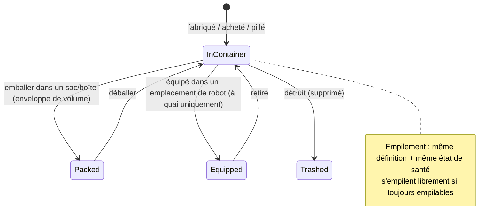

# Objets & inventaire

Votre **inventaire** se compose d'un ensemble de **conteneurs** (le conteneur public de la base, le conteneur de votre robot,
des sacs/boîtes, etc.). Cette page traite de la manipulation des objets en leur sein.

> Les emplacements dans l'interface suivent la [vue d'ensemble de l'interface](/fr/features/ui/). Les mécaniques ci-dessous
> sont confirmées par le serveur.

## Conteneurs

- **Lister un conteneur** — afficher son contenu.
- **Déplacer des objets** — transférer des objets entre conteneurs auxquels vous avez accès.

Des règles d'accès s'appliquent : certains conteneurs (hangar de corpo, inventaire de robot, conteneurs système)
sont soumis à restrictions — voir [robots](/fr/features/robots/) et [groupes](/fr/features/groups/).

## Emballage & déballage (Packing & unpacking)

- **Emballer des objets (Pack)** — placer des objets dans un sac/boîte (un conteneur « enveloppe de volume »)
  pour les transporter de manière compacte.
- **Déballer des objets (Unpack)** — extraire les objets d'un sac/boîte.

L'emballage permet également de compacter un **robot** pour le stockage ou le transport : le serveur retire son état
dynamique et ses composants, puis le marque comme *reconditionné (repacked)*. Un robot ne peut être emballé que s'il est
**intact (non endommagé)**, **non sélectionné**, **non assuré** et doté d'un **inventaire vide**. Le déballage reconstruit
le robot et le répare. Seuls les objets signalés comme *reconditionnables (repackable)* dans les données de contenu peuvent
être emballés ; un robot reconditionné ne peut être sélectionné ni équipé tant qu'il n'est pas déballé (voir [robots](/fr/features/robots/)).

## Empilement (Stacking)

De nombreux objets s'empilent. Les opérations d'empilement :

- **Empiler les objets** / **empiler vers** / **empiler la sélection** — regrouper des objets de même type en une pile
  (ou déplacer une pile sur une autre).
- **Désempiler une quantité** — séparer une quantité précise d'une pile.

Le serveur ne fusionne que les objets partageant la **même définition et le même niveau de points de vie (santé)**.
Les objets signalés comme *toujours empilables (always stackable)* (minerais, munitions, la plupart des matières premières)
s'empilent librement ; les objets marqués *non empilables (non-stackable)* ne s'empilent jamais ; tous les autres ne peuvent
s'empiler **qu'à l'état reconditionné (emballé)** — le matériel déballé ou endommagé reste donc individuel.

## Renommage & utilisation

- **Renommer un objet** — attribuer un nom personnalisé à un objet.
- **Utiliser un objet** — activer un objet utilisable (selon le contexte ; dans une zone, cela peut également interagir
  avec des objets de zone — voir [collecte](/fr/features/gathering/)).
- **Utiliser un objet de loterie** — ouvrir/activer un objet de type loterie.

## Destruction & remboursement

- **Détruire des objets (Trash)** — jeter des objets (les supprime définitivement).
- **Rembourser un objet** — procédure de remboursement réservée au personnel/administrateur : crée l'objet et le remet
  à un personnage, avec inscription dans le journal des transactions. Les joueurs ne l'invoquent pas directement.

## Objets spéciaux

- **Objets échangeables (Redeemables)** — lister, **échanger** ou **activer** des objets échangeables (codes/dotations).
- **Packs cadeaux (Goodie packs)** — lister et **réclamer** des packs cadeaux (lots d'objets).
- **Ouvrir un cadeau (Gift)** — un cadeau contient un objet **aléatoire** tiré parmi une réserve de butin globale
  au serveur (munitions, minerais bruts, plasma, kits de recherche, modules, capsules, peintures, boosters — 221 définitions
  possibles, chacune avec sa propre plage de quantité).

## Notes pratiques

- **L'accès dépend du conteneur** — vous ne pouvez manipuler que les conteneurs qui vous appartiennent ou dont l'accès vous est accordé.
- **Emballez pour transporter davantage** — les sacs/boîtes vous permettent de déplacer de gros volumes de manière compacte.
- **Les piles économisent de la place** — fusionnez les objets identiques ; désempilez pour prélever exactement ce dont vous avez besoin.
- **La destruction est irréversible** — les objets jetés sont définitivement supprimés.
- **Les échangeables et packs cadeaux sont à usage unique** — les réclamer consomme le code ou l'objet.
- **Les robots emballés sont inertes** — déballez-les avant de les sélectionner ou de les équiper.
- **Seuls les objets emballés s'empilent** — si des objets identiques refusent de fusionner, emballez-les (ou réparez-les) d'abord.

<!-- TODO: only the inventory UI remains.
     Confirmed: stacking rules (Item.cs CanStackTo: same ED + same health; AttributeFlags
     alwaysStackable/nonStackable; others must be repackaged); pack rules (ItemPacker.cs:
     robot must be undamaged, not selected, not insured, empty inventory; repackable
     flag); unpack rebuilds + repairs (ItemUnpacker.cs); gifts = random draw from
     giftloots (221 defs: ammo x1500-2000, epriton/fluxore x600-1000, reactor plasma
     x10-20k, research kits, paints, capsules, named3 modules, boosters, respec tokens);
     goodie packs are campaign-based (GoodiePackRedeem: campaignID + indy selection);
     ReimburseItem = admin tool (opp_reimburselog). AttributeFlags bit positions:
     nonStackable=10, alwaysStackable=11, repackable, consumable=24, deployable=23.
     Developer notes: ListContainer.cs; RelocateItems.cs; PackItems.cs / UnpackItems.cs;
     StackTo.cs / StackSelection.cs / UnstackAmount.cs; SetItemName.cs; UseItem.cs /
     UseLotteryItem.cs; TrashItems.cs; ReimburseItem.cs (PbsReimburseRequestHander.cs);
     RedeemableItemList.cs / RedeemableItemRedeem.cs / RedeemableItemActivate.cs;
     GoodiePackList.cs / GoodiePackRedeem.cs; GiftOpen.cs. Container access:
     ContainerAccess / ContainerAccessChecker.cs. -->
