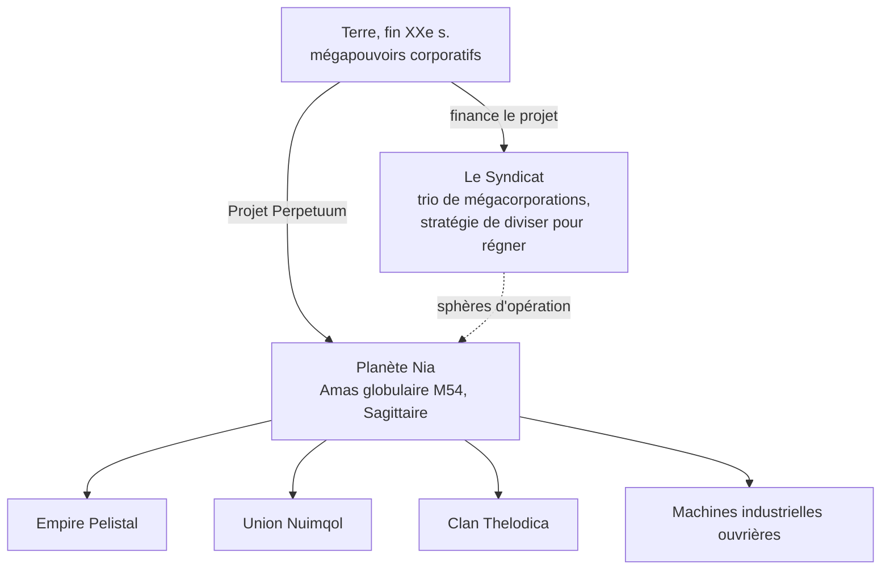

# Lore

## La découverte de Nia

Le boom technologique de la Terre à la fin du XXe siècle — l'internet, la fusion
médicale-IT, la recherche spatiale — a brisé les anciennes frontières physiques et
mentales. La communication et le commerce sont devenus plus rapides et moins chers,
et les grandes corporations sont devenues les gouvernements de fait de leurs régions.

Dans ce monde est venue la découverte de la **planète Nia**, dans l'amas globulaire
M54 de Sagittaire (la source du logo du projet). Nia orbite l'une d'une paire
d'étoiles — la quatrième planète de cette paire — et est étonnamment similaire à la
Terre : température moyenne de surface d'environ 19 °C et une densité atmosphérique
proche de la Terre. Deux particularités la distinguent. Ses océans sont des barrières
impassables pour tout ce qui est propulsé électriquement — le noyau dense de la
planète et sa rotation rapide les maintiennent chargés — et seulement environ 17 %
de la surface est terre ferme, que la tectonique rapide des plaques déchire en
archipels. Sur cette terre, la vie prospère.

## Les Nians

Les habitants de Nia brisent la signification habituelle de « forme de vie » : une
espèce synthétique, pas si différente de nos robots en apparence, mais organisée en
**sociétés** distinctes et technologiquement avancées — chacune avec sa propre
industrie, militaire et culture. L'accomplissement qui compte le plus pour une Terre
affamée d'énergie est leur **technologie de production d'énergie**.

Trois races aliens se battent pour la victoire finale à travers les chaînes
d'îles de leurs domaines — l'**Empire Pelistal**, l'**Union Nuimqol** et le
**Clan Thelodica** — avec une population dispersée de machines **Industrielles**
ouvrières entre elles (ce sont les mêmes quatre groupes que vous rencontrez en
[PNJ](/fr/features/npcs/)).

## Le Syndicat

L'investisseur principal du Projet Perpetuum est le **Syndicat** — une alliance des
trois mégacorporations terriennes les plus puissantes, chacune opérant sa propre
sphère d'operations en surface :

| Corporation | Domaine |
|---|---|
| **Truhold-Markson** | Géant de l'industrie de consommation nord-américaine ; pousse dans le domaine **Pelistal** en déclin. |
| **ICS — Institute of Corporate Security** | Association euro-russe ; opérant dans le territoire rebelle **Nuimqol**. |
| **Asintec** | Hégémon industriel asiatique avec ses voisins high-tech ; mène une offensive à grande échelle contre le **Clan Thelodica**. |

La stratégie est l'ancienne *diviser pour régner* : maintenir les trois sphères
en équilibre les unes contre les autres empêche les puissances aliens de s'unir au
lieu de se combattre. Des « Agents » humains opèrent en surface — récolter les
ressources énergétiques des Nians, étudier leur technologie, et faire respecter la
paix que le Syndicat veut.

C'est là que vous entrez en scène.
