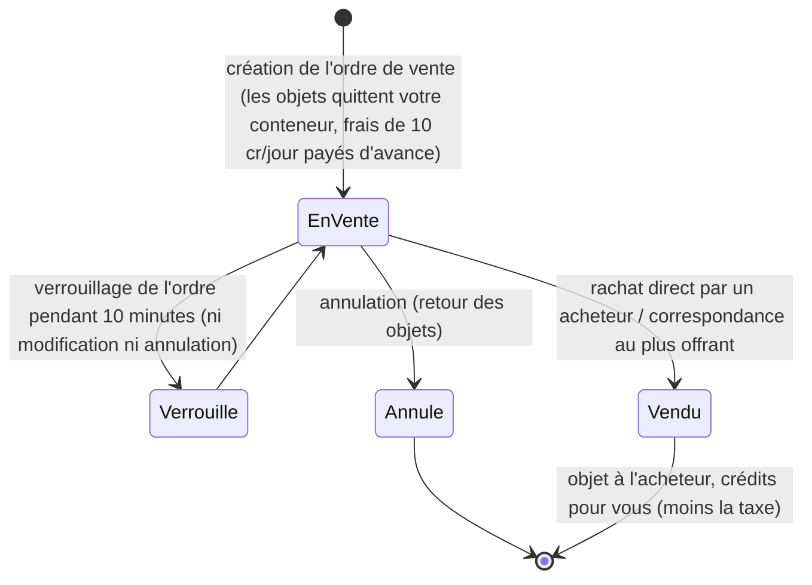

# Marché & commerce

Le **marché** est l'endroit où vous achetez et vendez des objets dans une base. Toutes les actions de marché s'effectuent
**à quai uniquement** (vous commercez au sein de la base où vous êtes amarré).

> Les emplacements dans l'interface suivent la [vue d'ensemble de l'interface](/fr/features/ui/) (la catégorie **Marché**
> sur la barre supérieure). Les mécaniques ci-dessous sont confirmées par le serveur.

## Ordres de marché

Vous pouvez émettre deux types d'ordres sur le marché de votre base actuelle :

### Ordres de vente
Mettre des objets en vente.
- Choisissez l'**objet**, la **quantité**, le **prix unitaire** et la **durée** en jours (minimum 1).
- L'objet est prélevé de votre conteneur (désempilé si vous ne vendez qu'une partie d'une pile).
- **Frais de mise en vente** — vous payez `10 crédits × durée` à l'avance (réductibles par l'extension
  *frais de transaction de marché*) ; ces frais sont versés à la banque centrale de la base (réserve de profits de la zone).
- **Garde de prix (Price guard)** — lorsqu'elle est active, votre prix doit s'inscrire dans une fourchette de **±30 %**
  du **prix moyen sur 14 jours** de l'objet ; tout prix en dehors de cette plage est refusé. *(Cette protection est
  actuellement **désactivée** sur ce serveur.)*
- **Verrouillage de l'ordre** — un ordre ne peut être ni modifié ni annulé pendant les **10 minutes** suivant sa création.
- **Nombre d'ordres** — vous pouvez maintenir ouverts 1 + (bonus de l'extension *expert en ordres de vente de marché*)
  ordres de vente (les ordres d'achat disposent de leur propre compteur).
- **Pour ma corporation** — vous pouvez réserver un ordre de vente aux membres de votre propre corpo (uniquement pour les corporations non par défaut).
- Paiement effectué depuis votre portefeuille **personnel** ou de **corporation** selon le cas.

### Ordres d'achat
Émettre un ordre d'achat permanent pour un objet à un prix fixé.
- Le marché l'exécute dès qu'une offre de vente correspondante apparaît.

### Gestion des ordres
- **Modifier un ordre** — ajuster le prix, la quantité ou la durée.
- **Annuler un objet / ordre** — retirer l'ordre (l'objet retourne dans votre conteneur).
- **Mes objets** — consulter vos ordres ouverts.
- **Correspondance au plus offrant** — une vente peut être directement dirigée vers un ordre d'achat existant.

## Achat direct

- **Acheter un objet** — acquérir instantanément un objet proposé sur le marché (sans émettre d'ordre permanent).

## Parcourir le marché

- **Liste des objets / objets disponibles / objets à portée** — consulter ce qui est en vente.
- **Informations sur le marché** — caractéristiques du marché de la base.
- **Prix moyens** — moyenne locale du marché, moyenne par définition et moyenne **globale**.
  C'est sur ces valeurs que repose la protection de prix.

## Taxe de marché

- **Modifier la taxe de marché** — ajuster le taux de taxe sur le marché. Seuls les **marchés des bases PBS** sont administrés
  par les joueurs ; partout ailleurs s'applique le taux par défaut fixe.
- **Journal de taxe** — consulter l'historique des changements de taxe.

La taxe est déduite du montant perçu par le **vendeur** lors d'une transaction. Le taux par défaut est de
**12 %** (le vendeur reçoit 88 % du prix de vente) ; ce taux peut être diminué par l'extension *taxe de transaction de marché*
et, sur les marchés administrés par les joueurs, par un taux personnalisé fixé par le propriétaire de la base PBS.

## Échanges directs entre joueurs

Un **échange** est une transaction directe de joueur à joueur entre deux personnages amarrés :

- **Initier un échange** — ouvrir une session avec un autre joueur.
- **Déposer / retirer mon offre** — placer des objets ou des crédits de votre côté.
- **Accepter** — les deux parties doivent valider pour finaliser l'échange de manière atomique.
- **Annuler** — interrompre l'échange.
- **Échange terminé / état** — finalisation et état courant.

Un personnage a la possibilité de **bloquer les échanges** le ciblant (voir [premiers pas](/fr/features/getting-started/)).

## La boutique d'objets

La **boutique d'objets** est un marchand à prix fixes situé dans une base (non géré par les joueurs). Le catalogue
intégral (chaque objet, quantité, prix par devise, condition de réputation) est généré sous [Boutique d'objets](/fr/content/shop/).

- **Lister** — consulter les articles en vente dans la boutique.
- **Acheter** — acquérir un objet contre des crédits.

## Transférer des crédits

- **Transférer des crédits** entre vos propres personnages (voir [premiers pas](/fr/features/getting-started/)).

## Notes pratiques

- **Tout se fait à quai uniquement** — il est impossible de commercer dans une zone.
- **Intégrez la taxe de 12 % dans vos prix** — les vendeurs reçoivent par défaut 88 % du prix affiché (moins sur les marchés PBS à forte taxe).
- **Les frais de mise en vente sont payés d'avance** — une durée plus longue coûte davantage, même si l'objet se vend dès le premier jour.
- **Les ordres réservés à la corpo** permettent de faire circuler du matériel au sein de votre corporation sans exposition publique.
- **Les échanges sont atomiques** — les deux parties doivent confirmer, sinon aucun bien n'est déplacé.
- **La taxe modifie le coût réel** — prenez en compte la taxe du marché dans le calcul de votre rentabilité.

<!-- TODO: only the client UI remains (market and trade screen flows).
     Confirmed: MarketInfoService(0.3, 10, false) registered in
     PerpetuumBootstrapper.cs -> margin +-30% vs 14-day average (MARKET_AVERAGE_DAYSBACK
     14), fee 10 credits/day (Market.MARKET_FEE), CheckAveragePrice=false on this
     server; DEFAULT_MARKET_TAX = 0.12 (seller gets 88%), player-controlled tax only on
     PBSDockingBase markets (MarketTaxHelper); order modify/cancel locked 10 min after
     submit (MARKET_CANCEL_TIME); order count = 1 + expert extension bonus;
     fee paid up front to the base's central bank. -->
     Developer notes: Markets/MarketCreateSellOrder.cs (docked, price guard vs average
     price, corp-only, unstack, corp wallet), MarketCreateBuyOrder.cs,
     MarketModifyOrder.cs, MarketCancelItem.cs, MarketBuyItem.cs, MarketItemList.cs,
     MarketAvailableItems.cs, MarketItemsInRange.cs, MarketGetMyItems.cs,
     MarketGetAveragePrices.cs / MarketGetDefinitionAveragePrice.cs /
     MarketGlobalAveragePrices.cs, MarketTaxChange.cs / MarketTaxLogList.cs;
     Trade*.cs (begin/offer/accept/cancel, atomic); ItemShopList.cs / ItemShopBuy.cs;
     CharacterTransferCredit.cs. -->
