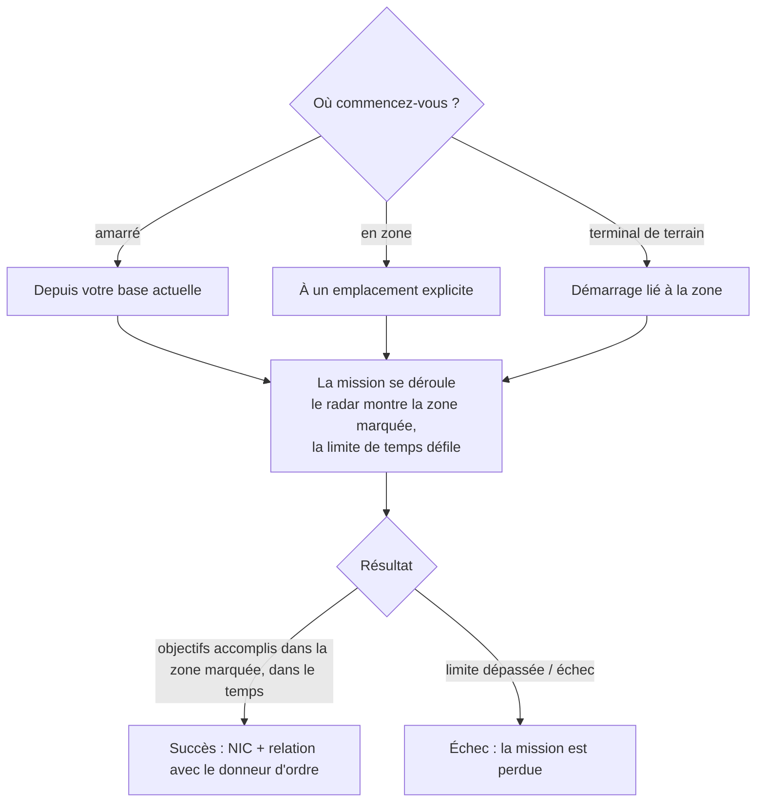

# Missions

Les **missions** sont des objectifs structurés que vous entreprenez en zone — livrer
des objets, toucher des cibles, utiliser des structures. C'est ainsi que vous
progresserez, gagnerez des récompenses, et que vous alimenterez une grande partie du
contenu de zone (alarmes, kiosques, et certains crochets PBS/transport sont liés aux
missions).

> Les emplacements dans l'interface suivent l'[aperçu de l'interface client](/fr/features/ui/).
> Les mécaniques ci-dessous sont confirmées par rapport au serveur.

## Commencer une mission

Vous commencez une mission en choisissant une **catégorie** et un **niveau** (les
niveaux sont limités à une plage valide), à un **emplacement** :

- Si vous êtes **amarré**, la mission commence depuis l'emplacement de votre base
  actuelle.
- Si vous êtes **en zone**, vous spécifiez l'emplacement explicitement.
- Les missions peuvent aussi démarrer **depuis une zone** directement (démarrage lié
  à la zone) ou **depuis un terminal de terrain**.

Toutes les catégories/niveaux ne sont pas disponibles partout — la disponibilité est
pilotée par le contenu. La liste complète des missions (type, catégorie, niveau,
durée, frais de récompense, et objets de récompense) est générée dans
[Missions](/content/missions/).

## À quoi servent les missions

Les missions servent deux buts à la fois : elles paient le NIC, et elles construisent
votre **relation** avec la corporation émettrice (donneur d'ordre). Une meilleure
relation est un facteur clé pour obtenir un **rapport d'installation plus élevé** aux
terminaux de cette corporation — la production et les autres installations deviennent
moins chères et plus rapides pour vous. Les relations peuvent aussi *baisser* :
certaines missions sont en conflit avec les intérêts d'une autre corporation, et le
brief note quand cela vous coûtera de la réputation.

- **Missions d'entraînement** — faciles, mises en avant pour les débutants ; faites-les
  toutes, les récompenses sont une belle injection précoce.
- **Missions régulières** existent en trois saveurs :
  - *Combat* — reconnaissance (scanner les robots ennemis), chasse à la prime (tuer
    les cibles dans un cercle marqué), détruire & récupérer (tuer + récupérer +
    livrer), reconnaissance & récupération, primes spéciales (cibles difficiles
    d'accès).
  - *Industrie* — géologie (scanner un minerai avec la bonne charge), récolte,
    exploitation minérale, exploitation qualifiée (sites de fouille gardés —
    amenez de l'aide armée).
  - *Logistique* — transport (livrer un paquet entre terminaux) et récupération
    (un gros paquet à travers un terrain dangereux — escortez-le).
- Il n'existe pas de **mission sûre** : si vous voyez des ennemis sur la route et
  que vous n'avez pas l'équipement pour vous défendre, demandez de l'aide avant de
  tout perdre en chemin.
- **Les objectifs ne comptent que dans la zone marquée** — la carte de mission la
  marque d'un cercle rouge sur le radar ; les kills et scans ailleurs ne comptent
  pour rien. Dépasser la limite de temps et la mission échoue instantanément.
- **Contrats de transport privés** — un système géré par le Syndicat (deuxième
  onglet de la fenêtre de mission) où les joueurs postent des conteneurs pour que
  d'autres joueurs les transportent entre terminaux, avec une récompense fixée et
  une **caution** que le porteur mise (rendue sur succès, perdue si le conteneur est
  détruit ; abandonner en cours ne rend que la moitié). Gardez les conteneurs assez
  petits pour que quelqu'un puisse réellement les porter.

## Données & options de mission

- **Données de mission** — détails d'une mission.
- **Options de mission** — les choix/variantes disponibles pour une mission.
- **Approvisionnement de mission** — les approvisionnements qu'une mission implique.
- **Objets de démarrage** — les objets avec lesquels une mission commence.

## Dérouler une mission

- **Lister les missions en cours** — ce que vous faites actuellement.
- **Abandonner** — annuler une mission que vous déroulez.
- **Ajouter un participant** — amener un autre personnage dans la mission
  (missions multijoueur).
- **Journal de mission** — le journal des événements d'une mission.

## Livraison

- **Livrer** — compléter une cible de livraison. Cela peut se faire **amarré**
  (à une base) ou **en zone** (à un emplacement/eid spécifique), selon la mission.

## Agents

- **Lister les agents** — les agents de mission disponibles (PNJ/factions qui émettent
  des missions).

## Terminaux de terrain

- **Infos du terminal de terrain** — inspecter un terminal de terrain dans une zone
  (une structure qui peut démarrer ou servir les missions).

## Notes pratiques

- **Les missions sont le tissu connexif** — les alarmes, kiosques, et certaines
  structures sont des objets de mission (voir [collecte](/fr/features/gathering/) et
  [combat](/fr/features/combat/)).
- **Multijoueur** — vous pouvez ajouter des participants pour coopérer sur une mission.
- **Le contexte de livraison compte** — certaines livraisons vous nécessitent
  amarré, d'autres à un emplacement de zone.
- **Le niveau est limité** — demander un niveau hors plage est corrigé, pas une erreur.
- **Abandonner est votre sortie** — si une mission tourne mal, abandonnez-la.

## Structures de mission

Les missions sont ancrées dans les zones par des **structures**. Le serveur implémente
ces types :

| Structure | Ce qu'elle fait |
|---|---|
| **Interrupteur simple** | interaction instantanée — approchez et la cible de mission est accomplie |
| **Interrupteur d'alarme** | une tâche chronométrée — rester à portée pendant une période (des options de la mission), vérifié toutes les 2 s |
| **Approvisionnement d'objets** | chronométré comme un interrupteur d'alarme, puis **génère des objets dans le conteneur de votre robot** |
| **Kiosque** | un point de **soumission d'objets** — remettez les objets requis à la mission |
