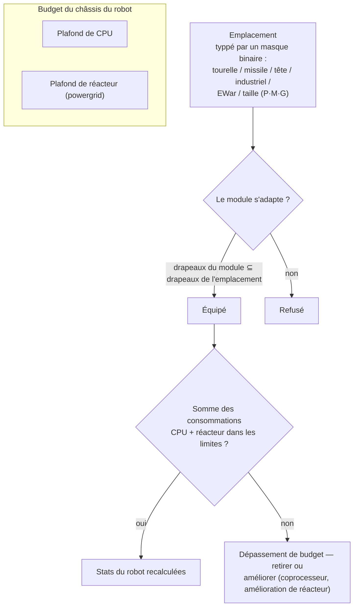

# Modules & équipement

« Acheter un robot ne vous donne que le châssis. » L'équiper avec des modules est l'étape où le robot devient
véritablement l'outil dont vous avez besoin. L'*équipement (fitting)* désigne à la fois la sélection de modules installés
(« envoie-moi ton fit ») et le budget CPU/réacteur qu'elle consomme.

## Emplacements & ressources

Le châssis d'un robot dispose d'un ensemble fixe d'**emplacements (slots)**, définis par sa structure. Chaque emplacement
est typé par un masque binaire — tourelle, lance-missiles, tête, industriel, EWar/ingénierie, taille (petit / moyen / grand) —
et un module ne peut être monté que si son propre masque de type est un sous-ensemble de celui de l'emplacement. Ainsi,
un emplacement de tourelle sur un caster accepte des modules de tourelle petits, moyens *ou* grands, mais aucun lance-missiles
ne pourra jamais y être installé. Les modules de tête (coprocesseurs, modules de tuning) et les modules de châssis/jambes
(plaques, châssis) occupent leurs propres emplacements dédiés.

Chaque module consomme du **CPU** et de la puissance de **réacteur** (powergrid) du châssis — la somme de tout ce qui est équipé
doit impérativement rester sous ces deux limites, et certains modules consomment également de l'énergie d'**accumulateur**
(core) à chaque cycle. La capacité restante constitue le *rendement disponible* affiché dans la fenêtre d'équipement.
Ordres de grandeur par classe de châssis (exemples T1/T2/T3) :

| Classe de châssis | CPU | Réacteur | Exemple |
|---|---:|---:|---|
| Petit crawler | ~250 | ~140 | Castel |
| Mech léger | ~480 | ~300 | Waspish |
| Mech lourd | ~1 100 | ~1 000 | Tyrannos |
| Walker | ~3 200+ | ~1 100+ | Gropho |

Lorsque la capacité vient à manquer : **CPU** — modules coprocesseurs (par ex. le coprocesseur T3 accorde +20 % de CPU)
ou variantes de modules T2 (consommation plus faible). **Réacteur** — améliorations de réacteur (par ex. le T3 offre +20 %
de rendement de réacteur) ou confinement de réacteur (réduit le rayonnement, ce qui protège également de l'EnWar — voir ci-dessous).

## Les familles de modules

Les valeurs chiffrées par modèle figurent dans le [catalogue d'objets](/fr/content/) et la [référence des formats](/fr/formats/) ;
voici la cartographie des familles.

### Armes & munitions

Quatre technologies d'armement, chacune avec son profil de munitions et de portée :

| Arme | Munitions | Profil de distance | Notes |
|---|---|---|---|
| **Armes à feu (Firearms)** | Balles | Optimale courte, immense falloff | Projectiles qui *ne manquent jamais* — mais leur « précision » agit comme un rayon de zone, les petites cibles subissent donc des dégâts réduits face aux gerbes larges. |
| **Magnétiques (canons à rail)** | Obus (slugs) | Portée moyenne, falloff marqué | Vitesse d'impact très élevée ; lourde consommation d'énergie. |
| **Lasers** | Cellules énergétiques | Longue portée | Les plus gourmands en énergie ; faisceaux concentrés. |
| **Missiles** | Missiles | Longue portée | Le coup au but est déterminé par la caractéristique de chance de toucher du *robot*, et non la distance. Les dégâts dépendent de la taille de la cible par rapport au rayon d'explosion — de gros missiles sur de petites cibles infligent bien moins de dégâts. |

Les dégâts diminuent avec la distance selon une courbe cosinusoïdale fluide : dégâts maximaux à portée optimale, zéro à optimale + falloff (voir [chute des dégâts](/fr/features/combat/#damage-types)).

Les munitions permettent d'ajuster le type de dégâts : combiner type principal et secondaire permet un ciblage plus fin
face à un adversaire (voir [types de dégâts](/fr/features/combat/#damage-types)) — au détriment d'un léger montant de dégâts totaux par rapport aux munitions à dégât unique.

Les tourelles existent en petit/moyen/grand ; **adaptez la taille au robot** (les petits robots emploient de petits modules, les mechs et les lourds recourent aux moyens/grands).

### Défense

- **Plaques de blindage** — la réserve de points de vie principale ; lorsque le blindage tombe à zéro, le robot explose.
  Les plaques **LWF** (lightweight frame) échangent de la robustesse contre de la vitesse : une plaque LWF T2 multiplie le blindage
  par ~0,73 mais accorde +19 % de vitesse, −0,2 de signature et −0,2 de masse.
- **Générateur de bouclier** — une barrière alimentée par l'accumulateur qui absorbe les dégâts avant le blindage. Le bouclier
  consomme *votre propre core* pour absorber : un impact qui infligerait 100 de dégâts sur un bouclier 2× puise 50 d'énergie
  au lieu de 100 de blindage. Tant que le bouclier est actif, vos propres armes ne peuvent pas tirer. L'efficacité d'absorption
  dépend du rayon du bouclier par rapport à votre signature — les grands boucliers sur de petits châssis sont les plus performants.
- **Réparation de blindage** — modules de réparation active (petit/moyen/grand) ; la **réparation de blindage à distance**
  atteint une cible verrouillée (alliés ou PBS) mais possède une portée courte et un cycle plus long.
- **Durcisseurs de blindage (Hardeners)** — points de résistance passive par type de dégâts (variantes chimique / cinétique / thermique / explosive).
- **Alliage adaptatif** — équipement passif qui *apprend* la composition des dégâts subis et redistribue une réserve fixe
  de points de résistance vers les types de dégâts que vous encaissez le plus.
- **Évasion / manœuvre** — les modules de réduction de signature et NEXUS (ci-dessous) réduisent la taille de la cible :
  moins de dégâts de zone subis et verrouillage plus difficile pour l'adversaire.

### Énergie

- **Réacteur** — la limite de puissance soutenue ; les améliorations de réacteur l'augmentent, le confinement de réacteur
  abaisse le rayonnement (moins de dégâts d'EnWar subis, au prix d'une légère baisse de puissance).
- **Accumulateur (core)** — la réserve d'énergie instantanée alimentant les cycles des modules. Il se recharge avec le temps
  (`core_recharge_time` du châssis, ~120 ms sur un crawler T1) ; les **rechargeurs d'accumulateur** accélèrent cette régénération.
- **Injecteurs d'énergie (core boosters)** — consomment une charge pour restaurer instantanément une portion d'accumulateur.
- **Transferts d'énergie** — projettent de l'énergie depuis votre robot vers un allié verrouillé (les joueurs ne peuvent pas en transférer aux PNJ).

### Électronique

- **Amplificateur de capteurs (Sensor booster)** — passif, personnel : réduit votre temps de verrouillage et augmente votre portée de ciblage.
- **Amplificateur de capteurs distant** — actif, sur cible : applique le même bonus à un allié verrouillé pendant ~10,5 s.
- **Coprocesseurs** — augmentent la limite de CPU du châssis (T1 +10 % … T3 +20 %).
- **Stabilisateurs d'armes** — améliorent la précision des armes (zone d'explosion effective plus resserrée) et allègent légèrement la masse.
- **Modules de tuning** (emplacements de tête) — bonus fixes accordés à des familles spécifiques : modificateurs de dégâts
  (+25 % de dégâts par famille d'armes au T3), améliorations de minage (+10 % de minage et récolte au T3), améliorations de
  réparateur de blindage (+16 % de réparation, −8 % de durée de cycle au T3).

### Guerre électronique (EWar)

Rendre l'ennemi aveugle et sourd :

- **Atténuateur de capteurs (Sensor dampener)** — affaiblissement à distance : allonge le temps de verrouillage de la cible
  et réduit sa portée de ciblage pendant ~5,5 s. Ne prend effet que si votre puissance ECM surpasse la puissance de capteurs
  (aléatoire) de la cible.
- **Brouilleur de capteurs (Sensor jammer)** — instantané : annule *l'ensemble* des verrouillages de la cible en cas de test ECM réussi.
- **ECCM** — amélioration personnelle pendant 20 s : renforce la puissance des capteurs et la résistance au verrouillage,
  et *dissipe* les affaiblissements vulnérables à l'ECM (atténuateurs, toiles/webs).
- **Neuralyzer** — réinitialise les verrouillages de **l'ensemble** des joueurs dans un rayon de ~1,65 km. Un bouton d'urgence absolue.

Contres : puissance des capteurs (châssis), ECCM et maintien de la distance.

### Furtivité & détection

- **Module de furtivité (Stealth)** — ~10,5 s de furtivité ; la consommation d'énergie est proportionnelle à votre rayon de
  signature (châssis plus imposant = combustion plus rapide du core).
- **Désignateur de cible (Target painter)** — affaiblissement de ~10,5 s qui supprime la force de furtivité de la cible.
- **Module de détection** — augmentation passive de votre puissance de détection.

La confrontation puissance de détection contre force de furtivité détermine si vous pouvez ou non apercevoir (et verrouiller)
une cible camouflée — voir [détection & masquage](/fr/features/combat/#detection-masking-and-speed).

### Guerre énergétique (EnWar)

Vider ou neutraliser l'énergie ennemie :

- **Draineurs (energy vampires)** — siphonnent l'énergie d'une cible verrouillée pour l'ajouter à votre propre accumulateur.
- **Neutraliseurs** — fonctionnement identique, mais l'énergie drainée est détruite.
- Tous deux sont atténués par le **rayonnement de réacteur** de la cible — le confinement est une véritable parade.
- **Démobilisateurs (toiles / webs)** — réduction de vitesse de ~5,5 s sur la cible ; l'effet dépend de la masse de la cible
  (les châssis lourds sont moins ralentis) et échoue face à des cibles situées hors de la portée optimale du module.
- **Scorcher** — arme électrique se *propageant en chaîne* jusqu'à 5 cibles, frappant les boucliers et le blindage avec des dégâts pénétrants.

### Industriel

- **Foreuses** (petites / grandes) et **récolteuses** (petites / grandes) — modules d'extraction ; rendement, durée de cycle
  et consommation d'accumulateur sont les statistiques déterminantes. Le minage octroie des EP (avec un plafond journalier et une pénalité sur les liquides).
- **Géoscanner** — analyse le gisement minéral autour de vous selon la précision de la sonde ; fournit une cartographie
  de ce qui se trouve sous terre (voir [collecte](/fr/features/gathering/)).
- **Excavatrice** — module à aura : augmente le rendement de minage/récolte des unités proches (T3 : +50 %) au détriment de la furtivité.
- **Terraformation** (zones gamma) — outils modifiant le terrain qui élèvent, abaissent ou aplanissent le sol (rayon maximal 5 m)
  et font pousser des plantes murales ; voir la [section des zones](/zones/zone-gamma-z106/).
- **Contrôleurs distants** — tourelles et drones déployés : chaque module de contrôle dispose d'une bande passante (nombre d'unités),
  d'une portée opérationnelle et d'une durée de vie de drone (5–10 min selon le tiers). Variantes : tactique (dégâts/cycle),
  assaut (dégâts), soutien (réparation à distance), industriel (drones de minage/récolte), chasseur. Un module de **traducteur
  de commande à distance** amplifie les dégâts, le blindage, le rendement de minage et la puissance de réparation des drones
  (T3 : +7,5 % chacun) et peut accroître la bande passante du contrôleur.

### NEXUS

Networked Extension Utilization Systems : **améliorations d'escouade**. Un module NEXUS émet une aura autour de son robot
qui confère des bonus aux **membres du gang** (ainsi qu'à leurs tourelles et drones) situés dans son rayon — 10 m par défaut,
rafraîchi toutes les 10 s. Règles :

- un robot ne peut porter que **3 auras NEXUS au maximum**, et au plus **une de chaque type** ;
- l'aura n'atteint que les unités faisant partie de votre **gang**, et non les alliés extérieurs.

Liste des types T3 (13) : vélocité, blindage, bouclier, farlock (portée de ciblage), lock booster (vitesse de verrouillage),
coup critique, assaut (cycle d'arme), EW (portée EWar), évasif (signature), réparateur, industriel (consommation d'accumulateur
en collecte), extracteur rapide (cycle de collecte), rechargeur (recharge du core). Chaque module T3 accorde environ +7,5 %
sur sa statistique ; par exemple, le NEXUS de vélocité multiplie la vitesse max par 1,075 pour chaque coéquipier de gang se trouvant à moins de 10 m.

### NOX

Outils de contre de rang cultiste : modules **négateurs** qui *désactivent* les modules ennemis dans leur rayon — un
**négateur de bouclier** (réduit l'absorption du bouclier d'environ 90 %), un **négateur de réparation** (diminue le rendement
de réparation) et un **négateur de téléportation** (bloque l'utilisation des téléporteurs). Chaque activation **consomme du plasma**
de votre cargaison, et en activer un dans une zone ouverte (hors entraînement) **active votre marqueur JcJ (flag PvP)**.

### Usages spéciaux

- **Module de piratage de siège** — l'outil de SAP actif : cycle de 5 s, portée de 3 m (voir [avant-postes](/fr/features/outposts/)).
- **Autodestruction** — enclenche un compte à rebours de 8 secondes ; le rayon est visible à 600 m. Solution de dernier recours.
- **Détecteur de mines** — étend la portée de détection des mines du châssis.
- **Émetteurs de blob** — déploie un émetteur diffusant un champ de blob ; le module modulateur d'émission affine ce champ (voir [combat](/fr/features/combat/)).
- **Construction PBS** — module employé pour poser les structures PBS sur les zones gamma.

## Règles empiriques (Rules of thumb)

1. **Ne panachez pas vos armes.** Associer magnétique + laser + missiles sur un même robot sous-performe généralement face aux trois ;
   mélanger courte et longue portée réussit rarement.
2. **Surveillez la masse.** Chaque plaque et chaque module de bouclier ajoute de la masse et de la signature — la vitesse prime parfois sur la défense.
3. **Ne cherchez pas à tout faire.** Un robot qui mine, scanne et tire n'excellera dans aucun de ces domaines face à un spécialiste.
4. **Adaptez la taille de vos modules** à celle du robot, et réservez une marge de CPU/réacteur pour les modules de tuning indispensables au bon fonctionnement du build.
5. …et oui, quelques configurations atypiques enfreignent toutes ces règles et fonctionnent malgré tout. Réfléchissez simplement à vos choix.

<!--
Developer notes: rewritten 2026 from backend sources; no community-wiki text reused.
Verified against:
- src/Perpetuum/Robots/RobotComponent.cs (slot bitmask fitting: moduleFlagMask & slotFlagMask)
- src/Perpetuum/Modules/SlotFlags.cs (12 slot flag bits)
- src/Perpetuum/Modules/Weapons/WeaponModule.cs + FirearmWeaponModule.cs +
  MissileWeaponModule.cs (accuracy: firearms never miss, explosion radius from
  Accuracy; missiles use ParentRobot.MissileHitChance)
- src/Perpetuum/Modules/Weapons/Damage.cs (cosine falloff, critical 1.75x +/-10%,
  explosion scaling signature/explosionRadius clamped [0,1])
- src/Perpetuum/Units/Unit.cs GetResistByDamageType (resist/(resist+100))
- src/Perpetuum/Zones/DamageProcessors/DamageProcessor.cs (shield draws core,
  electric = penetrating)
- src/Perpetuum/Modules/EffectModules/ShieldGeneratorModule.cs (absorption
  modifier = shieldRadius ratio / shieldAbsorbtion; WeaponModule.cs:112 blocks
  firing while HasShieldEffect)
- src/Perpetuum/Modules/EffectModules/{Webber,SensorDampener,SensorBooster,
  Stealth,TargetPainter,Eccm,Detection,AdaptiveAlloy}.cs (durations from
  effects table: dampener/web 5.5s, stealth/paint/remote-boost 10.5s, ECCM 20s)
- src/Perpetuum/Modules/SensorJammerModule.cs + Neuralyzer.cs (lock reset,
  NEURALYZER_RANGE=1650)
- src/Perpetuum/Modules/{EnergyVampire,EnergyNeutralizer,Scorcher,
  CoreBooster,EnergyTransferer}.cs (EnWar, reactor radiation modifier, chain)
- src/Perpetuum/Modules/GangModule.cs + Zones/Effects/GangEffect.cs +
  EntitiesModule.cs:532-544 (13 aura types, gang-members-only, effects table
  auraradius=10)
- src/Perpetuum/Modules/NoxModule.cs (plasma consumption, PvP flag)
- src/Perpetuum/Modules/RemoteControl/* (bandwidth/range/lifetime, translator
  amplification)
- entitydefaults rows: named1-3 armor plates/hardeners, shield generators
  (absorbtion 2.0-2.3, radius 5-33), LWF (mass_reductor), cpu/powergrid
  upgrades, damage/mining/repairer tuning, NEXUS named3 values, NOX cultist
  values, siege hack (5s/3m), chassis core_max/powergrid_max.
Corrections vs ingested page: NEXUS auras reach gang members only (not "all
friendly units"); no "co-reactor" module exists (reactor upgrades/sealing do
that); demobilizer effect scales with target mass, no "resistance stat";
sensor suppressor = sensor dampener (5.5s debuff).
-->
