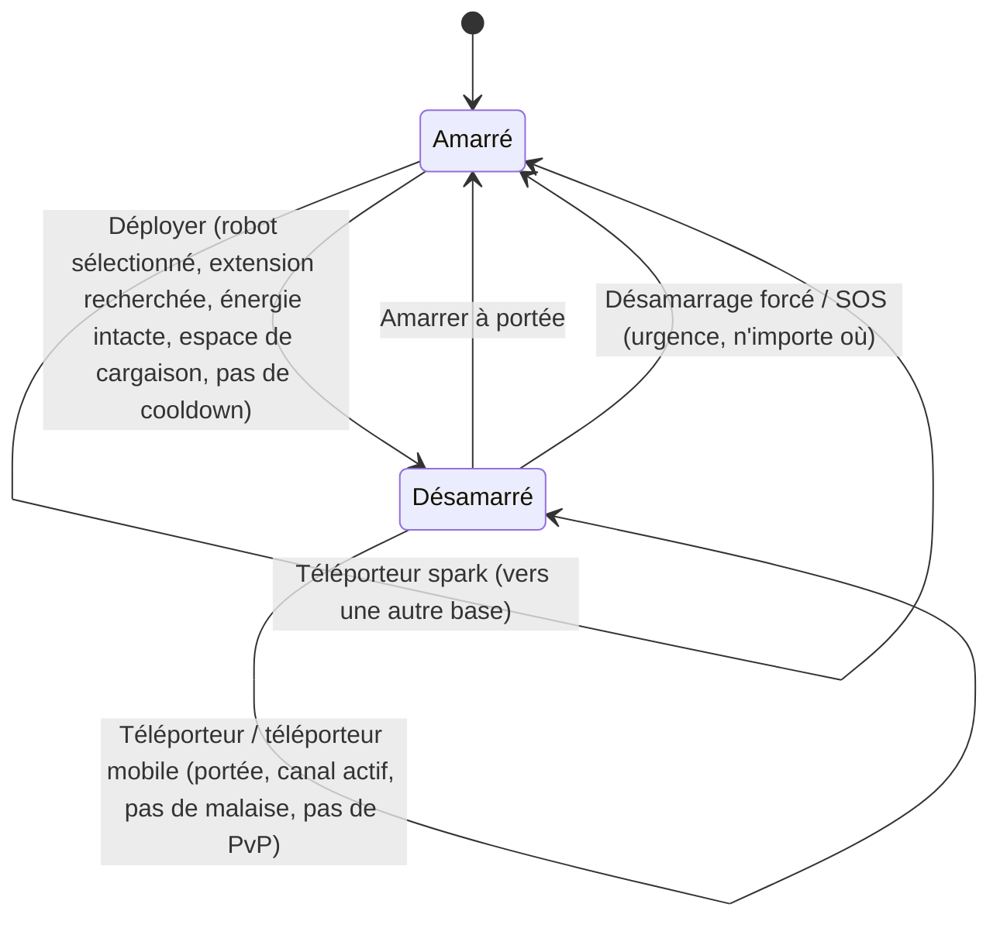

# Déplacement & zones

Vous êtes toujours dans l'un des deux états : **amarré** à une base, ou
**désamarré** dans une zone où vous pilotez votre robot actif à distance. Tout sur
cette page concerne le déplacement entre ces états et entre les zones.

> Les emplacements dans l'interface suivent l'[aperçu de l'interface client](/fr/features/ui/) :
> le **bouton Déployer/Amarrer** est le bascule centrale de la barre supérieure. Les
> mécaniques ci-dessous sont confirmées par rapport au serveur.

## Amarré vs désamarré

- **Amarré** — vous êtes à une base. Vos robots et objets sont dans des conteneurs.
  Vous ne pouvez pas piloter un robot, utiliser des téléporteurs, ou scanner, mais
  vous pouvez produire, échanger, rechercher, et utiliser les installations de base.
- **Désamarré** — vous êtes dans une zone, pilotant votre robot actif. Vous pouvez
  vous déplacer, scanner, combattre, et interagir avec les objets de zone, mais la
  plupart des activités exclusives à la base sont verrouillées.

## Désamarrer

Appuyez sur **Déployer** (centre de la barre supérieure). Le serveur vérifie alors :

1. Vous avez un **robot actif sélectionné**.
2. La classe de ce robot a l'**extension d'activation** requise recherchée sur votre
   personnage (voir [recherche](/fr/features/research/)).
3. Le **système d'énergie** du robot est intact.
4. Le **conteneur** du robot a de la capacité libre.
5. Vous n'êtes pas dans un **temps de recharge de désamarrage** (un court minuteur
   après certains événements).

Si une vérification échoue, le désamarrage est refusé.

## Ré-amarrer

- **Amarrer** à une base quand vous êtes à portée d'amarrage.
- **Désamarrage forcé** est l'action d'urgence : vous sort de la zone et vous amarre
  immédiatement à la base principale (TMA), même en combat. Utilisez-le quand vous
  perdez un combat.
- **SOS** — une action d'aide de zone qui vous amarre à la base actuelle et signale
  l'incident.

## La file d'entrée de zone

Certaines zones sont occupées et utilisent une **file d'entrée** quand vous vous
désamarrez / entrez :

- Vérifier l'état de la file (`zoneGetQueueInfo`).
- Définir votre longueur de file préférée (`zoneSetQueueLength`).
- Annuler l'attente si vous avez changé d'avis (`zoneCancelEnterQueue`).

## Téléporteurs

Les **téléporteurs** sont des structures dans une zone. Pour en utiliser un :

- Vous devez être **à portée du téléporteur**.
- Le **canal** (destination) doit être **actif** et valide.
- Vous ne devez **pas** être sous *malaise de téléportation* — un court temps de
  recharge après toute téléportation, pendant lequel vous ne pouvez plus téléporter.
- Certains effets (p. ex. négation *Nox*) ou être **en combat PvP** peuvent bloquer
  les téléporteurs.

Les canaux de téléportation existent en trois types :

| Type | Effet |
|---|---|
| **Dans la zone** | Vous déplace à un point aléatoire de la même zone |
| **Autre zone** | Vous déplace à un point aléatoire d'une autre zone |
| **Sortie d'entraînement** | Quitte une zone d'entraînement (avec option de niveau de récompense) |

Les **téléporteurs mobiles** sont des objets de téléportation *possédés* (p. ex.
téléporteurs mobiles de bastion/monde). Des règles supplémentaires s'appliquent :

- Seul le **propriétaire ou un membre de la bande du propriétaire** peut en utiliser.
- Ils **ne peuvent pas être utilisés en PvP**.
- Chaque utilisation applique un **temps de recharge** à ce téléporteur.

Vous pouvez lister les téléporteurs et leurs canaux, et interroger les canaux mondiaux.

## Téléporteurs spark

Les **téléporteurs spark** sont un système de déplacement rapide entre les bases :

- Vous **définissez** une destination spark à une base, puis vous l'**utilisez**
  (amarré) pour sauter instantanément à une autre base.
- Vous pouvez **lister, définir, utiliser et supprimer** vos téléporteurs spark.
- La base cible doit **permettre l'amarrage** pour vous.
- À l'arrivée, le serveur sélectionne un robot adapté pour vous (un dont vous avez
  recherché les extensions d'activation).
- Le **nombre de téléporteurs spark que vous pouvez détenir** est limité par une
  extension (voir [recherche](/fr/features/research/)) ; dépasser est refusé.

## Portes

Les **portes** sont des structures de zone qui peuvent être utilisées d'ailleurs
(non limitées par la portée comme les téléporteurs). Un propriétaire de base peut
**renommer** ses portes.

## Informations de base

Vous pouvez inspecter n'importe quelle base :

- **Infos** — ce que c'est et où.
- **Propriété** — qui est propriétaire.
- **Installations** — ce qu'elle offre (production, marché, boutique, …).
- **Mes objets** — vos objets stockés à cette base.
- **Droits d'amarrage** — un propriétaire de base peut définir qui peut y amarrer.

## Ce qui peut mal tourner

| Symptôme | Cause probable |
|---|---|
| Désamarrage refusé | Pas de robot actif, extension d'activation manquante, système d'énergie endommagé, conteneur de robot plein, ou temps de recharge de désamarrage |
| Téléportation refusée | Hors portée, canal inactif, malaise de téléportation, effet Nox, ou en PvP |
| Téléporteur mobile refusé | Pas propriétaire/membre de bande, ou en PvP |
| Téléporteur spark refusé | La base cible interdit l'amarrage, pas de robot valide à sélectionner, ou limite de téléporteurs spark atteinte |
| Bloqué à une entrée de zone | File de zone — vérifier l'état de la file ou annuler |
