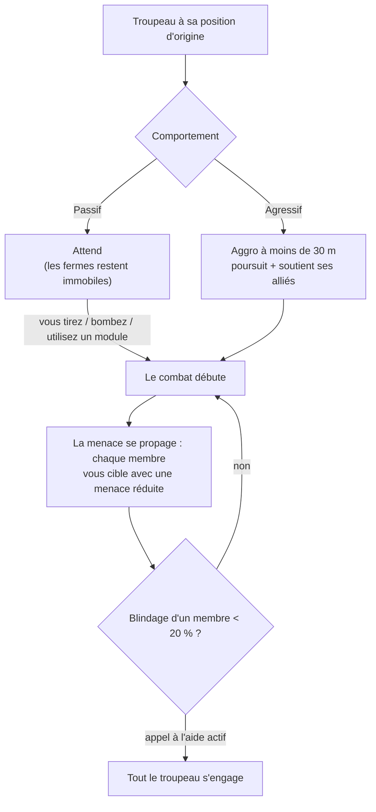

# PNJ & chasse JcE

Les PNJ constituent la source principale de [plasma de réacteur](/fr/content/ores/), de [noyaux (kernels)](/fr/features/research/)
et de modules du jeu, ainsi qu'un moyen fiable de remporter des points d'extension à tout niveau.
Ils évoluent en **troupeaux (flocks)** : des groupes partageant une position d'origine, un rayon territorial,
un temps de réapparition et un comportement.

## Qui trouve-t-on dehors

Les PNJ se déclinent en quatre races — **Nuimqol, Pelistal, Thelodica et Industriel** — chacune articulée autour
de plusieurs classes de robots (coureurs, crawlers, mechs, mechs lourds) et de rangs 1 à 5 aux statistiques et au butin croissants.
Au-delà des rangs réguliers :

- **Gobelins** — vigies de guerre électronique (EWar) sur les îles protégées. Fragiles, mais leurs modificateurs de verrouillage
  sont extrêmes (ils vous verrouillent ~5× plus vite que la normale, à ~2× plus de distance) : un camp de gobelins rend le combat
  ou le minage aux alentours particulièrement éprouvant.
- **Élites** — variantes rares des PNJ de rang, dotées de statistiques de base à peu près doublées et d'un meilleur butin.
- **Observateurs** — PNJ itinérants et agressifs (Arbalest, Baphomet, Waspish, Tyrannos, Artemis, Kain, Gropho, Sequer, Seth, Mesmer…).
  Ils patrouillent sur de vastes portions de l'île et s'avèrent nettement plus redoutables que les PNJ de rang de même classe —
  les *grands observateurs* des îles protégées et leurs variantes des îles ouvertes comptent parmi les chasseurs réguliers les plus puissants.
- **Boss** — PNJ rares, configurés individuellement. Ils ne fuient jamais, peuvent s'annoncer à l'échelle du serveur entier,
  et certains sont liés aux avant-postes (les tuer fait varier la [stabilité d'avant-poste](/fr/features/outposts/)) ou font apparaître
  des failles de reliques lors de leur destruction. Les boss les plus faibles peuvent être vaincus en solo sur les îles protégées ;
  les plus puissants requièrent un groupe dédié.
- **Groupes du Syndicat** — faction particulière (le Syndicat, dotée de ses propres PNJ nommés) exploitant ses propres fermes
  statiques, généralement sur les îles protégées et les îles ouvertes peu profondes.

## Passif contre agressif

- **Troupeaux passifs** n'attaquent jamais d'eux-mêmes — vous devez d'abord tirer, bombarder ou activer un module offensif sur eux.
  La majorité des fermes statiques classiques sont passives.
- **Troupeaux agressifs** réagissent spontanément dès que vous entrez dans un rayon de **30 m**, vous poursuivent et prêtent main-forte
  à leurs alliés engagés en combat. Tous les Observateurs, la plupart des apparitions itinérantes ainsi que les gardiens et envahisseurs
  d'avant-postes sont agressifs.

Lorsqu'un combat s'engage, **la menace se diffuse à travers le troupeau** : chaque membre vous prend pour cible avec un niveau
de menace réduit, et si le blindage de l'un d'eux passe sous la barre des **20 %**, le groupe entier se focalise sur vous
(pour les troupeaux dont l'appel à l'aide est activé). Considérez que vous affrontez la meute entière dès le premier tir ennemi.

## Apparitions et réapparitions (Spawns)

- **Spawns statiques** demeurent sur une position d'origine fixe avec un rayon de patrouille ; les membres réapparaissent
  **individuellement** selon leur propre compte à rebours. Un troupeau intensivement chassé réapparaît plus vite ; un groupe intact
  réapparaît plus lentement.
- **Spawns itinérants** arpentent l'île — ce sont les Observateurs et les formations en convoi, généralement agressifs.
- **Renforts de sites miniers** — les PNJ industriels exploitant un gisement disposent de vagues de renforts préconfigurées :
  au fil de l'affrontement, de nouvelles vagues arrivent sur place. Les boss appellent également des renforts lorsqu'ils sont blessés.
  Ainsi, ce qui semblait être une cible unique peut dégénérer en combat de groupe ; inspectez le secteur avant de vous engager.

## Ce qu'ils rapportent (Butin)

Le butin est paramétré par type de PNJ : **plasma de réacteur de la race de l'île**, **noyaux (kernels)** (communs, haute technologie,
industriels et spécifiques à la race), composants de modules et, plus rarement, modules emballés. Les rangs supérieurs et types spéciaux
offrent des récompenses plus généreuses.

Chaque élimination accorde également des **points d'extension (EP)**, définis par type de PNJ — et doublés sur les îles ouvertes
(palier bêta).

## Avantages selon le rang de zone (Zone tier perks)

Les îles se divisent en trois paliers — protégées (alpha), JcE ouvert (bêta) et JcJ ouvert (gamma). La chasse devient plus périlleuse,
mais aussi nettement plus gratifiante à mesure que vous vous enfoncez :

- **Explosions de destruction** — sur les îles protégées, un robot abattu n'explose *pas*. Sur les îles ouvertes (bêta et gamma),
  chaque robot détruit — joueur ou PNJ — explose en infligeant des dégâts de zone. Les explosions en chaîne accélèrent le nettoyage
  des camps mais rendent les embuscades meurtrières.
- **EP doublés** — la récompense de base en EP de chaque activité est doublée sur les îles de palier bêta.
- **Meilleures missions** — les missions de niveau supérieur se situent sur les îles ouvertes, et leurs gains d'EP sont également doublés.
- **Jetons de mission de faction** — les missions des îles ouvertes récompensent avec les jetons de mission de cette race
  (jetons Nuimqol / Pelistal / Thelodica) plutôt qu'avec le jeton universel. Les jetons de faction s'échangent également directement
  aux terminaux des îles ouvertes, tandis que le jeton universel peut être acheté là où les jetons de faction font défaut.

## Notes pratiques

- **Analysez le troupeau avant d'engager** — dénombrez les membres, repérez les rangs et vérifiez si le spawn est agressif ;
  un camp passif dans lequel vous pénétrez peut dissimuler cinq robots.
- **Tirez parti de votre portée** — les spawns statiques restent confinés à leur zone de patrouille ; vous positionner pour décocher
  des tirs lointains et dégagés est souvent la méthode la plus sûre et économique.
- **Les sites de ressources sont des pièges** — avec les renforts industriels, plus l'affrontement s'éternise, plus les ennemis affluent.
- **Observateurs en mouvement** — en phase d'exploration, de recherche d'artefacts ou de transport lourd, croiser un Observateur agressif
  implique soit un combat immédiat, soit un détour obligatoire.

<!--
Written from scratch against the server backend, 2026-09-27:
Zones/NpcSystem/Flocks/ (Flock.cs, NormalFlock.cs — group respawns, adaptive
respawn multiplier), AI/Behaviors/ (Passive vs Aggressive; threat spread at
50%, call-for-help at 20% armor in SmartCreature.cs), AI/BodyPullThreatHelper.cs
(30 m aggro range, aggressive-only body-pull), Reinforcements/ + npcreinforcements
(mining-site and boss waves at HP thresholds), NpcSpecialType + npcbossinfo
(boss respawn noise, outpost stability links, server-wide announce),
entitydefaults (rank1-5 + dps/interceptor/scout/miniboss/elite variants, 30
elite definitions with ~2x modifiers; 13 def_npc_roaming_* observers; goblin
lancer/shark with 5x lock-time / 2x lock-range modifiers),
npcloot (26k rows: race plasma, common/hitech/industrial/race kernels,
modules), NpcEp.cs + GetNpcKillEp (EP per NPC, x2 on beta),
Unit.DoExplosion (death AoE suppressed on protected zones, active on
beta/gamma; radius from signature, damage from remaining core),
MissionLocation.cs (race-specific mission coins; universal coin on protected
zones), ZoneConfiguration (IsAlpha/IsBeta/IsGamma).
An earlier version of this page was adapted from the Open Perpetuum
community wiki (perpetuum.miraheze.org) and has been fully rewritten from
backend sources; no text was reused.
The ingested "TAP" section was dropped: no teleport-attractor concept exists
in this backend (no definition, code or table).
-->
