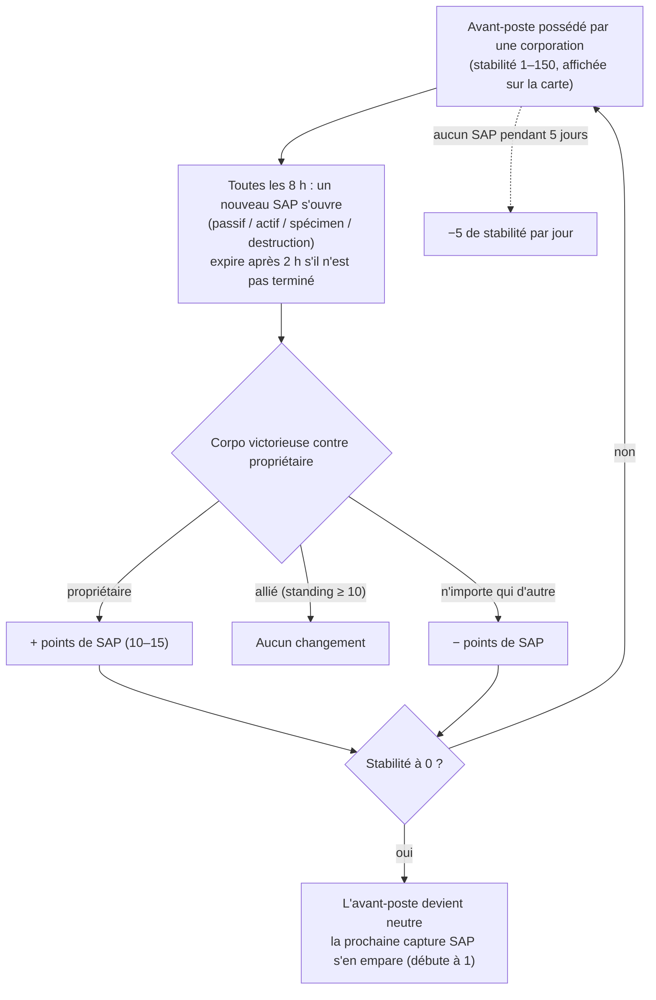

# Avant-postes & SAP

Sur les îles en JcJ ouvert, **les avant-postes peuvent appartenir à des corporations de joueurs**.
Le contrôle est mesuré par une jauge de **stabilité** (0–150) affichée au-dessus de l'avant-poste
sur la carte. Le système de **SAP** (Service Access Point) est le mécanisme par lequel cette jauge
évolue — et par lequel les avant-postes changent de propriétaire.

## Les règles

- Lorsque la corporation **propriétaire** termine un SAP, la stabilité **augmente** de la valeur en points du SAP.
- Lorsqu'une **corporation alliée au propriétaire** (réputation mutuelle à +10 ou plus) en termine un, la stabilité **ne bouge pas**.
- Lorsque **n'importe qui d'autre** en termine un, la stabilité **diminue** du même montant.
- À **zéro**, l'avant-poste perd son propriétaire et redevient neutre. Terminer n'importe quel SAP sur un avant-poste neutre le **capture**
  (la corporation ayant validé le SAP en devient propriétaire, avec une stabilité initiale de 1).
- **Dégradation (decay)** : si aucun SAP n'est validé pendant **5 jours**, l'avant-poste commence à perdre **5 points de stabilité
  par jour** jusqu'à ce qu'un SAP soit terminé (ou jusqu'à sa perte).

## Les quatre types de SAP

Toutes les 8 heures, un avant-poste propose un nouveau SAP — parmi quatre types. Chaque type possède sa propre valeur
en points et sa méthode de résolution :

| Type | Méthode d'accomplissement | Points | Nature des récompenses |
|---|---|---|---|
| **Passif** | Se tenir dans le rayon du SAP pendant **8 minutes**. La progression est individuelle (temps continu passé par chaque joueur dans le faisceau) ; le joueur au score personnel le plus élevé s'en empare. | +10 | Plasma de faction (proportionnel à la stabilité), kits de recherche, boosters d'EP. |
| **Actif** | Cibler le SAP et maintenir un **module de piratage SAP** en fonction — environ 120 cycles de module (5 s chacun), soit ~10 minutes. La progression persiste si vous vous interrompez ou quittez la zone ; individuelle. | +15 | Plasma, noyaux (kernels), kits de recherche et **cœurs de réacteur** (production de robots). |
| **Spécimen** | Apporter des **objets de spécimen** au SAP (à moins de 7 m) et soumettre les 5–6 demandés. Chaque dépôt a un temps de recharge de 90 secondes ; progression individuelle. | +15 | Plasma, noyaux, kits de recherche. |
| **Destruction** | Détruire le SAP au tir : **30 000 de blindage** et **150 de résistance aux quatre types de dégâts** (réduction de 60 %), **signature de 6 m** — les petites armes le touchent le plus efficacement. La progression des dégâts est **corporative et non individuelle**, des flottes entières peuvent donc tirer de concert ; la corporation ayant infligé le plus de dégâts à sa destruction applique le résultat. | ±15 | **Munitions JcJ** de faction, plasma, noyaux. |

Les quatre types de SAP **diffusent les meilleurs scores en cours** (top 10) à tous les joueurs à proximité,
et ils **expirent après 2 heures** s'ils ne sont pas achevés.

### Priver l'ennemi (Denying)

La progression en destruction étant corporative et le sens de la variation de stabilité dépendant du vainqueur,
une tactique fréquente consiste à **infliger suffisamment de dégâts pour prendre la tête du classement sans achever le SAP** :
si les troupes du propriétaire viennent le terminer, *votre* corporation reste désignée vainqueur, et la perte de stabilité
frappe le propriétaire.

## Surveillance et prédiction

- La **charge de scanner d'intrusion** dans un géoscanner, activée à proximité de l'avant-poste, indique le **temps avant le prochain SAP**
  pour les avant-postes à portée (sur les îles en JcJ ouvert, la même charge indique l'état des renforts PNJ).
- Les SAP s'annoncent aux joueurs des environs peu avant leur ouverture.
- La diffusion du classement des meilleurs scores permet de **suivre un SAP disputé en temps réel** et d'évaluer l'opportunité d'intervenir.

## Autres sources de variation de la stabilité

- **Reliques SAP** — objets de relique apparaissant entre 90 et 350 m de l'avant-poste (réapparition de 4 heures, durée de vie jusqu'à 12 heures).
  En détruire une applique **immédiatement ±1 de stabilité** (pour votre corporation), vous marque en JcJ (PvP flag) et rapporte des EP ainsi qu'un conteneur de plasma.
- **Gardiens et envahisseurs** — les boss PNJ de l'avant-poste :
  - Les PNJ **gardes** restent près de l'avant-poste (~35 m). En éliminer un **réduit systématiquement** la stabilité de 3, quel que soit l'auteur du tir ; ils réapparaissent en ~6 heures.
  - Les PNJ **envahisseurs** patrouillent jusqu'à ~300 m. En abattre un **augmente** la stabilité de 2 pour la corporation responsable ; réapparition en ~6 heures.

## Pourquoi les avant-postes comptent

Détenir un avant-poste accorde ses bonus à la corporation (production, infrastructures de défense, effets) et forme la clé de voûte
du contrôle territorial en JcJ ouvert — voir [PBS](/fr/features/pbs/) pour les structures qui transforment un avant-poste en véritable base d'opérations.

<!--
Written from scratch against the server backend, 2026-09-27:
Zones/Intrusion/Outpost.cs (stability 0-150, capture at 1, ally threshold
+10, EP to participants), OutpostDecay.cs (5-day grace, -5/day), SAP.cs +
PassiveHackingSAP.cs / ActiveHackingSAP.cs / SpecimenProcessingSAP.cs /
DestructionSAP.cs (8-min passive, 120x5s active, 5-6 specimen items with 90s
cooldown, corporate destruction score, 2h expiry, top-10 broadcast),
entitydefaults options (#increase=n10/n15), siegeitems (def_specimen_sap_item
2-3 x 5-6), def_sap_destruction stats (30k armor, 150 res all types, 6m
signature), def_siege_hack_module (5s cycle), intrusionsitestabilitythreshold
+ intrusionsaps, intrusionloot (plasma/kernels/research kits/cores/PvP ammo
by stability tier), npcbossinfo + npcflock (guard -3 @ ~35m, invader +2 @
~300m, 6h respawn), OutpostRelicManager.cs + SAPRelic.cs (90-350m spawn,
4h respawn, 12h lifespan, +1 stability, PvP flag), Scanner.Intrusion.cs
(next-SAP-time scan), EntitiesModule.cs (8h SAP interval).
An earlier version of this page was adapted from the Open Perpetuum
community wiki (perpetuum.miraheze.org) and has been fully rewritten from
backend sources; no text was reused.
Note: the ingested text had several numbers this server contradicts (3-day
decay vs 5-day, 10-min passive vs 8-min, "no resistances" vs 150 all types,
3 km invader range vs 300 m).
-->
