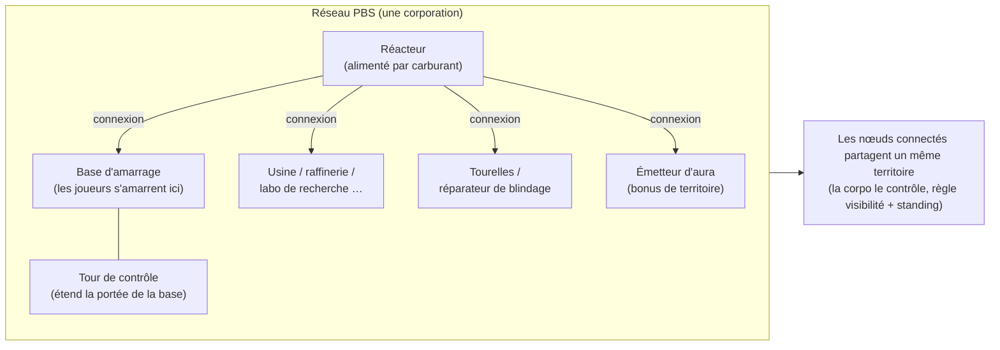
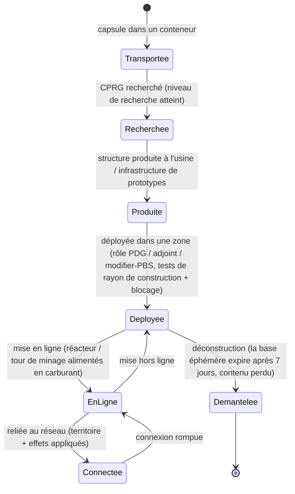

# Stations de base énergétiques (PBS)

Une **PBS** (Power Base Station) est une structure déployable dans une zone. Les objets PBS peuvent être
**connectés** au sein d'un **réseau**, qui délimite des **territoires** et active des **effets**.
Il s'agit d'une activité de corporation et de gestion d'infrastructures — la plupart des actions nécessitent
le rôle de corporation adéquat.

> Les emplacements dans l'interface suivent la [vue d'ensemble de l'interface](/fr/features/ui/). Le nom exact
> en jeu pour « PBS » reste à confirmer. Les mécaniques ci-dessous sont confirmées par le serveur.

## Rôle d'une PBS

- C'est un **nœud** d'un **réseau** PBS.
- Les nœuds connectés constituent un **territoire** partagé que contrôle la corporation propriétaire.
- Un réseau peut diffuser des **effets** (bonus/contrôles) sur l'ensemble de son territoire.
- Certaines structures PBS doivent être **alimentées** en objets (carburant) pour fonctionner.

## Familles de structures

Chaque structure PBS se décline en paliers **petit / moyen / grand**. Vous transportez la **capsule**,
recherchez l'objet (CPRG) et **déployez** la structure — le déploiement est soumis à des droits de corporation (voir plus bas).
Les familles :

| Famille | Structures | Rôle |
|---|---|---|
| Énergie | réacteur, puits d'énergie, batterie de core, transmetteur de core | générer, stocker et distribuer l'**énergie de core** alimentant l'ensemble |
| Amarrage | base d'amarrage, base d'amarrage éphémère, tour de contrôle | lieu d'amarrage des joueurs ; la tour de contrôle étend la portée de la base |
| Production | usine (mill), raffinerie, reprocesseur, réparation, usine de prototypes, laboratoire de recherche, forge de calibrage (CPRG), forge de kits de recherche, amélioration de production | les infrastructures de [production](/fr/features/production/), implantées en zone plutôt qu'à la base d'origine |
| Défense | tourelles (laser / rail / missile / guerre électronique), réparateur de blindage | défense automatisée du territoire |
| Effets | émetteur d'aura, fournisseur d'effets, tour de masquage, tour de minage | projettent les bonus d'effets du territoire ; la tour de minage extrait le minerai automatiquement |
| Transport | nœud d'autoroute (highway node) | relie à l'**autoroute** de la zone (voies de déplacement rapide) |
| Construction | module de construction | l'outil constructeur qui installe les autres structures |

### Effets de l'émetteur d'aura

L'émetteur d'aura est le principal diffuseur de bonus territorial. Chaque palier projette l'un des trois
**bonus de base échelonnés par niveau** :

- **petit** — capteurs lvl1 / ingénierie lvl1 / industrie lvl1
- **moyen** — ces trois mêmes bonus au lvl2
- **grand** — ces trois mêmes bonus au lvl3

Les capteurs augmentent la portée de scan/reconnaissance, l'ingénierie accélère la construction, et l'industrie accélère la production.

### La base d'amarrage éphémère (expiring)

Une base PBS spécifique dotée d'une **durée de vie fixe de 7 jours** (168 h dans les données de contenu).
Elle **ne peut pas être déconstruite** — elle **expire ou est détruite**. Le temps restant est proclamé
par un annonceur en jeu (sujet de canal de la base, messagerie et message du jour MOTD) ; à expiration,
la base est supprimée et son contenu est perdu. C'est le principe de la « location » pour l'amarrage PBS :
au lieu de payer un loyer régulier, vous disposez d'un créneau temporel limité.

## Déploiement

- **Tester le déploiement** — avant de poser une structure, vérifier si elle peut être déployée à cette position
  (pente, blocages et permissions). Nécessite un rôle de corporation (**PDG / adjoint / modifier-PBS**).
- Le déploiement prend en compte le **rayon de construction** et le **rayon de blocage** de la structure.

## Réseau & connexions

- **Consulter le réseau** — afficher le réseau PBS dont vous faites partie.
- **Informations sur le nœud** — détails d'un nœud PBS.
- **Renommer un nœud**.
- **Établir une connexion** — relier deux nœuds PBS. (Se connecter à un réseau disposant déjà d'une base d'amarrage
  déclenche une procédure spécifique de transfert de propriété.)
- **Rompre une connexion** — dissocier deux nœuds.
- **Définir le poids de connexion** — régler la puissance/priorité d'une connexion.

## Contrôle & état

- **Mettre en ligne / hors ligne** — basculer l'état opérationnel d'un nœud.
- **Définir un effet** — configurer l'effet projeté par un nœud.
- **Déclencher la déconstruction d'une base** — programmer le démantèlement d'une base.

## Territoire

- **Consulter les territoires** — lister les territoires contrôlés par votre réseau.
- **Régler la visibilité du territoire** — déterminer si le territoire est visible des tiers.
- **Définir la limite de réputation (standing)** — restreindre l'accès selon la réputation.
- **Définir le décalage de renfort** — ajuster le comportement des renforts.

## Alimentation (Feeding)

- **Informations d'alimentation** — besoins de la structure et état actuel de son réservoir.
- **Alimenter en objets** — fournir des objets pour alimenter et maintenir la PBS en activité.

Les structures nécessitant une alimentation sont le **réacteur** et la **tour de minage**. L'alimentation convertit
les objets dotés d'une valeur énergétique (les `corecalories` par unité) dans la réserve d'énergie de core du nœud,
jusqu'à son maximum — tout joueur à portée peut alimenter un nœud. Objets utilisables comme carburant :

| Carburant | Énergie de core par unité |
|---|---|
| Booster de réacteur classe C | 8 000 000 |
| Booster de réacteur classe B | 4 000 000 |
| Booster de réacteur classe A | 2 000 000 |
| Spécimen SAP (intrusion) | 600 000 (variante de flux : 28 000) |
| Bloc d'énergie gamma | 2 000 |
| Munition de booster de core | 1 000 |
| Minerai brut (espitium) | 400 |
| Minerai brut (vitricyl / prilumium / chollonin) | 300 |
| Minerai brut (axicol) | 40 |

Les boosters constituent le carburant le plus efficace ; le minerai brut sert de recours économique.

## Remboursement (Reimburse)

- **Consulter / définir les infos de remboursement** — configurer les dédommagements liés aux coûts PBS.

## Journaux (Logs)

- **Journaux PBS** — examiner l'historique des opérations PBS (connexions, déploiements, etc.).

## Notes pratiques

- **Activité réservée aux officiers** — le déploiement et la plupart des réglages exigent un rôle de corporation.
- **Les connexions définissent le territoire** — le réseau maillé que vous bâtissez matérialise l'espace sous votre contrôle.
- **Testez toujours le déploiement au préalable** — cela vous indique la raison d'un éventuel échec (pente, obstacle, droits) avant de vous engager.
- **L'alimentation garantit la marche continue** — réacteurs et tours de minage consomment du carburant (boosters ou minerai brut) pour conserver leur réserve de core.
- **La base éphémère est temporaire** — 7 jours, aucune déconstruction possible ; préparez-vous à son terme.
- **Visibilité et réputation** vous permettent d'ouvrir ou de verrouiller votre zone face aux autres joueurs.

## Tourelles de défense

Non pilotables par les joueurs — déployées comme structures de défense PBS. Les tourelles sont assemblées
à partir de pièces comme n'importe quel robot, mais restent ancrées sur une plateforme PBS et ne peuvent pas être pilotées.

| Tourelle | Rôle |
|---|---|
| PBS Turret | Défense PBS générique |
| PBS EW Turret | Guerre énergétique (perturbation de bouclier/blindage) |
| PBS Laser Turret | Défense par arme à faisceau |
| PBS Missile Turret | Défense par missiles |
| PBS Rail Turret | Défense par projectiles (EM) |
| Police guard tower | Défense de police de zone PNJ |

Consultez la [référence des robots](/fr/content/robots/) pour les détails sur les pièces composantes.

<!-- TODO: only the in-client name for PBS and the UI remain (structure list, network
     editor, feeding screen).
     Confirmed: 416 def_pbs_* definitions, S/M/L tiers with capsule/cprg/pr/object
     variants; aura emitter #effect=N93..101 = pbs sensors/engineering/industry lvl1-3
     (EffectType enum); feedable = reactor + mining tower (IPBSFeedable), fuel =
     definitionconfig.corecalories (boosters A/B/C 2/4/8M, SAP 600k/28k, gamma block
     2k, ore espitium 400 / vitricyl+prilumium+chollonin 300 / axicol 40);
     ExpiringPBSDockingBase: lifetime 168 h from definitionconfig.lifetime, no
     deconstruction, announcer channel topic + mail, kill on expiry. -->
     Developer notes: Zone/PBS/PBSCheckDeployment.cs (construction/blocking radius,
     CEO/deputy/editPBS role), PBSMakeConnection.cs / PBSBreakConnection.cs,
     PBSSetConnectionWeight.cs, PBSSetOnline.cs, PBSSetEffect.cs, PBSSetBaseDeconstruct.cs,
     PBSGetNetwork.cs, PBSNodeInfo.cs, PBSRenameNode.cs, PBSGetTerritories.cs,
     PBSSetTerritoryVisibility.cs, PBSSetStandingLimit.cs, PBSSetReinforceOffset.cs,
     PBSFeedableInfo.cs / PBSFeedItemsHander.cs, PBSGetReimburseInfo.cs /
     PBSSetReimburseInfo.cs, PbsGetLog.cs; Zones/PBS/* (IPBSObject, ConnectionHandler). -->
